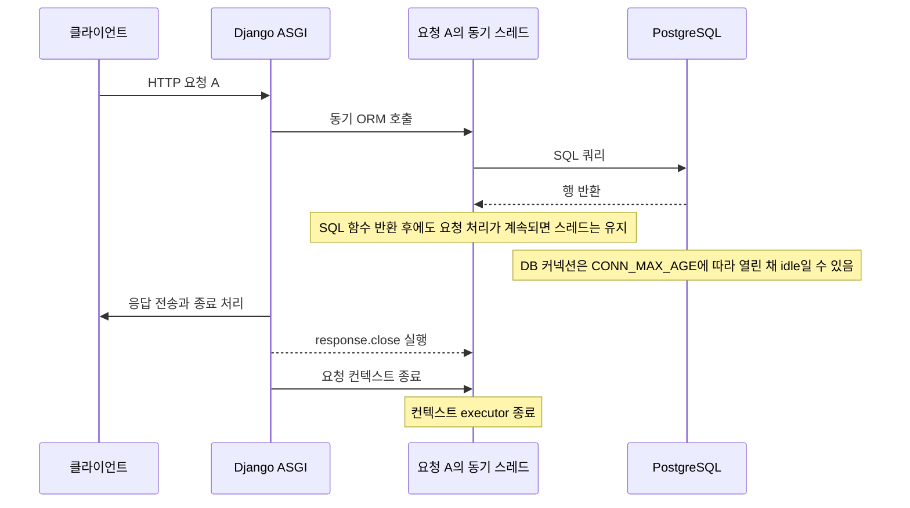
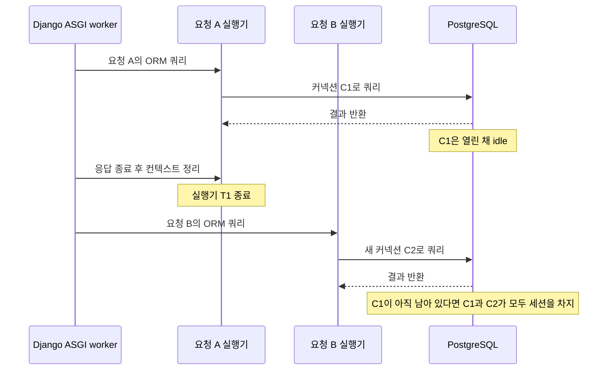

팀 개발 서버에서 코드 변경 자동 재시작을 위해 Gunicorn의 worker 구성을 ASGI 방식으로 바꾼 뒤 PostgreSQL 커넥션이 고갈되는 문제가 나타났다. [앞 글](/project/section-8-wsgi-asgi-thread-lifecycle/)에서 살펴본 WSGI와 ASGI의 스레드 차이가 Django 커넥션 재사용에 어떤 영향을 줬는지 따라가 본다. 핵심은 PostgreSQL의 `idle` 세션이 앱의 다른 요청에 자동으로 빌려지는 커넥션 풀이 아니라는 점이다.

Django 4.2 ASGI 핸들러는 HTTP 요청마다 `ThreadSensitiveContext`를 열고, 요청의 동기 코드를 그 컨텍스트에 묶인 한 개짜리 실행기에서 처리한다. SQL 쿼리가 끝나면 그 실행기 스레드는 요청이 마무리될 때까지 살아 있다. 요청이 끝나 컨텍스트가 닫히면 실행기도 종료된다. 다음 요청은 새로운 컨텍스트를 만들기 때문에, 이전 요청 스레드의 thread-local DB 커넥션을 찾아 재사용하지 않는다.

## 요청 안에서 SQL 결과가 돌아온 뒤

`thread_sensitive=True`는 “쿼리 후 스레드를 즉시 없앤다”는 설정이 아니다. 앞 글에서 본 것처럼 Django DB wrapper와 트랜잭션 상태를 같은 스레드에서 다루도록 동기 호출을 배치한다. SQL 함수가 결과를 받아 반환해도 실행기 스레드는 요청 컨텍스트가 끝날 때까지 유지된다.

따라서 “SQL 응답”과 “HTTP 요청 종료”는 다른 시점이다. 동기 뷰 하나가 ORM 쿼리 후 더 할 일이 없다면 그 스레드는 응답 처리 중 잠깐 유휴 상태일 수 있다. Django는 응답 종료 처리까지 마친 다음 요청 컨텍스트에서 빠져나온다. Django 4.2의 [ASGI 핸들러](https://github.com/django/django/blob/4.2.30/django/core/handlers/asgi.py#L1162-L1164)는 요청 전체를 컨텍스트로 감싸고, [응답 종료](https://github.com/django/django/blob/4.2.30/django/core/handlers/asgi.py#L1395-L1418) 과정에서 `response.close()`도 thread-sensitive 모드로 실행한다. 컨텍스트가 빠져나올 때 asgiref는 그 컨텍스트의 executor를 종료한다([구현](https://github.com/django/asgiref/blob/3.9.1/asgiref/sync.py#L1508-L1518)).

## 다음 요청은 왜 그 커넥션을 못 찾나

요청별 executor가 닫히면 다음 HTTP 요청은 새 `ThreadSensitiveContext`에서 시작한다. Django 4.2는 각 요청 시작 시 `request_started` 신호를 thread-sensitive 모드로 실행하므로, 동기 ORM 호출이 처음일 때가 아니라 이 신호를 처리할 때 executor 스레드가 먼저 만들어질 수 있다. `sync_to_async(thread_sensitive=True)`는 현재 컨텍스트에 실행기가 없으면 하나를 만들고, 같은 컨텍스트 안에서 재사용한다. 이 실행기는 요청 간 공유 풀이 아니다([Django 요청 시작 신호](https://github.com/django/django/blob/4.2.30/django/core/handlers/asgi.py#L1183-L1191), [asgiref의 선택 로직](https://github.com/django/asgiref/blob/3.9.1/asgiref/sync.py#L1972-L2003)).

Django의 DB 커넥션 핸들러는 커넥션을 실제 스레드 로컬에 둔다. 그래서 요청 B의 스레드가 요청 A의 Django 커넥션 wrapper를 자동으로 찾지 않는다. PostgreSQL의 `pg_stat_activity.state = 'idle'`은 해당 클라이언트 세션이 명령을 기다린다는 뜻이지, 커넥션이 앱의 공용 풀에 반납됐다는 뜻은 아니다.

Gunicorn의 기본 sync worker를 쓰는 WSGI 서버에서는 worker 프로세스의 메인 스레드가 한 번에 요청 하나를 처리하고, 요청 사이에도 계속 살아 있다. worker가 다음 요청을 맡으면 그 스레드의 thread-local 커넥션 wrapper에 접근할 수 있다. 이는 WSGI가 공용 커넥션 풀을 제공해서가 아니다. 같은 worker 스레드가 계속 살아 있어 그 스레드가 보유한 커넥션을 다시 찾는 것이다. worker 프로세스가 여러 개면 각 프로세스는 각자의 커넥션을 가진다.

## `CONN_MAX_AGE`가 커넥션 고갈에 영향을 주는 방식

`CONN_MAX_AGE=600`은 커넥션 개수를 600개로 제한하는 값이 아니다. 커넥션을 재사용할 수 있도록 최대 600초 동안 보유한다는 설정이다. Django는 요청 시작·종료 시 커넥션 상태와 수명을 확인한다. `600`초가 지나지 않은 커넥션은 요청 종료만으로 즉시 닫히지 않을 수 있다.

Django ASGI가 다음 요청에 새 동기 실행기를 만들고, 그 실행기가 이전 스레드의 커넥션을 찾지 못하면 새 PostgreSQL 세션을 열 수 있다. 이전 세션이 아직 정리되지 않은 동안 이런 요청이 반복되면 `idle` 세션이 쌓인다. `CONN_MAX_AGE=0`은 요청 경계에서 커넥션을 닫는 기본 동작이라 이 현상을 줄일 수 있지만, 동시 처리 요청 수를 제한하지는 않는다. 매우 많은 요청이 동시에 DB를 사용하면 그 순간 필요한 커넥션은 여전히 많다.

이 동작은 ASGI 표준이 요청마다 스레드를 만들라고 정해서 생기는 게 아니다. Django 4.2가 동기 코드를 이벤트 루프에서 분리하고 thread-sensitive 코드를 컨텍스트별 executor에 배치하는 구현 선택에서 나온다. 이 옵션은 동기 DB 커넥션이나 트랜잭션 상태가 다른 스레드에서 실행되거나 동시에 접근되는 문제를 막는다. Django는 이를 요청 컨텍스트 안에 두고 컨텍스트가 끝나면 실행기도 정리한다. WSGI의 Gunicorn sync worker는 요청을 메인 스레드에서 바로 실행하고 worker를 여러 요청에 걸쳐 유지하므로 같은 방식의 요청별 executor가 필요하지 않다.

Django 4.2 문서는 각 스레드가 커넥션을 따로 유지하며, 개발 서버처럼 요청마다 스레드를 만드는 구성에서는 영구 커넥션의 효과가 없다고 설명한다([Django 4.2 데이터베이스 문서](https://docs.djangoproject.com/en/4.2/ref/databases/#persistent-connections)). 여기서 재현한 요청별 ASGI executor도 같은 커넥션을 다음 요청에 넘겨 쓰지 못했다. 실제 커넥션 수는 Django 버전, worker 수, 동기·비동기 뷰 경계, DB 별칭, 요청 동시성에 따라 달라진다. 이 연재의 격리 재현 결과는 [실습 글](/study/database/section-8-asgi-db-connections-lab-django/)에 따로 적었다.

## 정리

| 구분 | 요청 A 종료 뒤 | 요청 B에서 커넥션 재사용 |
| --- | --- | --- |
| Gunicorn sync worker + WSGI | worker 프로세스의 메인 스레드와 wrapper가 요청 사이에도 유지될 수 있음 | 같은 worker 프로세스가 다음 요청을 처리하면 가능 |
| Django 4.2 ASGI + `CONN_MAX_AGE=600` | 커넥션이 열린 채 PostgreSQL에서 idle일 수 있음 | 새 요청 executor라 이전 wrapper를 찾지 못함 |
| Django 4.2 ASGI + `CONN_MAX_AGE=0` | 요청 정리에서 커넥션을 닫음 | 앞 커넥션을 재사용하지 않고 새 커넥션을 열 수 있음 |

여기서 구분할 것은 네 가지다. SQL 실행이 끝난 시점, HTTP 요청이 끝난 시점, Python 동기 스레드의 수명, PostgreSQL 세션의 수명이다. 이 네 가지가 같은 경계에서 끝난다고 가정하면 `idle` 커넥션의 재사용 여부를 잘못 판단하게 된다.

다음 글에서는 FastAPI의 스레드 풀과 SQLAlchemy DB 커넥션 풀이 어떻게 별도로 움직이는지 비교한다: [DB 커넥션 고갈: FastAPI의 스레드와 DB 커넥션 풀](/project/section-8-fastapi-db-pooling/).

## 참고

- [Django 4.2 ASGI handler](https://github.com/django/django/blob/4.2.30/django/core/handlers/asgi.py)
- [asgiref 3.9.1 `sync.py`](https://github.com/django/asgiref/blob/3.9.1/asgiref/sync.py)
- [Django 4.2: Persistent connections](https://docs.djangoproject.com/en/4.2/ref/databases/#persistent-connections)
