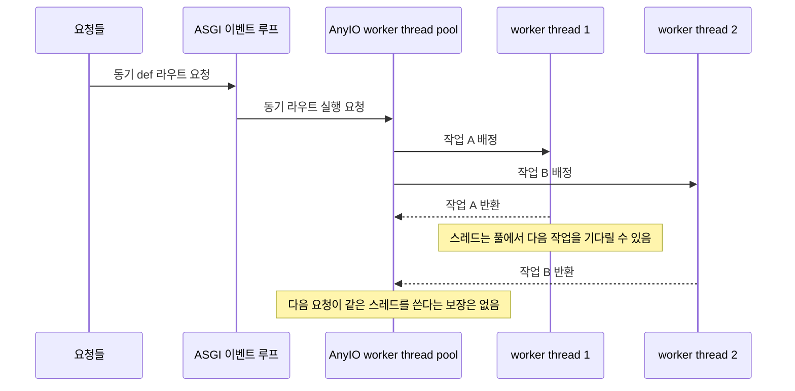
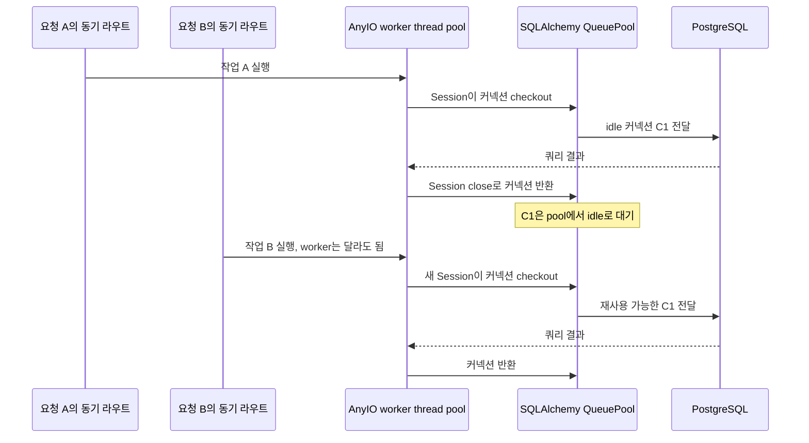

[앞 글](/project/section-8-asgi-db-connections/)에서 개발 서버를 ASGI 방식으로 바꾼 뒤 Django DB 커넥션이 고갈된 원인을 살펴봤다. 그렇다면 ASGI를 사용하는 FastAPI에서도 동기 DB 요청마다 새 스레드와 커넥션이 남을까? FastAPI에서는 동기 라우트의 스레드 풀과 DB 커넥션 풀이 서로 다른 계층에서 움직인다.

## `def` 라우트는 AnyIO worker thread에서 실행한다

FastAPI는 `async def`가 아닌 일반 `def` path operation과 동기 dependency를 외부 thread pool에서 실행한다. FastAPI의 문서는 이를 이벤트 루프를 막지 않기 위한 방식으로 설명한다. Starlette는 `run_in_threadpool()`에서 `anyio.to_thread.run_sync()`를 호출한다([FastAPI 비동기 문서](https://fastapi.tiangolo.com/async/), [Starlette 코드](https://github.com/Kludex/starlette/blob/main/starlette/concurrency.py)).

이 스레드 풀은 요청별 스레드 컨텍스트가 아니다. worker thread는 작업을 처리한 뒤 풀에서 다른 동기 작업을 기다리며 재사용될 수 있고, 풀은 자체 정책으로 한동안 쓰이지 않은 worker를 정리할 수 있다. 순차 호출에서 같은 스레드가 선택될 수 있지만, 요청이 항상 같은 스레드에 배정된다고 보장할 수는 없다. 이 점에서 Django 4.2 ASGI의 요청별 `ThreadSensitiveContext`와 구별된다.

`async def` 라우트는 이벤트 루프에서 coroutine으로 실행된다. DB 접근도 `await` 가능한 드라이버와 클라이언트를 사용하면 DB I/O를 기다리는 동안 이벤트 루프가 다른 작업을 처리한다. 반대로 `async def` 안에서 동기 DB 드라이버를 직접 호출하면 그 동기 호출이 이벤트 루프를 막는다. FastAPI 문서는 동기 라이브러리를 쓰는 경로 작업은 `def`로 선언해 thread pool에서 실행하라고 안내한다.

## DB 커넥션 풀은 커넥션을 빌리고 돌려준다

FastAPI 자체가 데이터베이스 커넥션 풀을 만드는 것은 아니다. SQLAlchemy를 쓴다면 `Engine` 또는 `AsyncEngine`의 pool이 커넥션을 관리한다. 보통 engine은 프로세스 시작 시 한 번 만들고 여러 요청에서 공유한다. 요청마다 session을 만들고, 요청이 끝날 때 session을 닫는다.

동기 SQLAlchemy에서는 `Session`이 쿼리할 때 engine pool에서 DB 커넥션을 checkout한다. `Session.close()` 또는 트랜잭션 종료 시 커넥션 자원을 pool에 돌려준다. 물리 TCP 커넥션은 끊지 않고 풀에서 재사용할 수 있게 남겨둔다([Session과 커넥션 관리](https://docs.sqlalchemy.org/en/20/orm/session_basics.html)). 동기 라우트가 worker thread A에서 실행됐다가 다음 요청이 worker thread B에서 실행돼도, DB 커넥션을 스레드 로컬이 아니라 engine의 풀에서 checkout한다는 점이 Django의 thread-local 커넥션과 다르다. 세션 객체 자체는 요청 단위로 사용하고 공유하지 않는다.

비동기 SQLAlchemy는 `create_async_engine()`으로 `AsyncEngine`을 만들고, asyncio에 맞는 `AsyncAdaptedQueuePool`을 사용한다. `AsyncSession`이나 `AsyncConnection`을 종료하면 커넥션 자원이 풀로 돌아간다. 비동기 커넥션 풀은 이벤트 루프에서 동작하므로 DB I/O마다 worker thread를 만들 필요가 없다([SQLAlchemy asyncio 문서](https://docs.sqlalchemy.org/en/20/orm/extensions/asyncio.html), [커넥션 풀 문서](https://docs.sqlalchemy.org/en/20/core/pooling.html)).

## 스레드 수와 DB 커넥션 수를 따로 계산한다

실습에서는 `AnyIO.to_thread.run_sync()`로 동기 함수의 실행 스레드를 확인하고, SQLAlchemy `QueuePool`을 `pool_size=2`, `max_overflow=0`으로 설정했다. 순차 호출에서는 실행 스레드와 PostgreSQL backend PID가 반복해서 같았다. 여섯 작업을 병렬 실행하자 AnyIO는 여러 worker thread에서 작업했지만 DB backend PID는 두 개만 사용했다. 풀은 요청 실행 스레드 수와 별도로 최대 커넥션 수를 제한했다.

이 재현은 FastAPI 라우터 전체를 띄운 벤치마크가 아니라 FastAPI가 동기 라우트를 보내는 AnyIO worker API와 SQLAlchemy pool의 수명 규칙을 분리해서 확인한 것이다. FastAPI 경로에서 같은 동기 라우트를 실행하는 호출은 Starlette의 `run_in_threadpool()`을 거쳐 AnyIO로 전달된다.

따라서 운영 커넥션 수는 thread pool 크기만으로 정해지지 않는다. SQLAlchemy pool은 프로세스마다 별도로 만들어지므로, 예를 들어 worker 프로세스가 여러 개면 각 프로세스의 `pool_size`와 `max_overflow`가 DB 커넥션 상한에 곱해진다. 앱의 worker 수, DB별 engine 수, pool 크기, overflow, 백그라운드 작업의 별도 커넥션을 함께 계산해야 한다.

| 계층 | 관리 대상 | 요청이 끝나면 |
| --- | --- | --- |
| FastAPI / AnyIO worker pool | 동기 `def` 라우트와 dependency 실행 스레드 | 스레드는 풀에서 다른 동기 작업을 기다릴 수 있음 |
| SQLAlchemy `QueuePool` | 동기 DBAPI 커넥션 | session/connection이 닫히면 커넥션을 pool에 반환 |
| SQLAlchemy `AsyncAdaptedQueuePool` | 비동기 DB 커넥션 | async session/connection이 닫히면 커넥션을 pool에 반환 |
| PostgreSQL | 실제 서버 backend와 세션 | 클라이언트 커넥션이 열려 있으면 idle이어도 커넥션 슬롯 사용 |

## 정리

앞의 [Django ASGI 글](/project/section-8-asgi-db-connections/)과 비교하면, ASGI가 스레드 생명주기를 하나로 고정하지 않는다는 점이 보인다. Django 4.2 ASGI는 요청별 thread-sensitive 컨텍스트를 사용하고, FastAPI의 동기 라우트는 AnyIO worker thread pool을 사용한다. 더 중요한 차이는 DB 커넥션을 관리하는 주체다. Django 기본 커넥션은 스레드별이고, SQLAlchemy는 engine의 커넥션 풀에서 checkout·checkin한다.

FastAPI에서 `async def`와 비동기 DB 드라이버를 쓰면 이벤트 루프가 I/O 대기 중 다른 작업을 처리하고, DB 커넥션은 async pool이 관리한다. `def`와 동기 드라이버를 쓰면 AnyIO thread pool이 동기 코드를 실행하고, SQLAlchemy의 sync pool이 DB 커넥션을 관리한다. 어느 쪽이든 FastAPI가 자동으로 pool 크기나 PostgreSQL 커넥션 수를 결정하지는 않는다.

## 참고

- [FastAPI: Concurrency and async/await](https://fastapi.tiangolo.com/async/)
- [Starlette `run_in_threadpool`](https://github.com/Kludex/starlette/blob/main/starlette/concurrency.py)
- [AnyIO worker threads](https://anyio.readthedocs.io/en/stable/threads.html)
- [SQLAlchemy: Session Basics](https://docs.sqlalchemy.org/en/20/orm/session_basics.html)
- [SQLAlchemy: Connection Pooling](https://docs.sqlalchemy.org/en/20/core/pooling.html)
- [SQLAlchemy: Asyncio support](https://docs.sqlalchemy.org/en/20/orm/extensions/asyncio.html)
