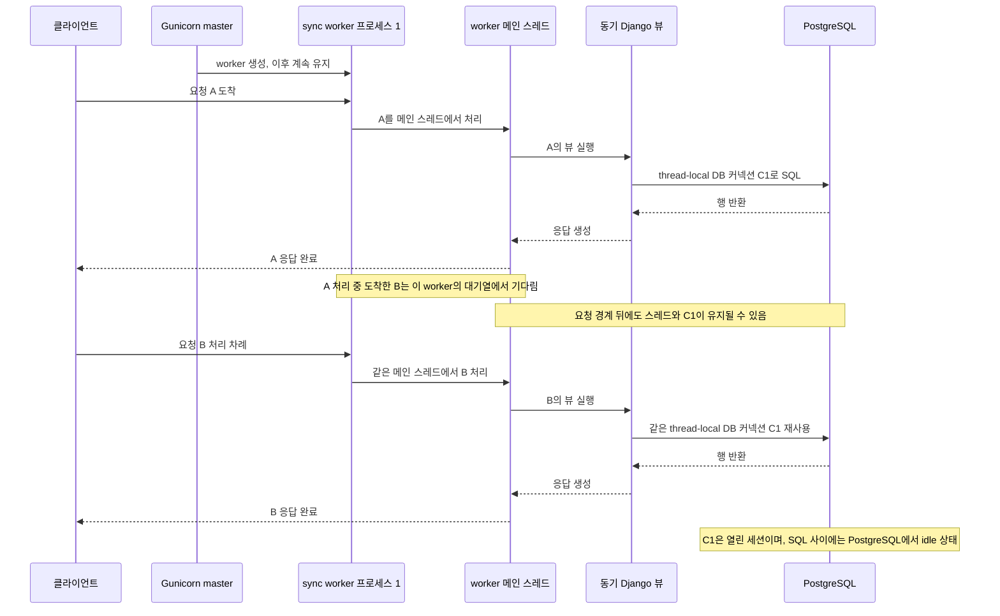
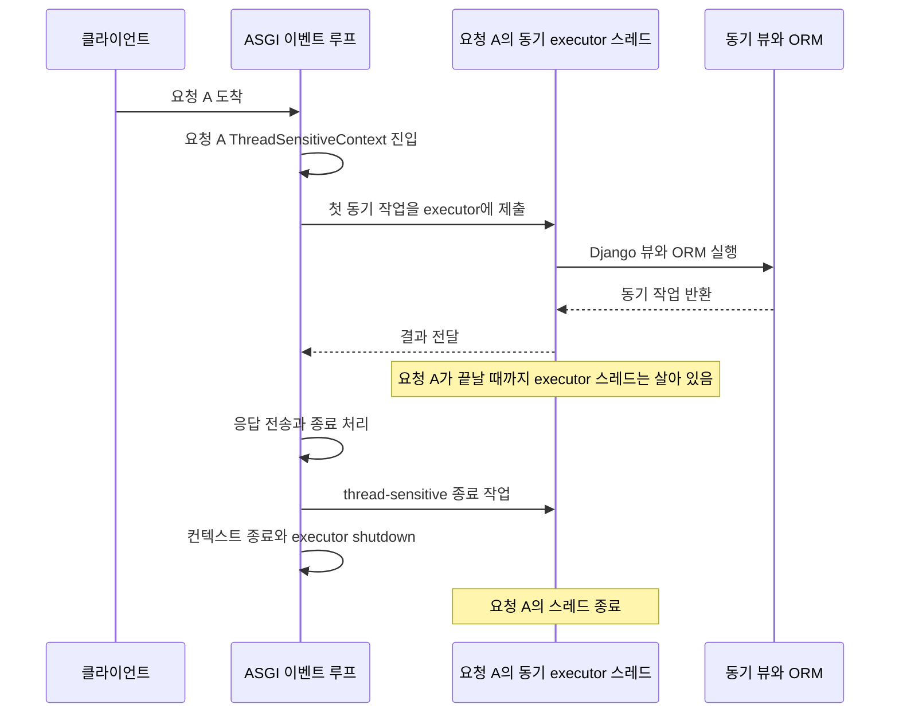

팀 개발 서버에서 코드 변경을 감지해 자동 재시작하도록 Gunicorn의 동기 WSGI worker 대신 Uvicorn worker를 쓰는 구성으로 바꿨다. 그 뒤 PostgreSQL 커넥션이 계속 쌓여 결국 고갈되는 문제가 나타났다. “요청 처리가 끝나 DB 커넥션이 idle이면 다음 요청이 쓰면 되지 않나?”라는 의문이 들었지만, 원인을 찾으려면 먼저 Gunicorn worker 프로세스, ASGI 이벤트 루프, Django 동기 코드 실행 스레드를 나눠 봐야 했다.

이 글에서는 WSGI의 장수명 sync worker 프로세스와 ASGI 앱의 이벤트 루프, 그리고 ASGI에서 동기 코드를 실행하는 별도 executor 스레드를 나눈다. 다음 글은 이 차이가 Django DB 커넥션에 미치는 영향을 다룬다: [DB 커넥션 고갈: Django ASGI에서 커넥션이 쌓이는 이유](/project/section-8-asgi-db-connections/).

## WSGI에서는 sync worker 프로세스가 요청을 맡는다

WSGI는 동기 호출 규약이고, Gunicorn은 master가 worker 프로세스를 관리하는 pre-fork 서버다. Gunicorn의 기본 worker는 `sync`다. sync worker는 한 번에 요청 하나를 처리한 뒤 다음 요청을 받으며, worker 프로세스는 여러 요청에 걸쳐 살아 있다. 이때 요청 코드는 worker 프로세스의 메인 스레드에서 순서대로 실행된다. 이번 개발 설정은 `--workers 1`이므로 worker 프로세스 하나가 요청을 하나씩 처리한다. [Gunicorn 문서](https://docs.gunicorn.org/en/stable/design.html)는 sync worker가 한 번에 요청 하나를 처리한다고 설명한다.

이 그림은 worker 하나 안에서 A와 B가 직렬 처리되는 모습이다. A가 SQL을 실행 중일 때 이 worker로 B가 도착하면 B는 동시에 메인 스레드에서 실행되지 않고 기다린다. 요청 처리가 끝나도 worker 프로세스와 메인 스레드는 다음 요청을 위해 살아 있다. `CONN_MAX_AGE` 등 DB 커넥션 정리 조건상 커넥션이 유지되면 Django의 thread-local DB wrapper가 같은 커넥션 C1을 다음 요청에서 다시 쓸 수 있다. 여기서 “유휴”는 SQL 명령 사이에 열린 PostgreSQL 세션이 대기한다는 뜻이며, DB 커넥션이 공용 풀에 반납됐다는 뜻은 아니다.

worker를 여러 개 설정하면 Gunicorn은 별도 프로세스들을 만들어 서로 다른 요청을 동시에 처리할 수 있다. 예를 들어 `--workers 2`면 A는 worker 1, B는 worker 2에서 동시에 실행될 수 있다. 각 프로세스의 메인 스레드는 별개이고 Django 커넥션도 프로세스/스레드별로 따로 생기므로, worker 1의 C1을 worker 2가 빌려 쓰지는 않는다. 각 worker는 이후 자신이 맡은 요청에 자기 커넥션을 재사용할 수 있다. 따라서 worker 수를 늘리면 동시 처리량뿐 아니라 DB가 감당해야 할 커넥션 수도 늘 수 있다. 실제 dev 설정은 `--workers 1`이어서 worker 간 병렬 처리를 하지 않는다.

Gunicorn sync worker는 HTTP 클라이언트의 keep-alive 커넥션을 지원하지 않지만, 이는 Django와 PostgreSQL 사이의 DB 커넥션과 별개다. HTTP 소켓이 응답 뒤 닫히더라도 Django의 PostgreSQL 커넥션은 `CONN_MAX_AGE`에 따라 유지될 수 있다. 여기서 말하는 재사용은 DB 커넥션 wrapper의 재사용이다.

## ASGI에서는 이벤트 루프와 동기 코드가 나뉜다

ASGI 앱의 진입점은 비동기 호출이다. 서버의 이벤트 루프는 여러 요청 coroutine을 번갈아 실행한다. 비동기 네트워크 I/O에서 한 요청이 기다리는 동안 다른 요청을 실행할 수 있다. 이런 요청 전환은 coroutine 전환이지, 요청마다 OS 스레드를 하나씩 만드는 동작이 아니다.

그런데 Django 프로젝트에는 동기 미들웨어, 동기 뷰, 동기 DB 드라이버가 남아 있을 수 있다. 이를 이벤트 루프 스레드에서 그대로 실행하면 SQL 응답을 기다리는 동안 이벤트 루프가 막혀 다른 요청을 처리하지 못한다. 그래서 Django는 `sync_to_async`를 사용해 동기 코드를 이벤트 루프 바깥의 스레드에서 실행한다.

이때 <abbr title="동기 함수를 현재 컨텍스트에 묶인 한 스레드에서 실행해 Django의 DB 커넥션과 트랜잭션 상태를 그 스레드에서 다룬다.">`thread_sensitive=True`</abbr>를 활성화하면 Django의 DB wrapper와 트랜잭션 상태를 다루는 동기 코드가 같은 스레드에서 실행된다. 단, WSGI와 달리 Django 4.2의 ASGI handler는 요청이 끝나면 해당 요청의 executor와 스레드를 종료한다.

## 요청마다 스레드를 만드는 것은 ASGI의 필수 규칙이 아니다

ASGI 표준은 앱을 비동기 호출 가능한 객체로 실행하는 규약이지, 동기 코드용 스레드 정책을 정하지 않는다. Django 4.2가 요청마다 컨텍스트를 만드는 것은 동기 Django 코드를 ASGI 안에서 안전하게 실행하기 위한 구현이다. `ThreadSensitiveContext`가 있으면 thread-sensitive 작업을 요청별 executor에 묶을 수 있고, 컨텍스트 종료 시 executor도 정리된다. 반면 컨텍스트가 없을 때 asgiref의 thread-sensitive 호출은 기본적으로 프로세스 공유 단일 스레드 executor를 사용할 수 있다. 즉, “ASGI라서 요청마다 스레드”가 아니라 “Django가 ASGI에서 동기 코드를 이 컨텍스트 경계로 실행한다”가 정확하다.

WSGI 동기 요청은 Gunicorn sync worker의 메인 스레드에서 바로 실행되므로 Django가 이벤트 루프와 동기 함수를 이어 주는 executor를 만들 필요가 없다. worker 프로세스와 그 메인 스레드는 다음 요청을 위해 계속 살아 있다. 반면 Django 4.2 ASGI는 동기 처리를 요청별 executor로 보내고, 요청 컨텍스트가 끝날 때 그 executor를 종료한다.

## 정리

| 실행 환경 | 요청 코드가 도는 곳 | 요청이 끝났을 때 |
| --- | --- | --- |
| Gunicorn 기본 `sync` worker + WSGI | worker 프로세스의 메인 스레드에서 요청 하나를 순차 처리 | 프로세스와 메인 스레드는 다음 요청을 처리하도록 유지 |
| Django 4.2 + ASGI, 비동기 코드 | ASGI 서버 이벤트 루프의 coroutine | coroutine은 끝나고 이벤트 루프는 다른 요청을 계속 처리 |
| Django 4.2 + ASGI, 동기 코드 | 요청 `ThreadSensitiveContext`의 executor 스레드 | 컨텍스트 executor가 종료됨 |

따라서 다음을 따로 추적해야 한다: ASGI 서버 worker 프로세스, 이벤트 루프 스레드, thread-sensitive 동기 executor, Django의 thread-local DB 커넥션. 이 네 가지의 수명이 같다고 볼 수 없다. [다음 글](/project/section-8-asgi-db-connections/)에서는 이 구조가 `CONN_MAX_AGE`와 만났을 때 커넥션이 쌓이는 이유를 설명한다.

## 참고

- [ASGI specification](https://asgi.readthedocs.io/en/latest/specs/main.html)
- [Gunicorn design](https://docs.gunicorn.org/en/stable/design.html)
- Django의 DB wrapper는 스레드별 상태를 관리하고 다른 스레드에서 DB 커넥션을 쓰는 것을 기본적으로 검사한다. <abbr title="일반 executor에서 실행해 호출을 특정 스레드에 고정하지 않는다. 호출마다 다른 스레드가 선택되거나 동시에 실행될 수 있으므로, 스레드에 묶인 DB 커넥션이나 트랜잭션 상태를 여러 호출 사이에 공유할 수 없다.">`thread_sensitive=False`</abbr>의 차이와 DB 커넥션을 스레드에 묶어야 하는 이유는 [asgiref의 synchronous code and threads 설명](https://github.com/django/asgiref#synchronous-code--threads)과 [Django의 DB 커넥션 스레드 공유 검사](https://docs.djangoproject.com/en/4.2/topics/async/#async-safety)를 참고한다.
- Django 4.2의 ASGI handler는 요청마다 `ThreadSensitiveContext`를 열고 닫으며, `request_started` 신호도 thread-sensitive 호출로 보낸다. [handler](https://github.com/django/django/blob/4.2.30/django/core/handlers/asgi.py#L1162-L1164), [신호 처리](https://github.com/django/django/blob/4.2.30/django/core/handlers/asgi.py#L1183-L1191), [asgiref 컨텍스트 종료 코드](https://github.com/django/asgiref/blob/3.9.1/asgiref/sync.py#L1508-L1518)
- [Django 4.2 ASGI handler](https://github.com/django/django/blob/4.2.30/django/core/handlers/asgi.py)
- [asgiref 3.9.1 sync source](https://github.com/django/asgiref/blob/3.9.1/asgiref/sync.py)
