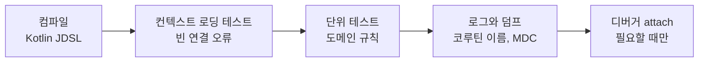

[앞 글](/project/zed-kotlin-debugger/)에서 무료 Kotlin 언어 서버인 Kotlin <abbr title="Language Server Protocol. 에디터와 언어 서버가 자동완성·정의로 이동·진단 결과를 주고받는 규약으로, 덕분에 언어 서버 하나를 VS Code·Zed·Neovim이 같이 쓴다.">LSP(Language Server Protocol)</abbr>의 디버거를 Zed에 붙이는 시제품을 만들었다. 중단점은 걸리지만 정식 확장에 들어가려면 Zed 쪽 API가 먼저 생겨야 한다. 한편 JetBrains는 IntelliJ 엔진을 다른 에디터에서 쓰게 해 주는 **Java & Kotlin by IntelliJ IDEA**를 내놓았는데, 프리뷰가 끝나면 IntelliJ IDEA Ultimate 구독이 필요하다.

둘 다 기다리는 동안 Zed로 코프링을 개발한다면 디버거 없이 어디까지 갈 수 있을까. 이 질문에 답하려고 컨벤션 저장소 [kopring-conventions](https://github.com/loading1031/kopring-conventions)를 만들었다. 결론부터 말하면 **기능 개발 대부분은 컨벤션과 테스트로 충분하다.** 남는 건 처음 보는 프레임워크 동작을 따라가거나 실행 환경에서만 생기는 버그를 좁힐 때인데, 그때만 디버거를 붙이면 된다.

## 빠지는 기능: 디버거와 Spring 정적 분석

IntelliJ Ultimate와 비교해 Zed + Kotlin LSP에 없는 기능은 두 덩어리다.

| 덩어리 | 빠지는 기능 | 드러나는 시점 |
| --- | --- | --- |
| 디버거 | 중단점, 변수 보기, 코루틴 목록, Spring 디버거(활성 프로필·적용된 설정값) | 런타임에 원인을 좁힐 때 |
| Spring 정적 분석 | 이름 규칙 메서드(`findBySkuAndLocation`) 검사, `@Query` <abbr title="Java Persistence Query Language. 테이블 대신 엔티티와 필드 이름으로 쓰는 JPA의 쿼리 언어다. Spring Data의 @Query 안에 문자열로 적는다.">JPQL</abbr> 검사, 빈 연결 오류 사전 검사, 주입 지점 ↔ 빈 정의 이동, 엔드포인트 목록, `@Value` ↔ yml 이동 | 앱을 띄울 때 |

일반 Kotlin 코드 탐색(정의로 이동, 사용처 찾기, 이름 바꾸기)은 Kotlin LSP로 잘 된다. Spring 관련 기능을 주는 Spring Tools 확장도 있지만 공식적으로 Java 소스만 지원해서 `.kt` 파일에서는 동작하지 않는다.

써 보면 체감은 디버거보다 **Spring 정적 분석 쪽이 더 크다.** 디버거는 가끔 필요하지만, 이름 규칙 메서드 오타나 빈 주입 실패는 매일 생긴다. 그리고 그 오류가 편집 중이 아니라 앱을 띄울 때 터진다.

## 검증 순서: 컴파일에서 디버거까지

디버거가 없다는 건 "런타임에 멈춰서 보는" 마지막 그물이 없다는 뜻이다. 그러면 문제를 그보다 앞에서 걸러야 한다.



왼쪽에서 잡힐수록 싸다. 컨벤션 저장소의 규칙은 대부분 문제를 한 칸이라도 왼쪽으로 옮기려는 것이다.

- **문자열 쿼리를 컴파일 에러로.** 조건이 있는 쿼리는 <abbr title="JPQL을 문자열 대신 Kotlin 코드(DSL)로 작성하게 해 주는 라이브러리. 필드를 프로퍼티 참조로 써서 쿼리 오류를 컴파일 단계로 끌어온다.">Kotlin JDSL</abbr>로 쓴다. 필드를 `Stock::sku`처럼 프로퍼티 참조로 쓰니 오타가 컴파일 에러가 되고, Kotlin LSP만으로 자동완성과 이름 바꾸기가 된다. QueryDSL도 후보였지만 Q클래스 코드 생성이 필요해서, 빌드 전까지 LSP가 생성 클래스를 못 찾고 빨간 줄을 띄운다.
- **빈 연결 오류를 테스트로.** `@SpringBootTest` 컨텍스트 로딩 테스트를 하나 둔다. IntelliJ가 편집 중에 보여 주던 "주입할 빈 없음", "후보 2개"를 커밋 전에 잡는 유일한 장치다.
- **핵심 규칙은 Spring 없는 순수 코드로.** `domain` 패키지는 Spring도 코루틴도 import하지 않는 동기 코드로 둔다. 디버깅이 가장 많이 필요한 비즈니스 규칙이 단위 테스트 한 줄로 확인되는 곳에 모인다.

## 공백별 컨벤션과 부류

빠지는 기능 하나하나에 대응하는 규칙을 정했다. 규칙 전체와 검사 규칙 색인은 [컨벤션 목록](https://github.com/loading1031/kopring-conventions/blob/main/docs/conventions/README.md)에 있다.

| 빠지는 기능 | 컨벤션 |
| --- | --- |
| 이름 규칙 메서드·JPQL 검사 | Kotlin JDSL, `@Query` 금지, 이름 규칙 메서드는 조건 2개까지 |
| 주입될 빈을 미리 볼 수 없음 | 생성자 주입, 구현체 선택(`@Primary`, `@Qualifier`, `@Profile`)은 기능별 `@Configuration`에서만 |
| 빈 연결 오류 사전 검사 | 컨텍스트 로딩 테스트 |
| `@Value` ↔ yml 이동 | `@ConfigurationProperties`만 사용 |
| 이벤트 발행 ↔ 리스너 이동 | 리스너는 구체 이벤트 타입 하나만 받는다. 이벤트 클래스의 사용처 찾기가 곧 리스너 목록이 된다 |
| 엔드포인트 목록 | 컨트롤러 위치·이름 규칙, 클래스 단위 경로 접두사 |
| Kotlin·코루틴 디버거 | 코루틴은 경계에만, `domain`은 동기 코드. 코루틴 디버그 모드, `CoroutineName`, Dispatcher 주입 |

규칙마다 **부류**를 붙였다. 나중에 환경이 바뀌면 이걸 보고 풀어도 되는 규칙을 고른다.

| 부류 | 뜻 | 환경이 바뀌면 |
| --- | --- | --- |
| 범용 | IDE와 무관한 모범 사례 (`@Autowired` 금지, `GlobalScope` 금지) | 유지 |
| 팀 | 합리적이지만 팀이 정한 선택 (`domain`에서 코루틴 금지) | 팀이 다시 결정 |
| Zed | Zed의 공백을 메우는 보정 (`@Query` 금지) | 풀어도 됨 |

`@Query` 금지는 IntelliJ에서라면 과한 제약이다. IntelliJ는 JPQL 문자열도 검사해 주기 때문이다. 이런 규칙을 범용 규칙과 섞어 두면, Zed가 디버거를 지원하거나 팀이 IntelliJ로 옮겼을 때 무엇을 풀어야 할지 다시 따져야 한다.

규칙은 문서로만 두지 않고 [검사 스크립트](https://github.com/loading1031/kopring-conventions/blob/main/scripts/conventions/check_kotlin_conventions.py) 하나로 강제한다. Claude Code의 <abbr title="Claude Code가 파일 쓰기 같은 도구를 실행하기 직전에 지정한 스크립트를 돌리는 훅이다. 스크립트가 실패하면 그 작업이 막힌다.">PreToolUse</abbr> 훅이 `.kt` 파일을 쓰기 직전에, git pre-commit 훅이 커밋할 때 같은 스크립트를 부른다. 줄 단위 정규식이라 계층 의존 방향 같은 구조 규칙은 <abbr title="패키지·클래스 간 의존 방향 같은 아키텍처 규칙을 JUnit 테스트로 검사하는 라이브러리.">ArchUnit</abbr> 테스트로 따로 본다.

## 코루틴 디버깅 단서

디버거가 없으면 로그와 스택 트레이스가 유일한 단서다. 코루틴은 여기서 특히 불리하다. 여러 코루틴이 같은 스레드 풀을 번갈아 쓰니 `DefaultDispatcher-worker-3`만으로는 어느 작업인지 모르고, suspend 뒤에 다른 스레드에서 재개되면 호출한 쪽이 스택 트레이스에서 사라진다.

그래서 코루틴 컨벤션은 단서를 남기는 데 집중한다.

| 어려운 점 | 컨벤션 |
| --- | --- |
| 로그로 어느 코루틴인지 구분 불가 | `-Dkotlinx.coroutines.debug` + `launch`/`async`에 `CoroutineName` |
| 스택 트레이스가 끊김 | 같은 디버그 모드. 예외 스택 트레이스가 복원된다 |
| 어느 코루틴이 어디서 멈췄는지 모름 | 로컬 프로필에서 `DebugProbes`로 코루틴 덤프 |
| 스레드를 옮기면 <abbr title="Mapped Diagnostic Context. 요청 ID 같은 값을 스레드에 붙여 두면 그 스레드가 찍는 로그마다 자동으로 따라 나오게 하는 로깅 기능이다. 스레드 로컬이라 스레드가 바뀌면 사라진다.">MDC</abbr>·트랜잭션 유실 | `MDCContext()`로 MDC를 넘기고, `@Transactional` 계층에는 `suspend fun`을 쓰지 않는다 |
| 취소가 삼켜짐 | suspend 호출을 `runCatching`으로 감싸지 않는다 |
| 타이밍에 따라 재현되다 말다 함 | Dispatcher를 주입받고, 테스트는 `runTest` 가상 시간으로 |

이 표가 실제로 성립하는지는 테스트로 확인한다. 같은 상황을 **컨벤션 없이**와 **컨벤션 적용**으로 나눠 두 Gradle 태스크에서 돌린다. 예시 프로젝트는 [`examples/debugging`](https://github.com/loading1031/kopring-conventions/tree/main/examples/debugging)에 있다.

```kotlin
// build.gradle.kts
// 컨벤션 적용: 코루틴 디버그 모드 켬, 문제 재현 테스트는 제외
tasks.test {
    systemProperty("kotlinx.coroutines.debug", "on")
    useJUnitPlatform { excludeTags("without-convention") }
}

// 컨벤션 없이: 디버그 모드 끔, 문제 재현 테스트만
val testWithoutConvention by tasks.registering(Test::class) {
    testClassesDirs = sourceSets.test.get().output.classesDirs
    classpath = sourceSets.test.get().runtimeClasspath
    systemProperty("kotlinx.coroutines.debug", "off")
    useJUnitPlatform { includeTags("without-convention") }
}

tasks.check { dependsOn(testWithoutConvention) }
```

두 태스크 모두 **통과해야 정상**이다. "컨벤션 없이" 쪽은 문제가 실제로 생긴다는 걸 단언한다. 스레드 이름 테스트가 이렇다.

```kotlin
private fun workerThreadName(context: CoroutineContext = EmptyCoroutineContext): String = runBlocking {
    withContext(Dispatchers.Default + context) { Thread.currentThread().name }
}

@Nested
@Tag("without-convention")
inner class `컨벤션 없이` {
    @Test
    fun `디버그 모드가 꺼져 있으면 CoroutineName을 붙여도 스레드 이름에 나타나지 않는다`() {
        val threadName = workerThreadName(CoroutineName("allocate-A1"))
        assertFalse("allocate-A1" in threadName, "스레드 이름: $threadName")
    }
}

@Nested
inner class `컨벤션 적용` {
    @Test
    fun `디버그 모드와 CoroutineName을 함께 쓰면 스레드 이름에 작업 이름이 붙는다`() {
        val threadName = workerThreadName(CoroutineName("allocate-A1"))
        assertContains(threadName, "@allocate-A1#")
    }
}
```

`CoroutineName`만 붙이고 디버그 모드를 안 켜면 아무 효과가 없다. 반대로 디버그 모드만 켜면 `@coroutine#3`처럼 번호만 붙는다. 둘이 같이 있어야 로그 한 줄에서 `DefaultDispatcher-worker-1 @allocate-A1#2`처럼 작업 이름이 보인다.

취소 테스트는 디버거로도 잡기 어려운 경우다. 오류 없이 조용히 끝까지 돈다.

```kotlin
@Test
fun `runCatching이 취소를 삼켜서 취소된 작업이 끝까지 돈다`() = runTest {
    var processed = 0
    val job = launch {
        repeat(100) {
            runCatching { delay(10) }   // CancellationException까지 잡는다
            processed++
        }
    }

    advanceTimeBy(55)
    job.cancel()
    job.join()

    assertEquals(100, processed)   // runCatching을 빼면 5
}
```

`runTest`의 가상 시간 덕분에 몇 번 돌고 취소됐는지가 매번 같다. 실제 시간에 기대는 테스트였다면 이것도 재현되다 말다 했을 것이다.

이 테스트들이 증명하는 건 디버거의 동작이 아니라 **디버거 대신 쓸 단서가 컨벤션을 지키면 생기고, 안 지키면 없다**는 것이다. 테스트는 Gradle이 띄운 JVM 안에서 돌고 디버거는 바깥에서 붙는 도구라, 테스트로 디버거를 검증할 수는 없다.

## 컨벤션의 한계와 디버거 attach

"이 입력이면 이 결과"를 확인하는 일은 테스트가 디버거보다 낫다. 남고, 반복되고, CI에서 돈다. 하지만 테스트는 **무엇을 확인할지 알 때** 쓰는 도구다. 모르는 흐름을 탐색할 때는 느리다.

| 상황 | 왜 테스트로 부족한가 | 대안 |
| --- | --- | --- |
| 처음 보는 프레임워크 동작 (트랜잭션 프록시가 언제 끼는지, 지연 로딩이 언제 쿼리를 날리는지) | 무엇을 단언할지부터 모른다 | SQL·바인딩 파라미터 로그, 트랜잭션 로그 레벨 올리기 |
| 실행 환경에서만 생기는 버그 (특정 데이터·설정 조합) | 재현 테스트를 만들려면 원인부터 좁혀야 한다 | 구조화된 로그, Actuator. 재현되면 그걸 테스트로 고정 |
| 동시성·코루틴 문제 | 디버거로 멈춰도 타이밍이 바뀌어 잘 안 잡힌다 | 스레드 덤프, `DebugProbes` 코루틴 덤프 |
| 라이브러리 내부 확인 | Zed에서 라이브러리 소스로 이동이 아직 불안정하다 | 소스 jar를 직접 열어 본다 |

세 번째 줄은 디버거가 있어도 마찬가지다. 실제로 디버거가 꼭 필요한 건 첫 번째와 두 번째, 즉 **원인이 어디쯤인지도 모를 때 멈춰서 둘러보는 일**이다.

그때는 앱을 `./gradlew bootRun --debug-jvm`으로 띄우고 디버거를 붙인다. JVM 디버깅은 표준 규약인 <abbr title="Java Debug Wire Protocol. 디버거가 실행 중인 JVM에 붙어 중단점을 걸고 변수를 읽는 JVM 표준 규약이다. 에디터는 DAP로 말하고, DAP 서버가 그 요청을 JDWP로 바꿔 JVM에 전달한다.">JDWP(Java Debug Wire Protocol)</abbr>를 쓰므로 Spring 앱도 일반 JVM 프로그램과 똑같이 붙는다.

| 방법 | 비용 | 지금 상태 |
| --- | --- | --- |
| 무료 Kotlin LSP 디버거를 Zed에 연결 | 무료 | 시제품으로 동작 확인. 정식 확장은 Zed API 대기 ([앞 글](/project/zed-kotlin-debugger/)) |
| IntelliJ에서 Remote JVM Debug로 attach | IntelliJ 설치 | 바로 가능. 편집은 Zed, 중단점은 IntelliJ |
| Java & Kotlin by IntelliJ IDEA | 프리뷰 후 Ultimate 구독 | 공식 지원은 VS Code 계열 |

## 정리

Zed로 코프링을 한다면 기본은 테스트와 로그로 개발하고, 정말 멈춰서 봐야 할 때만 디버거를 붙인다. 디버거보다 먼저 챙길 것은 Spring 정적 분석의 빈자리다. 쿼리는 JDSL로 컴파일 시점에, 빈 연결은 컨텍스트 로딩 테스트로 커밋 전에 잡는다. 핵심 규칙은 Spring 없는 동기 코드에 모아 단위 테스트로 확인한다.

규칙에는 부류를 붙여 둔다. Zed Kotlin 확장이 디버거를 지원하거나 IntelliJ 엔진을 쓸 수 있게 되면, "Zed" 부류만 골라 풀면 된다.

## 참고

- [loading1031/kopring-conventions](https://github.com/loading1031/kopring-conventions) — 이 글의 컨벤션 저장소. Zed 환경에서 빠지는 기능은 [docs/environment/zed.md](https://github.com/loading1031/kopring-conventions/blob/main/docs/environment/zed.md)에 정리했다
- [Zed에서 Kotlin 디버거 붙이기](/project/zed-kotlin-debugger/) — 앞 글
- [IntelliJ IDEA Goes LSP (JetBrains Blog)](https://blog.jetbrains.com/idea/2026/08/intellij-idea-goes-lsp/)
- [Zed Kotlin 문서](https://zed.dev/docs/languages/kotlin)
- [Kotlin JDSL](https://github.com/line/kotlin-jdsl)
- [kotlinx-coroutines-debug](https://github.com/Kotlin/kotlinx.coroutines/blob/master/kotlinx-coroutines-debug/README.md)
- [detekt — Coroutines rule set](https://detekt.dev/docs/rules/coroutines/)
