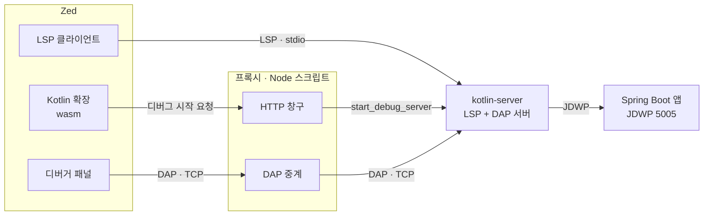
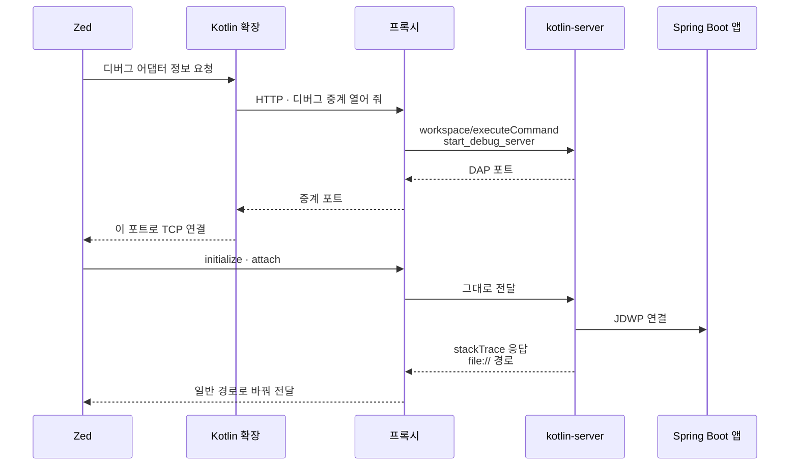
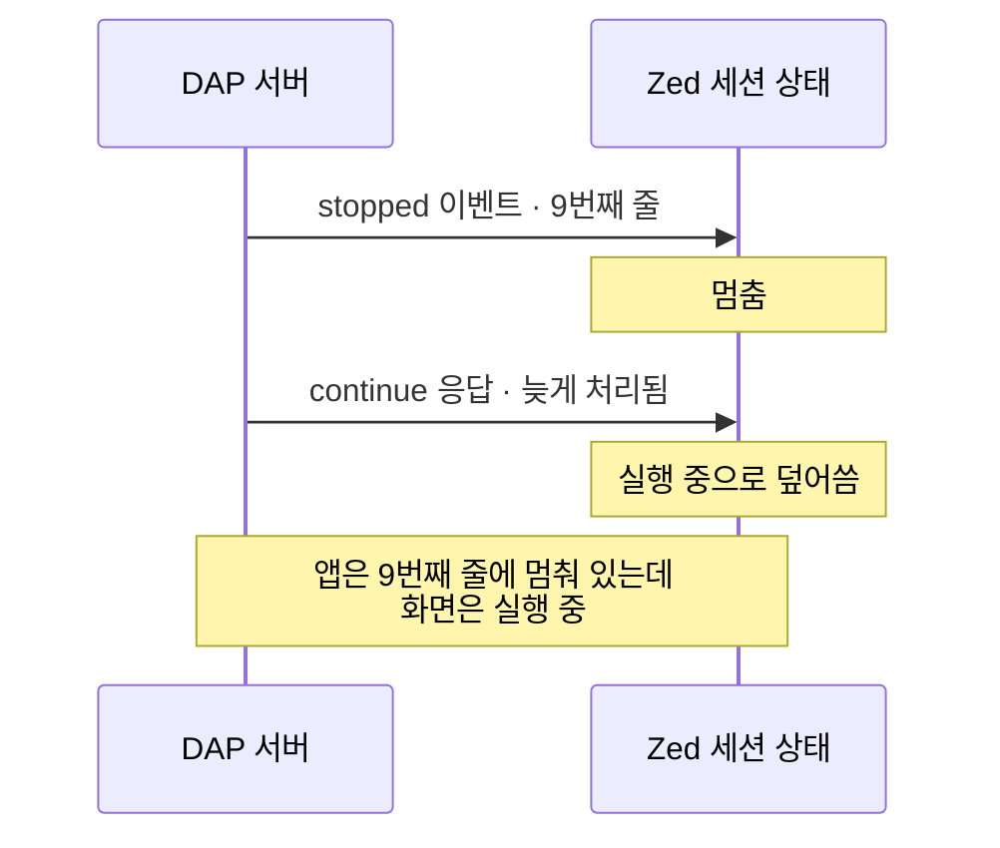

Zed로 Kotlin + Spring Boot(코프링)를 개발할 수 있는지 찾아보다 [선행 글](https://medium.com/@gunjourain112/go-1-25-%EB%AC%B4%EC%97%87%EC%9D%B4-%EC%96%BC%EB%A7%88%EB%82%98-%EB%8B%AC%EB%9D%BC%EC%A1%8C%EC%9D%84%EA%B9%8C-%EB%A6%B4%EB%A6%AC%EC%8A%A4-%EB%85%B8%ED%8A%B8-%EB%B6%84%EC%84%9D-%EB%B0%8F-%EC%84%B1%EB%8A%A5-%EB%A6%AC%ED%8F%AC%ED%8A%B8-671d8d5f3c73)을 읽었다. 결론은 "중단점이 안 잡힌다, Kotlin이면 Zed는 쓰지 마라"였다. 그 사이 사정이 바뀌었다. **JetBrains의 무료 Kotlin 언어 서버인 Kotlin <abbr title="Language Server Protocol. 에디터와 언어 서버가 자동완성·정의로 이동·진단 결과를 주고받는 규약으로, 덕분에 언어 서버 하나를 VS Code·Zed·Neovim이 같이 쓴다.">LSP(Language Server Protocol)</abbr> 안에 디버거가 들어왔고**, Zed 확장 시제품을 만들어 붙여 보니 Zed 화면에서 중단점이 걸리고 변수도 보였다.

이 글은 그 시제품을 만들면서 알게 된 것을 정리한다. 디버거가 어디에 있는지, Zed가 왜 거기에 직접 닿지 못하는지, 붙인 뒤에 무엇이 어긋났는지가 순서대로 나온다. 디버거 없이 컨벤션과 테스트로 어디까지 버틸 수 있는지는 [다음 글](/project/zed-kopring-without-debugger/)에서 다룬다.

## 선행 글의 시도: Java 디버그 어댑터

선행 글은 Java 확장의 디버거를 빌려 Kotlin 앱에 붙였고, 그래서 `.kt` 중단점이 무시됐다. 순서는 이랬다.

1. Zed에 Kotlin LSP를 언어 서버로 붙인다. 자동완성과 진단은 잘 된다.
2. 디버거는 **Java 확장의 디버그 어댑터**를 빌려 쓴다. `.zed/debug.json`에 `"adapter": "Java"`로 attach 설정을 적는다.
3. `bootRun`을 디버그 대기로 띄우고 붙는다. 붙기는 붙는데 `.kt` 중단점은 무시되고 요청이 그냥 끝난다.

원인은 글에 적힌 대로다. Java 확장의 디버거는 Eclipse JDT 기반이라 `.kt` 소스를 이해하지 못한다. 중단점이 걸린 `.kt` 줄을 어느 클래스의 어느 줄로 옮길지 모르니 중단점을 설치하지 못한다. 글은 "JetBrains가 공식 Kotlin LSP를 냈지만 디버깅 엔진은 넣지 않았다"고 결론짓는다.

선행 글의 실행 로그는 2026년 4월 12일자다. 그때는 맞는 말이었다. Kotlin LSP는 [4월 27일 릴리스(v262.4739.0)](https://github.com/Kotlin/kotlin-lsp/releases)부터 <abbr title="Debug Adapter Protocol. 에디터와 디버거가 중단점 설정, 실행 멈춤·재개, 변수 조회를 주고받는 규약이다. LSP의 디버거판으로, 디버거를 한 번 만들면 이 규약을 아는 에디터가 모두 쓸 수 있다.">DAP(Debug Adapter Protocol)</abbr> 디버거를 실험 기능으로 넣었다. "실행 중인 JVM에 attach하고 줄 중단점을 건다"까지가 그 릴리스의 범위다. 9월 릴리스에서 launch가, 10월 릴리스에서 스레드 덤프가 붙었다.

그러니 질문이 바뀐다. **디버거는 이제 있다. Zed에서 그걸 어떻게 부르나.**

## Kotlin LSP 내장 디버거와 start_debug_server

Kotlin LSP의 디버거는 별도 프로그램이 아니라 언어 서버 프로세스(`kotlin-server`, 실행 파일 이름은 `intellij-server`) **안에** 들어 있고, 언어 서버에 명령을 보내야 켜진다. Python의 debugpy, Go의 Delve, Rust의 CodeLLDB는 따로 실행되는 프로그램이라 Zed가 띄우고 바로 DAP로 대화하면 되는 것과 다르다.

- LSP `workspace/executeCommand`로 `start_debug_server`를 보내면
- 서버가 DAP 서버를 열고 **TCP 포트 번호**를 돌려준다
- 에디터는 그 포트로 DAP 연결을 맺는다

JetBrains가 낸 VS Code 확장이 정확히 이렇게 한다. [`vscode-extension-core/src/dap.ts`](https://github.com/Kotlin/kotlin-lsp/blob/dd97aa40d8be98dd47587a6221f8036572a54538/vscode-extension-core/src/dap.ts#L134-L146)에 있는 코드다.

```ts
const dapServerFactory: DebugAdapterDescriptorFactory = {
  async createDebugAdapterDescriptor(session: DebugSession) {
    const port: number = await commands.executeCommand(
      'start_debug_server',
      session.workspaceFolder?.uri.toString(),
    );
    return new DebugAdapterServer(port);
  },
};
```

디버깅 중에 `lsof`로 보면 앱의 디버그 포트(5005번, <abbr title="Java Debug Wire Protocol. 디버거가 실행 중인 JVM에 붙어 중단점을 걸고 변수를 읽는 JVM 표준 규약이다. 에디터는 DAP로 말하고, DAP 서버가 그 요청을 JDWP로 바꿔 JVM에 전달한다.">JDWP(Java Debug Wire Protocol)</abbr>)에 붙어 있는 쪽이 `kotlin-server` 프로세스 자신이다. 디버거용 프로세스가 따로 없다.

디버거가 언어 서버 안에 있으면 좋은 점도 있다. 서버는 이미 Gradle 프로젝트를 임포트해서 클래스패스와 소스 위치를 알고 있다. 그래서 `.kt`의 줄을 JVM 클래스의 줄로 바로 연결할 수 있다. 선행 글이 Java 디버거로 막혔던 바로 그 부분이다. 대신 프로젝트 임포트가 끝나기 전에 `start_debug_server`를 부르면 소스를 모르는 상태라 실패할 수 있다.

## Zed 확장 API의 제약과 프록시

Zed 확장은 실행 중인 언어 서버에 요청을 보낼 수 없다. 그래서 VS Code 확장에는 한 줄이면 되는 `start_debug_server` 호출에 프록시 프로세스가 하나 필요하다.

Zed 확장은 Rust로 쓰지만 <abbr title="WebAssembly. 호스트 프로그램 안의 샌드박스에서 돌도록 만든 바이너리 형식이다. Zed는 확장을 이 형식으로 실행해서, 확장이 파일·네트워크·프로세스에 닿는 범위를 Zed가 허용한 API로 제한한다.">wasm(WebAssembly)</abbr>으로 컴파일되어 Zed 안의 샌드박스에서 돈다. 확장이 할 수 있는 건 "이 명령으로 언어 서버를 띄워라", "이 명령으로 디버거를 띄워라"처럼 **Zed에게 무엇을 실행할지 알려 주는 것**까지다. 이미 떠 있는 언어 서버에 요청을 보내는 함수는 확장 API(`zed_extension_api` 0.8 기준)에 없다.

그래서 `start_debug_server`를 보낼 방법이 없다. 이 문제는 디버거가 언어 서버 안에 있는 경우에만 생긴다.

| 디버거 | 위치 | Zed가 켜는 방법 | 프록시 |
| --- | --- | --- | --- |
| Python (debugpy) | 별도 프로그램 | 실행 명령을 돌려주면 끝 | 불필요 |
| Go (Delve) | 별도 프로그램 | 〃 | 불필요 |
| Rust·C++ (CodeLLDB) | 별도 프로그램 | 〃 | 불필요 |
| Java (java-debug) | 언어 서버(<abbr title="Eclipse JDT Language Server. Eclipse의 Java 컴파일러·분석 엔진을 언어 서버로 띄운 것이다. VS Code와 Zed의 Java 지원이 이 서버를 쓴다.">jdtls</abbr>) 플러그인 | 언어 서버에 요청 필요 | **필요** |
| Kotlin | 언어 서버(kotlin-server) 내장 | 언어 서버에 요청 필요 | **필요** |

Zed Java 확장은 이걸 **프록시**로 푼다. Zed와 jdtls 사이에 `java-lsp-proxy`라는 프로세스를 끼워 표준입출력을 쥐고 있다가, 확장이 HTTP로 부탁하면 그 요청을 언어 서버에 끼워 넣는다. 확장은 Zed의 HTTP 클라이언트로 프록시에 요청을 보낸다. 프록시의 HTTP 포트는 `proxy/<프로젝트 경로의 hex>` 파일에 적어 둔다.

시제품도 같은 구조로 만들었다.



`kotlin-server`는 하나만 뜬다. 에디터 기능과 디버거가 같은 서버를 쓴다. 프록시는 언어 서버의 표준입출력을 그대로 통과시키면서, 디버그를 시작할 때만 자기 요청을 하나 끼워 넣는다.

프록시를 Node로 쓴 이유는 배포다. Zed가 Node를 내장하고 있어서(`zed::node_binary_path`) 스크립트를 확장 안에 넣어 두면 OS별 바이너리를 만들 필요가 없다. Java 확장도 [처음엔 Node 프록시였다가](https://github.com/zed-extensions/java/pull/214) 2026년 3월 Rust 바이너리로 바꿨다. 시작 속도와 메모리 때문이었는데, 그 뒤로 GLIBC 버전, Windows 실행 파일 경로, 원격 서버에서 동작하지 않는 문제가 이슈로 올라왔다. 바이너리 배포에는 이런 비용이 따른다.

다른 에디터에는 프록시가 없다. 플러그인이 LSP 클라이언트에 직접 요청을 보낼 수 있어서다.

- VS Code (Kotlin): `commands.executeCommand('start_debug_server', …)`
- Neovim ([nvim-jdtls](https://github.com/mfussenegger/nvim-jdtls/blob/master/lua/jdtls/dap.lua)): `client:request('workspace/executeCommand', …)`
- Emacs ([lsp-java](https://github.com/emacs-lsp/lsp-java/blob/master/dap-java.el)): `(lsp-send-execute-command "vscode.java.startDebugSession")`

즉 프록시는 JVM 언어의 사정이 아니라 **Zed 확장 API의 빈칸을 메우는 우회로**다. Zed에는 확장이 LSP 메시지를 주고받게 해 달라는 이슈([#20042](https://github.com/zed-industries/zed/issues/20042))가 2024년부터 열려 있다. 메인테이너가 거절한 기록은 없다. 비슷한 확장 API PR에 대한 반응을 보면 원격 개발 환경까지 고려해야 하고, 확장이 다룰 명령을 `extension.toml`에 미리 선언하는 식으로 범위를 좁히길 원한다. 아직 모양을 정하지 못한 상태로 보인다.

## 디버그 시작 흐름

Zed에서 `debugger: start`를 누르면 이렇게 흘러간다.



앱은 미리 `./gradlew bootRun --debug-jvm`으로 띄워 둔다. 이렇게 띄우면 JVM이 5005번 포트에서 디버거를 기다리며 멈춰 있고, 디버거가 붙어야 Spring이 올라온다. Zed 쪽 설정은 attach 하나다.

```json
[
  {
    "label": "Attach Spring Boot (5005)",
    "adapter": "intellij_jvm",
    "request": "attach",
    "hostName": "localhost",
    "port": 5005
  }
]
```

어댑터 이름은 `intellij_jvm`으로 둔다. Zed는 어댑터 이름을 DAP `initialize`의 `adapterID`로 보내는데, 서버는 JetBrains VS Code 확장이 쓰는 이 이름만 받는다.

## 경로 형식과 인라인 값

붙은 뒤에 막힌 건 두 가지다. 멈췄는데 Variables가 비어 있었고, 코드 옆에 값이 뜨지 않았다. 앞의 것은 VS Code만 보고 만든 서버와 명세대로 움직이는 Zed 사이의 불일치이고, 뒤의 것은 Kotlin 확장에 빠진 파일 하나다.

### pathFormat과 file:// URI

중단점에서 멈추고 Frames 목록도 나오는데 Variables 패널이 비어 있었다. DAP 응답 원문을 보니 서버가 스택 프레임의 소스 경로를 URI로 보내고 있었다.

```json
"source": { "name": "StockAllocator.kt", "path": "file:///path/to/project/.../StockAllocator.kt" }
```

DAP에서 경로 형식은 클라이언트가 고른다. `initialize`의 `pathFormat`이 `"path"`면 운영체제의 일반 경로(`/path/to/...`)로, `"uri"`면 `file:///...`로 주고받자는 뜻이다. Zed는 `"path"`를 보낸다. 서버가 그 약속을 어긴 것이다. 세 가지 값으로 시험해 봤다.

| `pathFormat` | 중단점에 보낸 경로 | 중단점 설치 | 멈췄을 때 받은 경로 |
| --- | --- | --- | --- |
| `"path"` (Zed) | 일반 경로 | 성공 | **URI** |
| `"uri"` | URI | **실패** | 멈추지 않음 |
| 생략 | 일반 경로 | 성공 | **URI** |

서버는 `pathFormat`을 보지 않는다. **받을 때는 일반 경로만, 보낼 때는 항상 URI**로 고정돼 있다. 클라이언트가 어느 쪽을 골라도 한쪽은 어긋나니 클라이언트 설정으로는 피할 수 없다.

VS Code에서는 이게 드러나지 않는다. VS Code는 `source.path`가 URI처럼 생겼으면 URI로 해석해 준다(`debugSource.ts`의 `getUriFromSource`). Zed는 약속대로 일반 경로를 기대하니 `file:///...`를 파일과 연결하지 못하고, 프레임에 딸린 변수도 불러오지 않는다.

시제품은 프록시의 DAP 중계에서 서버가 보내는 메시지를 고쳐 쓴다. `fileURLToPath`를 쓰면 공백이나 한글이 퍼센트 인코딩된 경로도 같이 풀린다.

```js
function sourceUrisToPaths(value) {
  if (value === null || typeof value !== "object") return false;
  let changed = false;
  if (typeof value.path === "string" && value.path.startsWith("file:") && "name" in value) {
    value.path = url.fileURLToPath(value.path);
    changed = true;
  }
  for (const child of Object.values(value)) {
    if (sourceUrisToPaths(child)) changed = true;
  }
  return changed;
}
```

이걸 넣고 나서 Variables에 `sku`, `requested`, `available`이 나왔다. 근본적으로는 서버가 `pathFormat`을 지키거나, Zed가 VS Code처럼 URI를 받아 주면 이 코드가 필요 없다. 둘 다 따로 요청해 두었다(아래 표).

### 인라인 값과 debugger.scm

Python을 디버깅할 때는 코드 줄 옆에 `requested: 10` 같은 값이 떴는데 Kotlin에서는 Variables 패널에만 나왔다. 이건 DAP가 아니라 Zed 쪽 기능이다.

Zed는 언어마다 `debugger.scm`이라는 <abbr title="소스를 구문 트리로 파싱하는 라이브러리. Zed는 강조, 들여쓰기, 접기 같은 언어 기능을 이 트리 위의 쿼리 파일로 정의한다.">tree-sitter</abbr> 쿼리 파일을 둔다. 어떤 노드가 변수 이름인지(`@debug-variable`), 어디까지가 범위인지(`@debug-scope`)를 적어 두면 Zed가 그 이름을 Variables 패널 값과 짝지어 코드 옆에 그린다. Zed 본체에는 Python, Rust, Go, C/C++, JS/TS용 파일만 있고 Kotlin 확장에는 없었다.

```scheme
(property_declaration
  (variable_declaration
    (simple_identifier) @debug-variable))

(parameter
  (simple_identifier) @debug-variable)
```

Zed의 Python·Go 쿼리를 본떠 `val`/`var` 선언, 파라미터, `for` 변수, 대입, 식 안의 변수를 잡는 쿼리를 만들었다. 예시 파일 세 개를 파싱해서 변수 이름이 잡히는 것까지는 확인했는데, **Zed 화면에 실제로 뜨는지는 아직 확인하지 못했다.**

## Zed의 continue 응답 경합

Zed는 DAP 응답과 이벤트를 다른 경로로 처리해서, Continue 직후 곧바로 다음 중단점에 멈추면 멈춘 상태가 "실행 중"으로 덮일 수 있다. 중단점을 같은 함수의 7번째 줄과 9번째 줄에 걸고 Continue를 눌렀을 때 Frames와 Variables가 사라지는 경우가 있었다.

```kotlin
class StockAllocator {
    fun allocate(sku: String, requested: Int, available: Int): Allocation {
        val allocated = minOf(requested, available)      // 7: 중단점
        val backordered = requested - allocated
        return Allocation(sku, allocated, backordered)   // 9: 중단점
    }
}
```

DAP 메시지를 기록해 보니 서버는 `continue` 응답과 다음 `stopped` 이벤트를 **같은 밀리초에** 보낸다. Zed는 응답과 이벤트를 다른 경로로 처리한다. 응답은 요청을 기다리던 작업으로 넘어가고, 이벤트는 이벤트 처리기로 바로 간다([`transport.rs`](https://github.com/zed-industries/zed/blob/f0b38ac75ea769b75287ff1370242d88b3878c2d/crates/dap/src/transport.rs#L350-L360)). 그래서 서버가 보낸 순서와 Zed가 처리하는 순서가 뒤집힐 수 있다.



[`on_continue_response`](https://github.com/zed-industries/zed/blob/f0b38ac75ea769b75287ff1370242d88b3878c2d/crates/project/src/debugger/session.rs#L2148-L2178)는 응답을 받으면 그 사이에 `stopped`가 왔는지 보지 않고 모든 스레드를 "실행 중"으로 바꾼다.

처음엔 프록시에서 `continue` 응답 직후 100ms 안에 오는 `stopped`를 잠깐 붙잡아 순서를 맞췄다. 헤드리스 실험에서는 잘 됐다. 하지만 Zed 안에서 순서가 다시 섞일 수 있으니 100ms는 "대부분 맞겠지"라는 추측일 뿐이다. 되돌리고 다른 구현이 이걸 어떻게 푸는지 찾았다.

VS Code가 이미 같은 경합을 막고 있었다. [`rawDebugSession.ts`](https://github.com/microsoft/vscode/blob/97212c3d6085780c91098f47f40856eeb0eba43e/src/vs/workbench/contrib/debug/browser/rawDebugSession.ts#L357-L368)는 `continue`를 보내기 전에 `stoppedSinceLastStep`을 `false`로 두고, `stopped`를 받으면 `true`로 바꾼다. 응답이 왔을 때 `true`면 "실행 중" 처리를 건너뛴다. 시간 값에 기대지 않는다.

Zed 수정도 같은 원리로 했다. 다만 불리언 대신 카운터를 썼다.

```rust
fn on_continue_response(
    thread_id: ThreadId,
    stopped_event_count: usize, // 요청을 보낼 때의 stopped 수
) -> impl FnOnce(/* … */) -> Option<dap::ContinueResponse> {
    move |this, response, cx| match response.log_err() {
        // 응답을 처리하기 전에 이미 다시 멈췄다. 그 stopped가 더 새로운 상태다.
        Some(response) if this.stopped_event_count != stopped_event_count => Some(response),
        Some(response) => { /* 기존대로 실행 중으로 표시 */ }
        // …
    }
}
```

`handle_stopped_event`에서 `stopped_event_count`를 하나씩 올리고, `continue`와 step 계열 요청을 보낼 때 그 값을 기억해 둔다. 응답이 왔을 때 값이 바뀌었으면 상태를 건드리지 않는다. JPA `@Version`으로 하는 낙관적 잠금과 같은 생각이다. 막고 기다리는 게 아니라 나중에 버전만 비교한다.

카운터를 쓴 이유는 한 세션 안에서 resume 요청이 겹칠 때다. 불리언이면 이런 일이 생긴다.

1. 요청1을 보내며 플래그를 `false`로
2. `stopped` 도착, 플래그 `true`
3. 요청2를 보내며 플래그를 다시 `false`로
4. 요청1의 응답 도착. 플래그가 `false`라 "그 사이 멈춤 없음"으로 보고 방금 멈춘 상태를 덮어씀

카운터면 요청1은 자기가 보낸 시점의 값과만 비교하니 요청2에 흔들리지 않는다. 겹치지 않는다면 불리언과 똑같이 동작한다.

Zed의 테스트 하네스로 가짜 어댑터가 `continue`에 응답한 뒤 곧바로 `stopped`를 보내게 하고 50가지 실행 순서로 돌렸다. 수정 전에는 시드 4에서 스레드가 `Running`으로 남아 실패했고, 수정 후에는 50개 모두 통과했다. 기존 `debugger_ui` 테스트 63개도 통과한다.

단, 화면에서 본 현상이 전부 이 경합 때문인지는 확정하지 못했다. 마지막 중단점에서 Continue해 요청이 끝난 경우에도 Frames는 사라진다. Zed는 실행 중으로 바뀔 때 Variables를 지우지 않고 다음에 멈출 때만 새로 만들기 때문에, 그때는 Variables가 남는 게 정상이다. **Frames와 Variables가 둘 다 사라졌는데 요청이 아직 응답을 기다리고 있다면** 이 경합이다. 원할 때 재현할 수는 없지만 테스트로 순서에 따라 상태가 틀어지는 걸 보였으니 고칠 이유는 충분하다고 봤다.

## 현재 상태와 업스트림 이슈

| 항목 | 상태 |
| --- | --- |
| 일반 요청 중단점, Frames | Zed에서 확인 |
| Variables 패널 | Zed에서 확인 (경로 변환 후) |
| 중단점 두 개 사이 Continue | Zed에서 확인 |
| 코루틴 안의 중단점 | 헤드리스로만 확인 |
| 코드 옆 인라인 값 | 쿼리 파싱만 확인 |
| `this` 같은 객체 값 | `Collecting data…`로 남을 수 있음. 서버가 나중에 `invalidated` 이벤트로 다시 읽어 가라고 알리는데 Zed가 이 이벤트를 무시한다 |
| Zed 경합 수정 | 자동 테스트만 |

시제품은 아직 업스트림에 들어가지 않았다. 프록시를 하나 더 늘리기보다 막힌 곳을 각자의 자리에서 푸는 게 맞다고 보고, 그렇게 요청해 두었다.

| 막힌 곳 | 프록시 없이 푸는 자리 | 올린 곳 |
| --- | --- | --- |
| 디버거를 켤 요청을 못 보냄 | Zed 확장 API에 LSP 요청 보내기 | [zed#20042 답글](https://github.com/zed-industries/zed/issues/20042) |
| 서버가 `pathFormat`을 무시 | JetBrains 서버 수정 | [kotlin-lsp#285](https://github.com/Kotlin/kotlin-lsp/issues/285) |
| Zed가 URI 경로를 못 받음 | Zed가 VS Code처럼 URI 허용 | [zed Discussion #65408](https://github.com/zed-industries/zed/discussions/65408) |
| continue 응답 경합 | Zed 세션 상태 처리 | [zed#65410](https://github.com/zed-industries/zed/issues/65410) |
| 위를 묶은 디버거 지원 제안 | Kotlin 확장 | [zed-extensions/kotlin#121](https://github.com/zed-extensions/kotlin/issues/121) |

2026-10-10 기준으로 모두 열려 있고 메인테이너 답은 아직 없다. 앞의 두 가지가 풀리면 Kotlin 확장은 `start_debug_server` 호출과 디버그 어댑터 등록만으로 디버거를 지원할 수 있다.

Zed 기여 규칙에는 AI 정책이 있다. 자율 에이전트가 올린 PR은 받지 않고, 설명이나 답글을 LLM에 맡기지 말라고 한다. 비영어권 기여자에게는 기계 번역을 인용 블록에 넣고 모국어 원문을 붙이라고 권한다. 위 글들은 모두 한국어 원문을 쓰고 영어 번역을 붙이는 형식으로 올렸다.

## 정리

"Zed에서 Kotlin 디버깅이 안 된다"는 말은 지금은 세 갈래로 나눠 봐야 한다. 디버거 엔진은 무료 Kotlin LSP 안에 있고 잘 동작한다. 막힌 건 **Zed 확장이 언어 서버에 요청을 못 보낸다는 것**, 그리고 VS Code만 보고 만든 서버와 명세대로 움직이는 Zed 사이의 **작은 불일치**다.

다음에 비슷한 에디터·디버거 조합이 안 붙으면 이 순서로 본다.

1. 디버거가 별도 프로그램인지, 언어 서버 안에 있는지. 안에 있다면 에디터 플러그인이 언어 서버에 요청을 보낼 수 있는지
2. DAP `initialize`의 `adapterID`를 서버가 받아 주는지. VS Code 확장의 `package.json`에 적힌 디버거 타입 이름이 정답인 경우가 많다
3. 멈추는데 변수가 안 보이면 `stackTrace` 응답의 `source.path` 형식. VS Code가 너그럽게 받아 주던 것이 다른 클라이언트에서 터진다
4. 상태가 가끔 틀어지면 응답과 이벤트의 처리 순서. 시간 지연으로 덮지 말고 VS Code가 어떻게 막는지부터 본다

## 참고

- [Rust 네이티브로 만든 Zed 툴로 Springboot 세팅하기](https://medium.com/@gunjourain112/go-1-25-%EB%AC%B4%EC%97%87%EC%9D%B4-%EC%96%BC%EB%A7%88%EB%82%98-%EB%8B%AC%EB%9D%BC%EC%A1%8C%EC%9D%84%EA%B9%8C-%EB%A6%B4%EB%A6%AC%EC%8A%A4-%EB%85%B8%ED%8A%B8-%EB%B6%84%EC%84%9D-%EB%B0%8F-%EC%84%B1%EB%8A%A5-%EB%A6%AC%ED%8F%AC%ED%8A%B8-671d8d5f3c73) — 선행 글
- [Kotlin LSP 릴리스](https://github.com/Kotlin/kotlin-lsp/releases)
- [Zed Debugger 문서](https://zed.dev/docs/debugger)
- [DAP 명세 — Initialize Request](https://microsoft.github.io/debug-adapter-protocol/specification#Requests_Initialize)
- [zed-extensions/java#214 — JDTLS Rust Proxy](https://github.com/zed-extensions/java/pull/214)
- [VS Code `rawDebugSession.ts`](https://github.com/microsoft/vscode/blob/97212c3d6085780c91098f47f40856eeb0eba43e/src/vs/workbench/contrib/debug/browser/rawDebugSession.ts#L357-L368)
