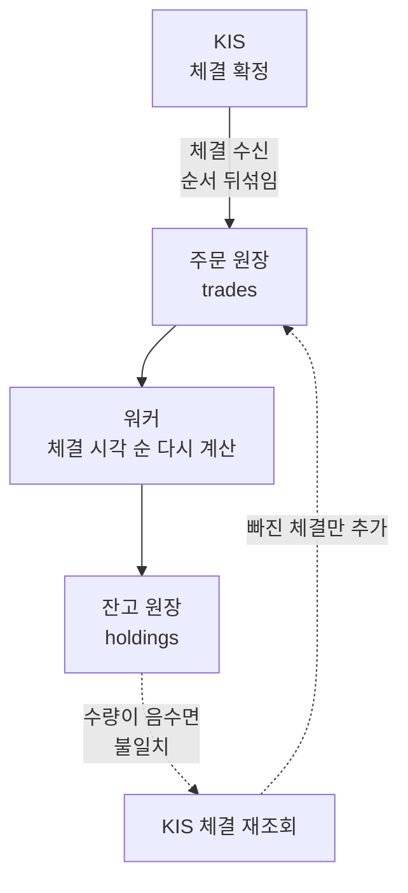

[앞 글](/study/database/sequence-id-outside-snapshot/)에서 시퀀스 id 는 스냅샷 밖에서 나오고,
그래서 **id 순서가 커밋 순서가 아니라는 것**을 봤다. 4 를 받은 트랜잭션이 5 를 받은 트랜잭션보다
늦게 커밋될 수 있다.

이게 실제로 문제가 된 곳이 주식 잔고다. KIS(한국투자증권) 모의투자 API 에 연동해서,
받은 체결을 **주문 원장**에 쌓고 그걸 보고 **잔고 원장**(보유 수량, 평균 단가)을
비동기로 갱신하는 구조였다.
체결이 우리 쪽에 들어오는 순서는 실제 체결 순서와 다르다. 앞 글처럼 커밋 순서가 뒤바뀌기도 하고,
네트워크 지연이나 재시도로 늦게 오기도 한다.

결론부터 쓰면 이렇다.

- 들어온 순서대로 잔고에 한 건씩 반영하면 **평균 단가가 틀린다.** 평균 단가는 순서에 따라 값이 달라진다.
- 순서를 맞추려고 애쓸 필요가 없다. 진짜 순서는 **KIS 가 준 체결 시각**에 이미 있다.
  잔고는 주문 원장 전체를 그 순서로 **다시 계산**하면 된다. 도착 순서가 어떻든 결과가 같다.
- 계산하다 보유 수량이 음수가 나오면 거절할 일이 아니다. 체결은 KIS 가 확정한 사실이라,
  음수는 **우리 쪽에 체결이 빠졌다는 신호**다. KIS 에 재조회해서 맞춘다.
- 음수를 허용할 수 있는 건 **정합성을 지키는 주체가 우리가 아니라 KIS** 이기 때문이다.
  우리 잔고 원장은 다음 주문을 판단하려고 들고 있는 사본이다.

## 두 원장



```sql
-- 주문 원장: KIS 가 체결을 확정한 주문을 한 줄씩 적는다
CREATE TABLE trades (
  id          bigint GENERATED ALWAYS AS IDENTITY PRIMARY KEY,  -- 우리가 받은 순서
  account_id  int         NOT NULL,
  fill_no     text        NOT NULL UNIQUE,                        -- KIS 체결번호
  executed_at timestamptz NOT NULL,                               -- KIS 체결 시각
  side        text        NOT NULL CHECK (side IN ('buy', 'sell')),
  qty         int         NOT NULL,
  price       int         NOT NULL
);

-- 잔고 원장: 주문 원장에서 계산한 보유 수량과 평균 단가
CREATE TABLE holdings (
  account_id int PRIMARY KEY,
  qty        int     NOT NULL DEFAULT 0,
  avg_price  numeric NOT NULL DEFAULT 0,
  mismatch   bool    NOT NULL DEFAULT false
);
INSERT INTO holdings (account_id) VALUES (1);
```

주문 원장에는 순서가 두 개 있다. `id` 는 **우리가 받은 순서**이고, `executed_at` 은
**KIS 가 실제로 체결한 순서**다. 앞 글에서 봤듯 `id` 는 커밋 순서조차 아니다.
잔고에 의미가 있는 건 `executed_at` 쪽이다.

## 순서가 필요한 경우

잔고 원장에서 하는 계산 중 순서에 따라 결과가 달라지는 것이 있다.

| 잔고 계산 | 순서가 바뀌면 | 이유 |
| --- | --- | --- |
| 보유 수량 (매수 +, 매도 −) | 최종 값은 같다 | 더하기·빼기는 순서를 바꿔도 같다 |
| 평균 단가 | **달라진다** | 매수할 때마다 그 시점 보유분과 가중 평균한다 |
| 보유 수량이 음수인지 | **달라진다** | 매도가 매수보다 먼저 반영되면 중간에 음수가 된다 |

평균 단가는 <abbr title="매수할 때마다 기존 보유분과 새로 산 것을 수량으로 가중 평균하는 방식. 매도는 평균 단가를 바꾸지 않는다.">이동평균법</abbr>으로 계산했다.
매수하면 `(보유수량 × 평단 + 매수수량 × 매수가) / (보유수량 + 매수수량)`, 매도하면 수량만 줄고
다 팔면 평단은 0 이 된다.

### 들어온 순서대로 반영

체결이 하나 들어올 때마다 워커가 그 한 건을 잔고에 더한다. 가장 먼저 떠오르는 방식이다.

```sql
CREATE FUNCTION apply_trade(t_id bigint) RETURNS text LANGUAGE plpgsql AS $$
DECLARE t trades; h holdings;
BEGIN
  SELECT * INTO t FROM trades WHERE id = t_id;
  SELECT * INTO h FROM holdings WHERE account_id = t.account_id FOR UPDATE;
  IF t.side = 'buy' THEN
    h.avg_price := (h.qty * h.avg_price + t.qty * t.price) / (h.qty + t.qty);
    h.qty := h.qty + t.qty;
  ELSE
    h.qty := h.qty - t.qty;
    IF h.qty = 0 THEN h.avg_price := 0; END IF;
  END IF;
  UPDATE holdings SET qty = h.qty, avg_price = round(h.avg_price, 2)
    WHERE account_id = h.account_id;
  RETURN t.fill_no || ' → 수량 ' || h.qty || ', 평단 ' || round(h.avg_price, 2);
END $$;
```

실제 체결은 이 순서였다.

| 체결번호 | KIS 체결 시각 | 내용 |
| --- | --- | --- |
| F1 | 09:00:01 | 매수 10주 @100 |
| F2 | 09:00:02 | 매수 10주 @200 |
| F3 | 09:00:03 | 매도 10주 @180 |

맞는 답은 보유 10주, 평단 150 이다. 그런데 F2 가 늦게 와서 **F1 → F3 → F2** 순으로 들어왔다.

```sql
INSERT INTO trades (account_id, fill_no, executed_at, side, qty, price)
  VALUES (1, 'F1', '2026-10-14 09:00:01', 'buy', 10, 100);
SELECT apply_trade(currval('trades_id_seq'));
INSERT INTO trades (account_id, fill_no, executed_at, side, qty, price)
  VALUES (1, 'F3', '2026-10-14 09:00:03', 'sell', 10, 180);
SELECT apply_trade(currval('trades_id_seq'));
INSERT INTO trades (account_id, fill_no, executed_at, side, qty, price)
  VALUES (1, 'F2', '2026-10-14 09:00:02', 'buy', 10, 200);
SELECT apply_trade(currval('trades_id_seq'));
```

| 들어온 체결 | 잔고 |
| --- | --- |
| F1 매수 10@100 | 10주, 평단 100 |
| F3 매도 10 | 0주, 평단 0 |
| F2 매수 10@200 | 10주, 평단 **200** |

수량은 10주로 맞는데 평단이 **200** 이다. F3 가 F2 보다 먼저 반영되면서 F1 의 100원짜리를
다 판 것으로 계산됐고, 그 뒤 F2 만 남았다. 실제로는 F1·F2 를 모두 산 다음에 팔았으니
평단은 150 이어야 한다.

한 건씩 반영하는 방식은 **반영 순서 = 체결 순서**여야만 맞는다. 그런데 도착 순서는 우리가
정할 수 없다. 워커에 락을 걸어도 소용이 없다. 락은 워커끼리 동시에 돌지 못하게 할 뿐,
아직 안 온 F2 를 기다려 주지는 않는다.

## 순서가 필요 없게 만들기

### 다시 계산

한 건씩 더하지 않고, 체결이 들어올 때마다 **주문 원장 전체를 KIS 체결 시각 순으로 다시 계산**한다.

```sql
CREATE FUNCTION recompute(acc int) RETURNS text LANGUAGE plpgsql AS $$
DECLARE t trades; q int := 0; avg numeric := 0; bad bool := false;
BEGIN
  PERFORM 1 FROM holdings WHERE account_id = acc FOR UPDATE;
  FOR t IN SELECT * FROM trades WHERE account_id = acc
           ORDER BY executed_at, fill_no LOOP           -- 받은 순서(id)가 아니라 체결 시각 순
    IF t.side = 'buy' THEN
      avg := (q * avg + t.qty * t.price) / (q + t.qty);
      q := q + t.qty;
    ELSE
      q := q - t.qty;
      IF q < 0 THEN bad := true; END IF;   -- 판 게 가진 것보다 많다 = 체결이 빠졌다
      IF q = 0 THEN avg := 0; END IF;
    END IF;
  END LOOP;
  UPDATE holdings SET qty = q, avg_price = round(avg, 2), mismatch = bad
    WHERE account_id = acc;
  RETURN '수량 ' || q || ', 평단 ' || round(avg, 2)
         || CASE WHEN bad THEN ', 불일치' ELSE '' END;
END $$;
```

같은 F1 → F3 → F2 도착 뒤에 `recompute(1)` 을 부르면 **10주, 평단 150** 이 나온다.
한 번 더 불러도 같다.

이 방식에서는 도착 순서가 결과에 영향을 주지 않는다. 계산할 때마다 체결 시각으로 정렬하니,
늦게 온 F2 도 제자리(F1 과 F3 사이)에 들어간다. 몇 번을 다시 계산해도 같은 원장에서는
같은 잔고가 나온다.

두 가지는 챙긴다.

- **워커끼리는 잔고 행을 잠근다** (`FOR UPDATE`). 둘이 동시에 계산하면 먼저 읽은 쪽이
  나중에 써서 최신 값을 덮을 수 있다. 락을 잡은 **다음 문장**에서 원장을 읽어야 하므로,
  문장마다 새 스냅샷을 잡는 <abbr title="PostgreSQL 의 기본 격리 수준. 문장마다 그 시점에 커밋된 데이터를 본다.">READ COMMITTED</abbr> 를 전제로 한다.
- **체결이 커밋된 뒤에 다시 계산한다.** 그래야 마지막 계산이 그때까지 커밋된 체결을 전부 본다.
  중간에 잠깐 틀린 잔고가 보일 수는 있어도, 마지막 체결의 계산이 끝나면 맞는다.

매번 원장 전체를 읽는 게 부담이면, 확정된 시점(예: 전날 장 마감)의 잔고를 따로 저장해 두고
그 이후 체결만 다시 계산하면 된다.

### 음수는 거절이 아니라 불일치

매도가 매수보다 먼저 도착하면 계산 중에 보유 수량이 음수가 된다.

| 상황 | `recompute` 결과 |
| --- | --- |
| 매도 G2 (09:00:02) 만 도착 | 수량 **−10**, 불일치 |
| 매수 G1 (09:00:01) 도착 | 수량 0, 불일치 해제 |

우리가 승인하는 거래였다면 음수가 나오는 매도를 거절하면 끝이다. 하지만 체결은
**KIS 가 이미 확정한 사실**이다. 우리가 거절한다고 체결이 없던 일이 되지 않는다.
틀린 쪽은 우리 원장이다.

그래서 음수는 에러로 막지 않고 `mismatch` 로 표시만 한다. 대부분은 늦게 온 체결이
들어오면서 저절로 풀린다. 끝내 안 풀리면 **체결이 유실된 것**이니 KIS 에 체결 내역을
재조회해서 원장을 맞춘다.

```sql
-- H2 (매수 10@200) 가 유실된 상태
INSERT INTO trades (account_id, fill_no, executed_at, side, qty, price) VALUES
  (1, 'H1', '2026-10-14 09:00:01', 'buy', 10, 100),
  (1, 'H3', '2026-10-14 09:00:03', 'sell', 15, 180);
SELECT recompute(1);   -- 수량 -5, 평단 100.00, 불일치

-- KIS 체결 조회 결과를 통째로 다시 넣는다. 이미 있는 체결번호는 건너뛴다
INSERT INTO trades (account_id, fill_no, executed_at, side, qty, price) VALUES
  (1, 'H1', '2026-10-14 09:00:01', 'buy', 10, 100),
  (1, 'H2', '2026-10-14 09:00:02', 'buy', 10, 200),
  (1, 'H3', '2026-10-14 09:00:03', 'sell', 15, 180)
ON CONFLICT (fill_no) DO NOTHING
RETURNING fill_no;     -- H2 만 새로 들어간다
SELECT recompute(1);   -- 수량 5, 평단 150.00
```

`fill_no` 에 걸어 둔 `UNIQUE` 가 여기서 쓰인다. 재조회 결과를 통째로 다시 넣어도
이미 있는 체결은 건너뛰고 빠진 것만 들어간다. 같은 체결이 두 번 수신돼도 마찬가지다.
원장이 맞으면 다시 계산한 잔고도 맞는다.

### 정합성은 KIS 의 몫

음수를 그냥 둘 수 있는 건 **이 서비스가 데이터 정합성을 책임지는 쪽이 아니라서**다.

| | 정합성을 지키는 서비스 | 이 서비스 (모의투자 연동) |
| --- | --- | --- |
| 진짜 잔고를 가진 곳 | 우리 DB | KIS |
| 잔고 원장의 역할 | 원본. 틀리면 그게 곧 사고 | 사본. 다음 주문을 판단하는 재료 |
| 음수가 나오면 | 그런 거래를 막아야 한다 | 우리 사본이 덜 따라온 것. 표시하고 재조회 |
| 틀렸을 때 고치는 법 | 우리가 보정 거래를 만든다 | KIS 에서 다시 받아 덮는다 |

은행 계좌처럼 우리가 원본을 들고 있다면 잔고가 음수가 되는 출금은 기록 전에 막아야 한다.
기록되는 순간 그게 사실이 되기 때문이다. 이 서비스는 다르다. 체결도, 잔고도, 주문이 가능한지도
KIS 가 정한다. 우리는 그 결과를 받아 **다음에 무엇을 주문할지 판단**할 뿐이다.

그래서 잔고 원장에 요구되는 건 "항상 맞다" 가 아니라 **"틀렸으면 틀렸다는 걸 안다"** 이다.
`mismatch` 가 그 역할이다. 불일치 상태의 잔고로는 다음 주문을 판단하지 않고, 먼저 KIS 에
재조회해서 사본을 맞춘 다음 판단한다. 우리 사본으로 정합성을 맞추려 들면 KIS 가 이미 하는 일을
한 번 더 하는 셈이고, 그 과정에서 두 쪽이 어긋나면 어느 쪽을 믿을지가 오히려 문제가 된다.

## 정리

주문 원장에 체결이 들어오는 순서는 실제 체결 순서가 아니다. 커밋 순서도, 우리가 매긴 `id` 순서도 아니다.
이 상태에서 한 건씩 잔고에 반영하면 평균 단가처럼 순서에 기대는 값이 틀린다.

순서를 맞추려고 워커를 줄 세우거나 순번을 매길 필요는 없다. 진짜 순서는 KIS 가 준 체결 시각에 있다.

- **잔고 원장은 주문 원장에서 다시 계산한다.** KIS 체결 시각 순으로 정렬해서 계산하면
  도착 순서와 상관없이 같은 결과가 나온다.
- **음수 잔고는 거절하지 않는다.** 우리 원장에 체결이 빠졌다는 신호로 보고 표시해 둔다.
  안 풀리면 KIS 에 재조회한다. 정합성은 KIS 가 지키고, 우리 잔고는 다음 주문을 판단하기 위한 사본이라서
  가능한 선택이다. 불일치 상태에서는 그 사본으로 판단하지 않는다.
- **주문 원장은 체결번호로 중복을 막는다.** 그래야 재조회 결과를 그대로 다시 넣어도 안전하다.

## 참고

- [loading1031/stock](https://github.com/loading1031/stock) — 이 글의 배경인 KIS 모의투자 연동 프로젝트. 글의 SQL 은 원리만 보이려고 새로 짠 최소 예제다
- [PostgreSQL — Explicit Locking: Row-Level Locks](https://www.postgresql.org/docs/current/explicit-locking.html#LOCKING-ROWS)
- [PostgreSQL — INSERT ... ON CONFLICT](https://www.postgresql.org/docs/current/sql-insert.html#SQL-ON-CONFLICT)
