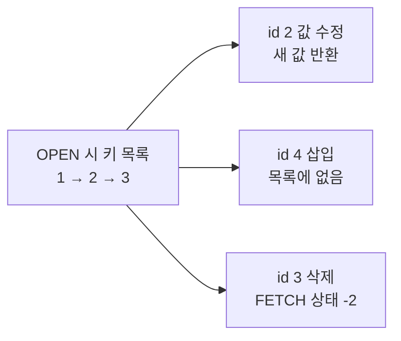

[섹션12: 데이터베이스 커서](/study/database/section-12-database-cursors/)에서 비교한 `STATIC`, `KEYSET`, `DYNAMIC`을 SQL Server 2022에서 열어 봤다. 아래 출력은 SQL Server 2022 CU28(16.0.4325.4) Developer Edition 컨테이너에서 직접 받았다. 이 Mac은 ARM64라 amd64 에뮬레이션으로 실행했다. Microsoft가 공식 지원하는 SQL Server 컨테이너 호스트는 x86-64다. 따라서 성능 수치를 다른 환경의 기준으로 삼지 않는다. [컨테이너 지원 환경](https://learn.microsoft.com/en-us/sql/linux/quickstart-install-connect-docker)

## 준비

기존 SQL Server가 없다면 x86-64 호스트에서 실습용 컨테이너를 띄운다. 아래 암호는 이 셸에서만 쓰며 글에 실제 값을 남기지 않는다. 서버가 준비된 뒤 `sqlcmd`를 실행한다.

```bash
export CURSOR_LAB_PASSWORD="B!z9$(openssl rand -hex 20)"
docker run --rm -d --name cursor-lab -e ACCEPT_EULA=Y \
  -e MSSQL_SA_PASSWORD="$CURSOR_LAB_PASSWORD" \
  mcr.microsoft.com/mssql/server:2022-latest
docker logs cursor-lab
```

```bash
docker exec -it -e SQLCMDPASSWORD="$CURSOR_LAB_PASSWORD" cursor-lab \
  /opt/mssql-tools18/bin/sqlcmd -S localhost -U sa -C
```

다음은 `sqlcmd` 안에서 실행한다. 데이터베이스와 표는 실습 전용으로 만든다.

```sql
CREATE DATABASE CursorLab;
GO
USE CursorLab;
GO
CREATE TABLE dbo.Items (
  id int NOT NULL PRIMARY KEY,
  sort_key int NOT NULL,
  label nvarchar(30) NOT NULL
);
INSERT dbo.Items (id, sort_key, label) VALUES
  (1, 2, N'one'), (2, 1, N'two'), (3, 1, N'three');
GO
```

## DECLARE와 OPEN 사이의 할당을 비교했다

**확인할 내용** — `tempdb` 내부 객체 할당은 `DECLARE`와 `OPEN` 중 언제 생기는가. 그리고 `DYNAMIC`은 `OPEN` 뒤에 들어온 행을 다음 `FETCH`에서 찾는가. 다음 코드는 **새 연결의 한 배치**에서 실행했다. 실습용 `#Items`는 측정 전에 만든다.

**쿼리**

```sql
SET NOCOUNT ON;
CREATE TABLE #Items (id int NOT NULL PRIMARY KEY, label varchar(20) NOT NULL);
INSERT #Items VALUES (1, 'one'), (3, 'three');

SELECT 'before' AS phase, SUM(internal_objects_alloc_page_count) AS pages
FROM sys.dm_db_task_space_usage WHERE session_id = @@SPID;

DECLARE sta CURSOR LOCAL SCROLL STATIC FOR SELECT id, label FROM #Items ORDER BY id;
SELECT 'static declare' AS phase, SUM(internal_objects_alloc_page_count) AS pages
FROM sys.dm_db_task_space_usage WHERE session_id = @@SPID;
OPEN sta;
SELECT 'static open' AS phase, SUM(internal_objects_alloc_page_count) AS pages
FROM sys.dm_db_task_space_usage WHERE session_id = @@SPID;
SELECT 'static rows' AS phase, @@CURSOR_ROWS AS rows;
CLOSE sta; DEALLOCATE sta;

DECLARE ks CURSOR LOCAL SCROLL KEYSET FOR SELECT id, label FROM #Items ORDER BY id;
SELECT 'keyset declare' AS phase, SUM(internal_objects_alloc_page_count) AS pages
FROM sys.dm_db_task_space_usage WHERE session_id = @@SPID;
OPEN ks;
SELECT 'keyset open' AS phase, SUM(internal_objects_alloc_page_count) AS pages
FROM sys.dm_db_task_space_usage WHERE session_id = @@SPID;
SELECT 'keyset rows' AS phase, @@CURSOR_ROWS AS rows;
CLOSE ks; DEALLOCATE ks;

DECLARE dyn CURSOR LOCAL SCROLL DYNAMIC READ_ONLY FOR
  SELECT id, label FROM #Items ORDER BY id;
SELECT 'dynamic declare' AS phase, SUM(internal_objects_alloc_page_count) AS pages
FROM sys.dm_db_task_space_usage WHERE session_id = @@SPID;
OPEN dyn;
SELECT 'dynamic open' AS phase, SUM(internal_objects_alloc_page_count) AS pages
FROM sys.dm_db_task_space_usage WHERE session_id = @@SPID;
SELECT 'dynamic rows' AS phase, @@CURSOR_ROWS AS rows;
SELECT name, properties FROM sys.dm_exec_cursors(@@SPID) WHERE name = 'dyn';
FETCH NEXT FROM dyn; -- id = 1
INSERT #Items VALUES (2, 'two');
FETCH NEXT FROM dyn; -- 새로 들어온 id = 2
FETCH NEXT FROM dyn; -- id = 3
CLOSE dyn; DEALLOCATE dyn;
GO
```

**결과** — `sqlcmd -W -h -1` 출력에서 열 제목과 빈 줄을 줄였다.

```text
before            0 pages
static declare    0 pages
static open       8 pages
static rows       2
keyset declare    8 pages
keyset open      16 pages
keyset rows       2
dynamic declare  16 pages
dynamic open     16 pages
dynamic rows     -1
dyn  TSQL | Dynamic | Read Only | Local (0)
1    one
2    two
3    three
```

`STATIC`과 `KEYSET`은 `DECLARE` 직후 할당량이 그대로였고 `OPEN` 뒤 각각 8페이지 늘었다. `DYNAMIC`은 이 예제에서 `OPEN` 뒤 내부 객체 할당이 늘지 않았다. `@@CURSOR_ROWS`도 앞의 두 타입은 2였고 `DYNAMIC`은 행 수가 고정되지 않았음을 뜻하는 `-1`이었다. 첫 `FETCH` 이후 삽입한 `id = 2`가 다음 행으로 나왔다. 이는 **키 목록을 `OPEN`에서 고정하지 않았다는 관찰**이다. 내부 실행 위치의 마커는 이 출력으로 직접 본 것이 아니라 [SQL Server 팀의 구현 설명](https://techcommunity.microsoft.com/blog/sqlserver/understanding-sql-server-fast-forward-server-cursors/383556)에 근거한다. DMV 값은 현재 요청의 누적 내부 객체 할당량이며, 8페이지가 각 커서 작업 테이블의 정확한 크기를 뜻하지는 않는다. [SQL Server `OPEN`](https://learn.microsoft.com/en-us/sql/t-sql/language-elements/open-transact-sql), [`@@CURSOR_ROWS`](https://learn.microsoft.com/en-us/sql/t-sql/functions/cursor-rows-transact-sql), [DMV 설명](https://learn.microsoft.com/en-us/sql/relational-databases/system-dynamic-management-views/sys-dm-db-task-space-usage-transact-sql)

## 커서 타입에 따라 다음 행의 값이 달랐다

### DYNAMIC은 다음 FETCH에서 수정값을 읽었다

**확인할 내용** — `READ_ONLY`는 커서가 가리키는 행을 직접 수정하지 못하게 하지만, 같은 연결의 일반 `UPDATE`까지 금지하지 않는다. `DYNAMIC`은 아직 가져오지 않은 두 번째 행의 새 값을 읽는가.

**쿼리**

```sql
DECLARE dyn CURSOR LOCAL SCROLL DYNAMIC READ_ONLY FOR
  SELECT id, label FROM dbo.Items ORDER BY id;
OPEN dyn;
SELECT name, properties FROM sys.dm_exec_cursors(@@SPID) WHERE name = 'dyn';
FETCH NEXT FROM dyn;
UPDATE dbo.Items SET label = N'two_changed' WHERE id = 2;
FETCH NEXT FROM dyn;
CLOSE dyn;
DEALLOCATE dyn;
GO
```

**결과**

```text
dyn  TSQL | Dynamic | Read Only | Local (0)
1    one
2    two_changed
```

실제 타입은 `Dynamic`이었다. 두 번째 행은 `OPEN` 뒤에 수정했지만 다음 `FETCH`가 새 값을 읽었다. 여기서는 **같은 연결이 직접 수정**했다. 다른 트랜잭션의 수정은 격리 수준까지 따져야 한다. [정리 글의 격리 수준 절](/study/database/section-12-database-cursors/#read_only와-격리-수준은-다른-질문이다)

### STATIC은 열 때의 값을 유지했다

**확인할 내용** — `STATIC`으로 연 뒤 두 번째 행을 고치면 커서가 복사해 둔 값을 반환하는가.

**쿼리**

```sql
DECLARE sta CURSOR LOCAL STATIC FOR
  SELECT id, label FROM dbo.Items ORDER BY id;
OPEN sta;
SELECT name, properties FROM sys.dm_exec_cursors(@@SPID) WHERE name = 'sta';
FETCH NEXT FROM sta;
UPDATE dbo.Items SET label = N'two_changed_again' WHERE id = 2;
FETCH NEXT FROM sta;
CLOSE sta;
DEALLOCATE sta;
GO
```

**결과**

```text
sta  TSQL | Snapshot | Read Only | Local (0)
1    one
2    two_changed
```

원본의 두 번째 행은 `two_changed_again`으로 바뀌었지만, 커서는 열 때의 `two_changed`를 반환했다. DMV는 이 타입을 `Snapshot`으로 표시했다. [정리 글의 타입 비교](/study/database/section-12-database-cursors/#open과-fetch에서-타입별로-하는-일)

### KEYSET은 고정된 행의 새 값을 읽었다

**확인할 내용** — 행의 키 목록은 유지하면서 기존 행의 값 변경을 읽는가.

**쿼리**

```sql
DECLARE key_cur CURSOR LOCAL KEYSET FOR
  SELECT id, label FROM dbo.Items ORDER BY id;
OPEN key_cur;
SELECT name, properties FROM sys.dm_exec_cursors(@@SPID) WHERE name = 'key_cur';
FETCH NEXT FROM key_cur;
UPDATE dbo.Items SET label = N'two_changed_third' WHERE id = 2;
FETCH NEXT FROM key_cur;
CLOSE key_cur;
DEALLOCATE key_cur;
GO
```

**결과**

```text
key_cur  TSQL | Keyset | Optimistic | Local (0)
1        one
2        two_changed_third
```

결과에 속한 행은 열 때 정했지만, 두 번째 행의 값은 원본에서 다시 읽었다. [정리 글의 타입 비교](/study/database/section-12-database-cursors/#open과-fetch에서-타입별로-하는-일)

### KEYSET에서 삽입과 삭제를 확인했다

**확인할 내용** — 커서를 연 뒤 새 행을 삽입하면 키 목록에 추가되는가. 목록에 있던 행을 삭제하면 다음 `FETCH`는 어떻게 되는가. 아래 코드는 앞선 실습의 `dbo.Items`와 별개인 임시 테이블을 쓴다.

**쿼리**

```sql
CREATE TABLE #Items (id int NOT NULL PRIMARY KEY, label varchar(20) NOT NULL);
INSERT #Items VALUES (1, 'one'), (2, 'two'), (3, 'three');

DECLARE c CURSOR LOCAL SCROLL KEYSET FOR
  SELECT id, label FROM #Items ORDER BY id;
OPEN c;
FETCH NEXT FROM c; -- id = 1
UPDATE #Items SET label = 'two_new' WHERE id = 2;
INSERT #Items VALUES (4, 'four');
DELETE #Items WHERE id = 3;
FETCH NEXT FROM c; -- id = 2
SELECT @@FETCH_STATUS AS status_after_two;
FETCH NEXT FROM c; -- 삭제된 id = 3의 자리
SELECT @@FETCH_STATUS AS status_after_deleted_three;
FETCH NEXT FROM c; -- id = 4는 키 목록에 없음
SELECT @@FETCH_STATUS AS status_after_end;
CLOSE c;
DEALLOCATE c;
GO
```

**결과** — `sqlcmd -W -h -1` 출력에서 빈 줄은 생략하고 상태값의 이름을 붙였다.

```text
1  one
2  two_new
status_after_two              0
삭제된 행의 자리: 0  (label은 빈 값)
status_after_deleted_three   -2
다음 행 없음
status_after_end             -1
```

`id = 2`는 새 값을 읽었고, 삽입한 `id = 4`는 보이지 않았다. 삭제한 `id = 3`의 키는 남아 있으나 원본 행이 없어 `@@FETCH_STATUS`가 `-2`였다. 출력된 `0`과 빈 `label`은 원래 행의 값으로 해석하면 안 된다. 다음 `FETCH`는 키 목록 끝에 도달해 `-1`을 반환했다. 이 상태값은 `FETCH` 직후에 읽어야 한다. [SQL Server `@@FETCH_STATUS`](https://learn.microsoft.com/en-us/sql/t-sql/functions/fetch-status-transact-sql)



## 정렬 조건이 요청한 타입을 바꿨다

### 비고유 정렬 열은 KEYSET으로 전환됐다

**확인할 내용** — `DYNAMIC`을 요청해도 인덱스가 없고 고유하지 않은 `sort_key`로 정렬하면 실제 타입은 무엇인가. 이 실습은 `FETCH`마다 정렬 횟수를 측정하는 것이 아니다.

**쿼리**

```sql
DECLARE sorted_dyn CURSOR LOCAL SCROLL DYNAMIC READ_ONLY TYPE_WARNING FOR
  SELECT id, sort_key FROM dbo.Items ORDER BY sort_key;
OPEN sorted_dyn;
SELECT name, properties FROM sys.dm_exec_cursors(@@SPID) WHERE name = 'sorted_dyn';
FETCH NEXT FROM sorted_dyn;
CLOSE sorted_dyn;
DEALLOCATE sorted_dyn;
GO
```

**결과**

```text
The created cursor is not of the requested type.
sorted_dyn  TSQL | Keyset | Read Only | Local (0)
2           1
```

`TYPE_WARNING`과 DMV가 전환을 보여 줬다. `ORDER BY`가 있다고 언제나 이렇게 되는 것은 아니다. 쿼리와 인덱스에 따라 실제 타입을 확인해야 한다. [정리 글의 타입 전환 절](/study/database/section-12-database-cursors/#dynamic-요청이-다른-타입으로-바뀌는-경우)

## tempdb 내부 객체 할당을 봤다

### 같은 인스턴스에서 작업 공간을 썼다

**확인할 내용** — `STATIC`과 `KEYSET`을 열 때 `tempdb` 내부 객체 페이지 할당이 생기는가. 이 실험은 **새 연결**에서 아래 코드만 실행했다. DMV 값은 현재 요청의 task에서 누적된 할당량이므로 `KEYSET`을 연 뒤의 증가분은 앞선 값을 빼서 읽는다.

**쿼리**

```sql
CREATE DATABASE CursorLabSpace;
GO
USE CursorLabSpace;
GO
CREATE TABLE dbo.Items (id int NOT NULL PRIMARY KEY, sort_key int NOT NULL, payload char(200) NOT NULL);
INSERT dbo.Items (id, sort_key, payload)
SELECT TOP (10000) ROW_NUMBER() OVER (ORDER BY (SELECT NULL)),
       ROW_NUMBER() OVER (ORDER BY (SELECT NULL)) % 50, REPLICATE('x', 200)
FROM sys.all_objects AS a CROSS JOIN sys.all_objects AS b;

SELECT 'before' AS phase, SUM(internal_objects_alloc_page_count) AS pages
FROM sys.dm_db_task_space_usage WHERE session_id = @@SPID;

DECLARE sta CURSOR LOCAL STATIC FOR SELECT id, payload FROM dbo.Items ORDER BY id;
OPEN sta;
SELECT 'static open' AS phase, SUM(internal_objects_alloc_page_count) AS pages
FROM sys.dm_db_task_space_usage WHERE session_id = @@SPID;
CLOSE sta;
DEALLOCATE sta;

DECLARE key_cur CURSOR LOCAL KEYSET FOR SELECT id, payload FROM dbo.Items ORDER BY id;
OPEN key_cur;
SELECT 'keyset open' AS phase, SUM(internal_objects_alloc_page_count) AS pages
FROM sys.dm_db_task_space_usage WHERE session_id = @@SPID;
CLOSE key_cur;
DEALLOCATE key_cur;
GO
USE master;
GO
DROP DATABASE CursorLabSpace;
GO
```

**결과**

```text
before         0 pages
static open  264 pages
keyset open  288 pages  (이전 측정 대비 24페이지 증가)
```

DMV의 `internal_objects_alloc_page_count`는 커서 작업 테이블을 포함한 **내부 객체의 할당**을 세며, 특정 객체 하나의 크기를 정확히 재는 값은 아니다. 행 크기·인덱스·계획에 따라 숫자는 달라진다. 이 실험에서는 키 목록을 저장하는 `KEYSET`의 추가 할당이 결과 행을 복사하는 `STATIC`보다 작았다. [DMV 문서](https://learn.microsoft.com/en-us/sql/relational-databases/system-dynamic-management-views/sys-dm-db-task-space-usage-transact-sql)

## REPEATABLE READ에서는 읽은 행의 수정이 기다렸다

### 두 연결로 잠금 타임아웃을 확인했다

**확인할 내용** — SQL Server에서 `DYNAMIC READ_ONLY` 커서로 행을 읽더라도 `REPEATABLE READ`가 그 행의 공유 잠금을 트랜잭션 끝까지 유지하는가.

**쿼리** — 먼저 실습용 DB를 만든다.

```sql
CREATE DATABASE CursorLabIsolation;
GO
USE CursorLabIsolation;
GO
CREATE TABLE dbo.Items (id int NOT NULL PRIMARY KEY, label varchar(30) NOT NULL);
INSERT dbo.Items VALUES (1, 'old'), (2, 'other');
GO
```

연결 A에서 다음 코드를 시작한다. `WAITFOR` 중에 연결 B의 코드를 실행한다.

```sql
USE CursorLabIsolation;
SET TRANSACTION ISOLATION LEVEL REPEATABLE READ;
BEGIN TRANSACTION;
DECLARE c CURSOR LOCAL SCROLL DYNAMIC READ_ONLY FOR
  SELECT id, label FROM dbo.Items ORDER BY id;
OPEN c;
FETCH NEXT FROM c;
SELECT GETDATE() AS fetched_at, @@TRANCOUNT AS tran_count;
WAITFOR DELAY '00:00:30';
COMMIT TRANSACTION;
CLOSE c;
DEALLOCATE c;
GO
```

연결 B에서는 이미 읽힌 `id = 1`을 수정한다.

```sql
USE CursorLabIsolation;
SET LOCK_TIMEOUT 2000;
SELECT GETDATE() AS update_attempt_at;
UPDATE dbo.Items SET label = 'new' WHERE id = 1;
GO
```

**결과**

```text
연결 A: 1 old
연결 A: fetched_at = 2026-11-13 02:38:21.687, tran_count = 1
연결 B: update_attempt_at = 2026-11-13 02:38:32.867
연결 B: Msg 1222, Lock request time out period exceeded.
```

연결 B의 시각은 실험 당시 `UPDATE` 앞에서 `SELECT GETDATE()`로 확인했다. 시각은 실행마다 다르다. 연결 B는 2초 안에 읽힌 행의 잠금을 얻지 못했다. 이 동작은 PostgreSQL의 스냅샷 기반 `REPEATABLE READ`에 그대로 적용되지 않는다. [SQL Server 격리 수준](https://learn.microsoft.com/en-us/sql/t-sql/statements/set-transaction-isolation-level-transact-sql)

## 정리 — 무엇을 확인했나

| 정리 글의 주장 | 확인 방법 | 결과 |
| --- | --- | --- |
| 타입마다 값을 보관하는 방식이 다르다 | 열고 난 뒤 아직 읽지 않은 행 수정 | `STATIC`은 옛 값, `DYNAMIC`·`KEYSET`은 새 값 |
| `tempdb` 작업 테이블은 `OPEN`에서 채운다 | `DECLARE`·`OPEN` 뒤의 내부 객체 할당량 | `STATIC`·`KEYSET`에서 `OPEN` 뒤 증가 |
| `DYNAMIC`은 행 목록을 고정하지 않는다 | 첫 `FETCH` 뒤 중간 키 삽입 | `1` 다음에 새 행 `2` 반환 |
| `KEYSET`은 행 목록을 고정한다 | 연 뒤 행 삽입·삭제 | 새 행은 보이지 않고, 삭제된 행은 `@@FETCH_STATUS = -2` |
| 요청한 커서 타입이 바뀔 수 있다 | 비고유 `sort_key` 정렬 + `TYPE_WARNING` | `DYNAMIC` 요청이 `KEYSET`으로 전환 |
| `tempdb` 작업 공간이 든다 | 1만 행과 내부 객체 DMV | `STATIC` 264페이지, 이후 `KEYSET` 추가 24페이지 |
| 읽기 전용 커서와 읽기 잠금은 다르다 | 두 연결 + `REPEATABLE READ` | 두 번째 연결의 수정이 잠금 타임아웃 |

## 정리하기

```sql
USE master;
GO
DROP DATABASE CursorLabIsolation;
DROP DATABASE CursorLab;
GO
```

`sqlcmd`에서 `QUIT`으로 나온 뒤 컨테이너를 중지한다. `--rm`으로 띄웠으므로 컨테이너는 함께 삭제된다.

```bash
docker stop cursor-lab
unset CURSOR_LAB_PASSWORD
```

## 참고

- [SQL Server `DECLARE CURSOR`](https://learn.microsoft.com/en-us/sql/t-sql/language-elements/declare-cursor-transact-sql)
- [SQL Server 커서 개요](https://learn.microsoft.com/en-us/sql/relational-databases/cursors)
- [SQL Server `tempdb`](https://learn.microsoft.com/en-us/sql/relational-databases/databases/tempdb-database)
