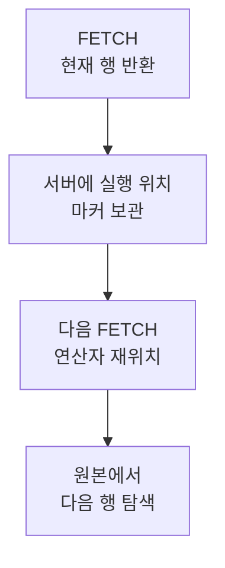

커서가 `FETCH NEXT`로 한 행씩 반환한다는 사실만으로 DB의 비용은 알 수 없다. SQL Server에서 `STATIC`은 결과를 `tempdb`에 복사하고, `KEYSET`은 행의 식별 키를 저장하며, `DYNAMIC`은 이동할 때 원본의 변경을 반영한다. 같은 `FETCH NEXT`라도 **무엇을 저장하고 어디서 다음 행을 찾는지**가 다르다.

이 글의 커서는 [섹션8의 페이지네이션 커서](/study/database/section-8-postgresql-pagination/)와 다르다. 페이지네이션 커서는 다음 HTTP 요청에 넘길 정렬 경곗값이고, 여기서는 DB 연결에 열린 결과의 **현재 위치**를 다룬다. 아래 SQL Server 동작은 2022 컨테이너에서 확인했다. [실습 글](/study/database/section-12-database-cursors-lab/)에 쿼리와 출력을 남겼다.

## 공부 내용 — 커서는 현재 위치를 기억한다

SQL Server의 Transact-SQL 서버 커서는 다음 순서로 사용한다.

```sql
DECLARE items CURSOR LOCAL STATIC FOR
  SELECT id, label
  FROM dbo.Items
  ORDER BY id;
OPEN items;
FETCH NEXT FROM items;
FETCH NEXT FROM items;
CLOSE items;
DEALLOCATE items;
```

`DECLARE`는 커서의 이름과 조회문·동작을 정한다. **`STATIC`이라면 `DECLARE`가 아니라 `OPEN`에서 조회 결과를 `tempdb`에 복사한다.** `FETCH`는 복사본에서 현재 위치의 행을 가져온다. `CLOSE`는 열린 결과를 닫고, `DEALLOCATE`는 마지막 커서 참조와 자원을 해제한다. 다른 타입이 `OPEN`과 `FETCH`에서 하는 일은 아래에서 비교한다. [SQL Server `OPEN`](https://learn.microsoft.com/en-us/sql/t-sql/language-elements/open-transact-sql), [`CLOSE`](https://learn.microsoft.com/en-us/sql/t-sql/language-elements/close-transact-sql), [`DEALLOCATE`](https://learn.microsoft.com/en-us/sql/t-sql/language-elements/deallocate-transact-sql)

커서는 위치를 유지하므로 다음 `FETCH NEXT`가 앞선 `FETCH`의 뒤를 잇는다. 그렇다고 모든 커서가 서버에서 행을 한 개씩 만들거나, 모든 결과를 처음부터 끝까지 복사하지 않는다는 뜻은 아니다. **한 행씩 반환하는 인터페이스**와 **결과를 보관하는 방법**은 별개다.

## 심화 — 다음 행을 어디서 찾나

### OPEN과 FETCH에서 타입별로 하는 일

SQL Server의 Transact-SQL 서버 커서 기준이다. [SQL Server `OPEN`](https://learn.microsoft.com/en-us/sql/t-sql/language-elements/open-transact-sql), [시점별 실습](/study/database/section-12-database-cursors-lab/#declare와-open-사이의-할당을-비교했다)

| 시점 | `STATIC` | `KEYSET` | `DYNAMIC` |
| --- | --- | --- | --- |
| `OPEN` | 조회문을 실행해 **결과 행 전체**를 `tempdb` 작업 테이블에 채움 | 조회문에서 얻은 **행 식별 키와 순서**를 `tempdb` 키 목록에 채움 | 커서를 열고 첫 행 앞에 위치함. 전체 결과나 키 목록을 미리 채우지 않음 |
| `FETCH NEXT` | 작업 테이블의 다음 행 반환 | 다음 저장 키로 원본 행의 현재 값 조회 | 현재 실행 위치에서 원본 데이터의 다음 행 탐색 |
| 원본 변경 | 열 때 복사한 값 유지 | 기존 행의 새 값은 읽지만 행 목록은 고정 | 보이는 행과 순서가 바뀔 수 있음 |

`KEYSET`은 [keyset 페이지네이션](/study/database/section-8-postgresql-pagination/)과 관리 범위가 다르다. 이 서버 커서는 열린 동안 행의 키 **전체 목록**을 `tempdb`에 보관한다. 페이지네이션은 다음 요청에 **마지막 정렬 키**를 넘겨 새 쿼리를 실행한다.

**정렬 주의:** `KEYSET`은 `OPEN` 때 정한 행 순서를 유지하지만, 행 식별 키가 아닌 정렬 열은 `FETCH` 때 새 값을 읽을 수 있다. 다른 트랜잭션의 변경이 현재 격리 수준에서 보이면, 반환된 값이 더는 현재 `ORDER BY` 순서대로 나열되지 않을 수 있다. 예를 들어 `10, 20, 30`으로 열고 가운데 값을 `100`으로 바꾸면 `10, 100, 30` 순서로 읽힌다. `STATIC`은 열 때 복사한 값과 순서를 모두 유지한다. 최신 값으로 정렬된 결과가 필요하면 새로 조회해야 한다. [SQL Server `KEYSET` 설명](https://learn.microsoft.com/en-us/sql/t-sql/language-elements/declare-cursor-transact-sql)

`DYNAMIC`은 마지막 키 하나나 전체 키 목록 대신, **서버 실행 계획의 현재 위치를 작은 마커(marker)**로 보관한다. 다음 `FETCH`에서 연산자를 그 위치로 되돌리고 원본의 다음 행을 찾는다. 따라서 커서를 연 뒤 새로 들어온 행도 이동 방향과 격리 수준에 따라 보일 수 있다. 마커에 무엇이 들어가는지는 실행 계획에 따라 다르다. [SQL Server 팀의 동적 계획 설명](https://techcommunity.microsoft.com/blog/sqlserver/understanding-sql-server-fast-forward-server-cursors/383556)



여러 사용자가 커서를 열어도 `tempdb` 데이터베이스가 사용자마다 새로 생기지는 않는다. **같은 인스턴스의 `tempdb`를 공유**하며, 각 커서의 작업 공간이 늘어난다. 열린 커서가 많고 결과가 크면 공간과 I/O 부담이 커질 수 있다. [`tempdb` 문서](https://learn.microsoft.com/en-us/sql/relational-databases/databases/tempdb-database), [할당량 실습](/study/database/section-12-database-cursors-lab/#같은-인스턴스에서-작업-공간을-썼다)

### DYNAMIC 요청이 다른 타입으로 바뀌는 경우

`DYNAMIC`은 현재 실행 위치로 돌아가야 해서 결과 전체를 만든 뒤 반환하는 [`Sort`](#order-by와-sort는-무엇이-다른가 "정렬 결과를 만드는 실행 계획 연산자")를 계획에 넣을 수 없다. 필요한 순서를 인덱스로 얻지 못하면 SQL Server가 `KEYSET` 등 다른 커서 타입을 선택할 수 있다. 이때 정렬은 키 목록이나 결과를 채우는 `OPEN`에서 일어날 수 있으며, **`FETCH NEXT`마다 전체를 다시 정렬한다는 뜻은 아니다.** 요청한 타입과 실제 타입은 `TYPE_WARNING`이나 `sys.dm_exec_cursors`로 비교한다. [SQL Server 팀의 동적 계획 설명](https://techcommunity.microsoft.com/blog/sqlserver/understanding-sql-server-fast-forward-server-cursors/383556), [타입 전환 실습](/study/database/section-12-database-cursors-lab/#비고유-정렬-열은-keyset으로-전환됐다)

### READ_ONLY와 격리 수준은 다른 질문이다

`READ_ONLY`는 `UPDATE ... WHERE CURRENT OF cursor_name`처럼 **커서의 현재 행을 지정해서 수정하는 경로**를 막는다. 같은 연결의 일반 `UPDATE`까지 금지하는 옵션은 아니다. [SQL Server `DECLARE CURSOR`](https://learn.microsoft.com/en-us/sql/t-sql/language-elements/declare-cursor-transact-sql)

다른 트랜잭션의 변경이 보일지는 **격리 수준**에 달려 있다. SQL Server `REPEATABLE READ`는 이미 읽은 행의 공유 잠금을 트랜잭션 끝까지 유지한다. PostgreSQL의 같은 이름의 격리 수준은 일반 읽기가 쓰기를 막지 않고 이전 스냅샷을 본다. [SQL Server 격리 수준](https://learn.microsoft.com/en-us/sql/t-sql/statements/set-transaction-isolation-level-transact-sql), [PostgreSQL 격리 수준](https://www.postgresql.org/docs/current/transaction-iso.html), [두 연결 실습](/study/database/section-12-database-cursors-lab/#두-연결로-잠금-타임아웃을-확인했다)

## 보충 개념

### ORDER BY와 Sort는 무엇이 다른가

`ORDER BY`는 **결과를 어떤 순서로 내보낼지** 요구하는 SQL 문법이고, `Sort`는 그 순서를 만드는 **실행 계획 연산자**다. 예를 들어 `ORDER BY id`는 `id` 인덱스를 순서대로 읽어 충족할 수 있다. 맞는 인덱스가 없다면 `Sort` 같은 작업이 필요할 수 있지만, SQL Server가 `ORDER BY`를 생략하지는 않는다. [SQL Server 인덱스 설계 문서](https://learn.microsoft.com/en-us/sql/relational-databases/sql-server-index-design-guide)

### API 커서와 서버 커서를 구분한다

Python DB-API의 `con.cursor()`는 SQL 실행과 결과 읽기에 쓰는 **Python 객체**를 만든다. 그 이름만으로 SQL Server의 `STATIC`·`DYNAMIC` 서버 커서가 생성됐다고 판단할 수 없다. 드라이버는 결과를 클라이언트에 먼저 받아 둘 수도 있고, 서버에 열린 결과를 유지하며 나눠 받을 수도 있다. [Python DB-API](https://peps.python.org/pep-0249/), [SQLAlchemy 커서 설명](https://docs.sqlalchemy.org/en/20/core/connections.html#using-server-side-cursors-a-k-a-stream-results)

연결은 세션과 트랜잭션을 관리하고, DB-API 커서는 그 연결에서 SQL을 실행하고 결과를 읽는다. 그래서 보통 `cur.execute()`로 실행하고 `con.commit()`으로 확정한 뒤 커서와 연결을 닫는다. `sqlite3`처럼 `con.execute()` 편의 메서드를 제공하는 드라이버도 있다. [Python DB-API](https://peps.python.org/pep-0249/), [Python `sqlite3`](https://docs.python.org/3/library/sqlite3.html)

```python
import sqlite3

con = sqlite3.connect(":memory:")
cur = con.cursor()
cur.execute("CREATE TABLE items (id integer)")
cur.execute("INSERT INTO items VALUES (1)")
con.commit()
cur.close()
con.close()
```

Django에서 PostgreSQL 결과를 크게 읽을 때는 `QuerySet.iterator(chunk_size=...)`가 서버 쪽 커서로 결과를 스트리밍할 수 있다. `chunk_size`를 크게 하면 왕복은 줄지만 한 번에 보관하는 행이 늘어난다. PostgreSQL에서 `DISABLE_SERVER_SIDE_CURSORS`가 켜져 있으면 이 동작은 달라진다. 이 옵션은 **조회 결과를 가져오는 방법**이며, 쓰기 ORM 호출을 한 SQL로 합치는 기능은 아니다. [Django `iterator()`](https://docs.djangoproject.com/en/6.0/ref/models/querysets/#iterator)

### 원자성과 왕복 횟수를 따로 본다

`transaction.atomic()`은 여러 DB 변경을 함께 커밋하거나 롤백한다. **ORM 호출을 한 SQL 문장으로 합치거나 왕복 횟수를 줄이지는 않는다.** 두 번의 `create()`는 여전히 두 `INSERT`다. 한 `update()` 안의 `F()` 표현식처럼 계산을 DB로 옮길 수 있을 때만 한 문장으로 줄어든다. [Django 트랜잭션](https://docs.djangoproject.com/en/6.0/topics/db/transactions/), [Django `F()`](https://docs.djangoproject.com/en/6.0/ref/models/expressions/)

서로 다른 테이블의 변경을 한 SQL 문장으로 보내야 한다면 PostgreSQL의 데이터 변경 `WITH`를 사용할 수 있다. `posts(id, title)`와 `post_events(post_id, event_type)`가 있을 때 글을 만들고 그 ID로 이벤트를 기록하는 예다.

```sql
WITH new_post AS (
  INSERT INTO posts (title) VALUES ('hello')
  RETURNING id
)
INSERT INTO post_events (post_id, event_type)
SELECT id, 'created' FROM new_post;
```

`RETURNING id`가 첫 삽입의 결과를 다음 삽입에 전달한다. 두 작업은 **한 SQL 문장**이지만, `WITH`가 트랜잭션보다 강한 원자성을 주는 것은 아니다. Django ORM도 독립적인 두 호출을 자동으로 이 문장으로 합치지 않는다. [PostgreSQL `WITH`](https://www.postgresql.org/docs/current/queries-with.html)

## 정리

커서의 `FETCH NEXT`만 보고 성능을 판단하지 않는다. 먼저 **실제 커서 타입과 결과를 저장하는 위치**, 그다음 **정렬 인덱스와 실행 계획**, 마지막으로 **격리 수준과 한 번에 가져오는 행 수**를 확인한다. Python의 `cursor()`는 서버 커서 타입의 증거가 아니며, `atomic()`은 통신 횟수를 줄이는 기능이 아니다.

## 참고

- [Fundamentals of Database Engineering](https://www.udemy.com/course/database-engineering-korean/) — Hussein Nasser
- [SQL Server `DECLARE CURSOR`](https://learn.microsoft.com/en-us/sql/t-sql/language-elements/declare-cursor-transact-sql) — 강의 뒤에 읽은 문서와 같은 주제의 최신 공식 문서
- [SQL Server 커서 개요](https://learn.microsoft.com/en-us/sql/relational-databases/cursors)
- [Django QuerySet `iterator()`](https://docs.djangoproject.com/en/6.0/ref/models/querysets/#iterator)
- [Django 트랜잭션 관리](https://docs.djangoproject.com/en/6.0/topics/db/transactions/)
