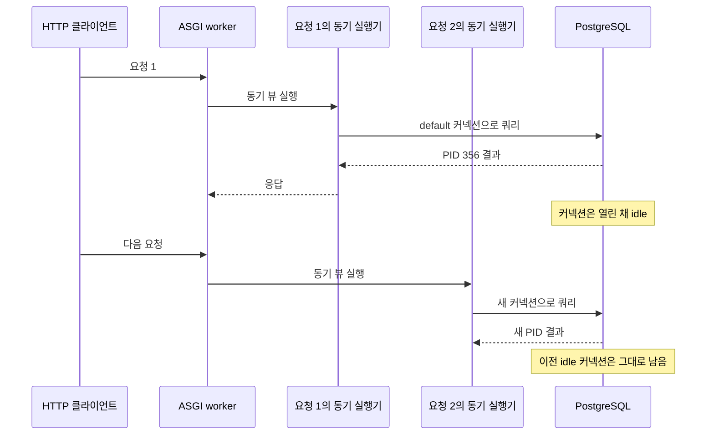

앞선 [Django ASGI 커넥션 수명 설명](/project/section-8-asgi-db-connections/)을 실제 세션으로 확인한다. Django는 일반적인 웹 요청별 커넥션 풀을 제공하지 않는다. 그렇다면 ASGI 서버에서 요청이 끝난 뒤 `idle`로 남은 DB 커넥션을 다음 요청이 재사용할까? 이 실습은 Django 4.2.30, PostgreSQL 17, Gunicorn 22와 `uvicorn-worker`를 사용해 확인한다. DB 별칭 세 개는 모두 격리된 PostgreSQL 하나를 가리키고, 각 커넥션에 별칭 이름을 `application_name`으로 기록한다.

실행 방식과 패키지 버전은 실제로 사용했던 ASGI 서버 조합에 맞췄다. 서비스 코드와 접속 정보는 사용하지 않고, 동작을 관찰하기 위한 최소 Django 앱으로 바꿨다.

## ASGI 서버와 최소 Django 앱

세 DB 별칭 모두 같은 실험 DB를 가리킨다. 기본 조건은 `CONN_MAX_AGE=600`이다. `0`은 설정 변경의 효과를 비교하기 위해 별도로 실행한다.

```bash
docker network create asgi-db-lab
docker run -d --name asgi-db-lab-db \
  --network asgi-db-lab --network-alias db \
  -e POSTGRES_USER=lab -e POSTGRES_PASSWORD=lab -e POSTGRES_DB=lab \
  postgres:17
```

```python
# settings.py
SECRET_KEY = "lab"
DEBUG = False
ROOT_URLCONF = "urls"
ALLOWED_HOSTS = ["*"]
INSTALLED_APPS = []
MIDDLEWARE = []
ASGI_APPLICATION = "asgi.application"

def database(alias):
    return {
        "ENGINE": "django_prometheus.db.backends.postgresql",
        "NAME": "lab", "USER": "lab", "PASSWORD": "lab",
        "HOST": "db", "PORT": 5432,
        "CONN_MAX_AGE": 600,
        "OPTIONS": {"application_name": f"asgi-lab-{alias}"},
    }

DATABASES = {
    "default": database("default"),
    "default_read": database("default_read"),
    "secondary_read": database("secondary_read"),
}
```

```python
# asgi.py
import os
from django.core.asgi import get_asgi_application

os.environ.setdefault("DJANGO_SETTINGS_MODULE", "settings")
application = get_asgi_application()
```

동기 Django 뷰 하나가 각 별칭으로 쿼리해 PostgreSQL backend PID를 돌려준다. `delay`를 주면 SQL 실행은 끝났지만 HTTP 요청은 아직 진행 중인 구간도 만들 수 있다.

```python
# urls.py
import threading
import time
from django.db import connections
from django.http import JsonResponse
from django.urls import path

ALIASES = ("default", "default_read", "secondary_read")

def index(request):
    pids = {}
    for alias in ALIASES:
        with connections[alias].cursor() as cursor:
            cursor.execute("select pg_backend_pid()")
            pids[alias] = cursor.fetchone()[0]
    time.sleep(float(request.GET.get("delay", "0")))
    return JsonResponse({
        "pids": pids,
        "thread_id": threading.get_ident(),
        "thread_name": threading.current_thread().name,
    })

urlpatterns = [path("", index)]
```

앱 컨테이너는 Gunicorn의 Uvicorn worker 한 개로 실행한다. 패키지 설치는 한 번만 하고 요청 생성 스크립트를 실행한다.

```bash
pip install Django==4.2.30 asgiref==3.9.1 django-prometheus==2.5.0 \
  psycopg2-binary==2.9.9 gunicorn==22.0.0 uvicorn==0.49.0 uvicorn-worker==0.4.0

gunicorn asgi:application -k uvicorn_worker.UvicornWorker \
  --bind 0.0.0.0:8000 --workers 1
```

부하 스크립트는 HTTP 요청 10개를 차례로 보낸 뒤, 8개를 동시에 보낸다. 각 응답에서 받은 PID를 별칭별로 출력한다.

```python
import concurrent.futures
import json
import urllib.request

ALIASES = ("default", "default_read", "secondary_read")

def get(url):
    with urllib.request.urlopen(url, timeout=30) as response:
        return json.load(response)

sequential = [get("http://127.0.0.1:8000/") for _ in range(10)]
print("sequential:", {a: [r["pids"][a] for r in sequential] for a in ALIASES})

with concurrent.futures.ThreadPoolExecutor(max_workers=8) as executor:
    concurrent = list(executor.map(
        get, ["http://127.0.0.1:8000/?delay=0.5"] * 8
    ))
print("concurrent:", {a: sorted({r["pids"][a] for r in concurrent}) for a in ALIASES})
```

## 실제 ASGI 설정인 `CONN_MAX_AGE=600`에서 커넥션을 관찰한다

기본 설정의 `CONN_MAX_AGE=600`으로 실행하고, 순차 요청과 동시 요청을 보낸다. 요청이 끝난 다음 PostgreSQL에서 실험 세션을 조회한다.

```sql
select application_name, state, count(*)
from pg_stat_activity
where datname = 'lab' and application_name like 'asgi-lab-%'
group by application_name, state
order by application_name, state;
```

**결과** — 순차 요청 10개와 동시 요청 8개가 모두 성공했다. 순차 요청마다 별칭별 backend PID가 달랐고, 이어진 동시 요청도 새로운 backend PID들을 사용했다. 요청 뒤에는 여러 커넥션이 `idle`로 남았다.

**순차 요청 결과** — 같은 ASGI worker에 요청을 차례로 보냈는데도 별칭마다 backend PID가 열 개씩 달랐다. 예를 들어 `default`의 결과는 다음과 같았다.

```text
default: [356, 359, 362, 365, 368, 371, 374, 377, 380, 383]
default_read: [357, 360, 363, 366, 369, 372, 375, 378, 381, 384]
secondary_read: [358, 361, 364, 367, 370, 373, 376, 379, 382, 385]
```

이어서 8개 요청을 동시에 보내자 각 별칭에서 다시 8개의 backend PID가 관찰됐다. `pg_stat_activity`에는 순차·동시 요청에서 만들어진 커넥션이 `idle`로 남았다.

```text
application_name        | state | count
-------------------------+-------+------
asgi-lab-default        | idle  |    10
asgi-lab-default_read   | idle  |    10
asgi-lab-secondary_read | idle  |     9
```

결과는 “idle 커넥션이 다른 요청에 할당될 때까지 기다리는 공용 풀”과 달랐다. SQL이 끝나면 PostgreSQL 관점에서는 세션이 `idle`이지만, 다음 Django ASGI 요청은 그 커넥션의 backend PID를 재사용하지 않았다. 같은 프로세스에서 요청이 순차 처리돼도 새 PID가 나왔고, 동시 요청 뒤에는 여러 idle 세션이 남았다.



### 결과 해석

`CONN_MAX_AGE`는 커넥션의 최대 유지 시간이지 커넥션 수 제한이나 커넥션 풀 크기가 아니다. 이 재현에서는 `600`이므로 요청 후 idle 상태로 남은 커넥션을 즉시 닫지 않았다. 하지만 다음 ASGI 요청은 그 세션을 빌려 쓰지 않았고, 별도의 backend PID로 쿼리했다. 따라서 요청 수가 누적되면 유지 기간이 지나거나 커넥션 정리 시점이 올 때까지 idle 세션이 늘 수 있다.

응답에 포함한 OS thread ID는 연속 요청에서 같게 보일 때도 있었다. 하지만 thread 이름은 `ThreadPoolExecutor-19_0`, `ThreadPoolExecutor-20_0`처럼 달라졌고 DB backend PID도 매번 달랐다. OS가 종료된 스레드의 숫자 ID를 재사용할 수 있으므로, thread ID 하나만으로 같은 실행기가 DB 커넥션을 재사용했다고 판단하면 안 된다.

## 별도 설정 변경의 비교 실험 — `CONN_MAX_AGE=0`

이제 `settings.py`의 `CONN_MAX_AGE`를 `0`으로 바꾸고 앱을 재시작한 뒤 같은 요청을 보낸다. 요청 종료 시 커넥션 정리가 어떻게 달라지는지 비교한다.

**결과** — 순차 요청 10개와 동시 요청 8개가 모두 성공했다. 요청이 끝난 뒤 `pg_stat_activity` 조회는 `0 rows`를 반환했다. 이 최소 재현에서는 `CONN_MAX_AGE=0` 설정으로 요청 후 실험용 DB 세션이 남지 않았다.

이 결과만으로 실제 개발 환경의 커넥션 고갈이 해결됐을 것이라고 결론 내릴 수 없다. 실제 서비스의 미들웨어, 요청 경로, 프로세스 수와 DB 별칭 사용 패턴이 재현 앱과 같다는 보장이 없기 때문이다. 또 `CONN_MAX_AGE=0`은 매 요청에서 커넥션을 닫는 설정이므로 물리 커넥션을 새로 만드는 비용이 든다. 지속 커넥션이 필요하다면 ASGI 지원이 명시된 풀링 방식이나 외부 풀러를 별도로 평가해야 한다.

## 확인한 것

| 설정 | 요청 완료 후 PostgreSQL 세션 | 다음 순차 요청의 backend PID |
| --- | --- | --- |
| 실제 ASGI 조건인 `CONN_MAX_AGE=600` | 여러 `idle` 세션이 남음 | 앞 요청의 PID 재사용을 관찰하지 못함 |
| 비교 조건인 `CONN_MAX_AGE=0` | 요청 뒤 실험 세션 0개 | 매 요청에서 새 커넥션 후 종료 |

여기서 확인한 범위는 Django 4.2.30, 동기 뷰를 Gunicorn `uvicorn-worker`로 실행한 재현이다. 다른 Django/asgiref 버전, async 뷰, 드라이버, DB 풀 설정은 별도 실험이 필요하다.
