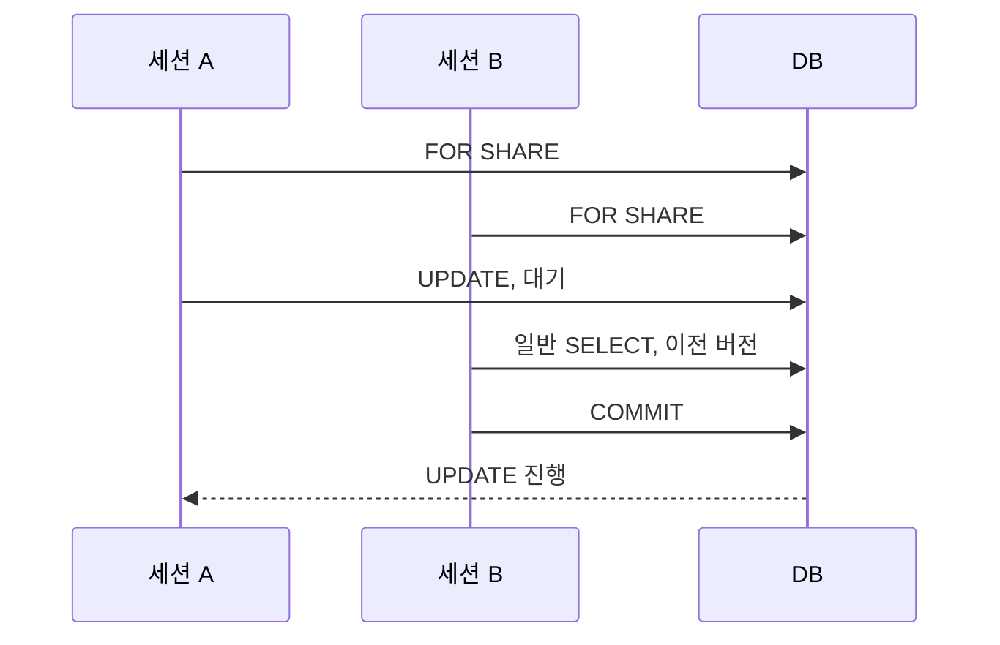

[섹션8: PostgreSQL 동시성 제어](/study/database/section-8-postgresql-concurrency/)에서 정리한 행 잠금이 실제로 어떻게 기다리는지 확인한다. 아래 출력은 기존 데이터베이스와 분리한 공식 `postgres:17.11` 임시 컨테이너 안에서 재현했다. 버전은 PostgreSQL 17.11이며, 세션 A/B는 별도의 `psql` 창 두 개다.

## 준비

```bash
docker run --rm --name section8-pg -e POSTGRES_PASSWORD=pw -p 127.0.0.1:55432:5432 -d postgres:17.11
until docker exec section8-pg pg_isready -U postgres; do sleep 1; done
docker exec -it section8-pg psql -U postgres
```

컨테이너가 준비된 뒤 psql에 접속한다. 실습을 끝내면 마지막 절의 `docker stop section8-pg`로 이 임시 인스턴스를 제거한다.

한 세션에서 다음을 실행한다.

```sql
CREATE SCHEMA section8;
CREATE TABLE section8.accounts(id int PRIMARY KEY, balance int NOT NULL);
INSERT INTO section8.accounts VALUES (1, 100), (2, 200);

CREATE TABLE section8.plan_accounts(id int PRIMARY KEY, balance int NOT NULL);
INSERT INTO section8.plan_accounts
SELECT n, n * 10 FROM generate_series(1, 10000) AS n;
ANALYZE section8.plan_accounts;

CREATE EXTENSION pgrowlocks;
CREATE TABLE section8.unique_only(
    id int PRIMARY KEY,
    external_key text UNIQUE,
    value int NOT NULL
);
INSERT INTO section8.unique_only VALUES (1, 'alpha', 0);
```



## 두 FOR SHARE는 공존한다

**확인할 내용** — 두 세션이 같은 행에 `FOR SHARE`를 얻고, 갱신이 대기하는지.
([정리 글](/study/database/section-8-postgresql-concurrency/#공부-내용--읽기는-버전을-고르고-쓰기는-행을-잠근다))

**쿼리 — 세션 A**

```sql
BEGIN;
SELECT id FROM section8.accounts WHERE id = 1 FOR SHARE;
```

반환된 뒤 A를 열어 둔 채 세션 B에서도 실행한다.

```sql
BEGIN;
SELECT id FROM section8.accounts WHERE id = 1 FOR SHARE;
```

**결과 — 두 세션 모두 반환**

```text
 id
----
  1
(1 row)
```

두 세션 모두 `COMMIT`하지 않은 채 A에서 다음을 실행한다.

```sql
UPDATE section8.accounts SET balance = balance + 1 WHERE id = 1;
```

**기대 결과** — A의 `UPDATE`는 B가 `FOR SHARE`를 해제할 때까지 대기한다.

**실제 결과** — A 명령은 대기했고, `pg_stat_activity`에서 해당 명령의 `wait_event_type`은 `Lock`, `wait_event`는 `transactionid`였다. 이때 B에서 다음 일반 조회는 대기 없이 기존 커밋 버전을 읽었다.

```sql
SELECT balance FROM section8.accounts WHERE id = 1;
```

```text
 balance
---------
     100
(1 row)
```

일반 SELECT는 A의 미커밋 변경을 기다리지 않고, 커밋된 이전 버전의 값 100을 반환했다. `pg_stat_activity`에서는 A가 `wait_event_type = Lock`, `wait_event = transactionid`로 대기하는 것을 확인했다. B를 `COMMIT`하자 A의 `UPDATE`가 `UPDATE 1`로 끝났다.

A에서도 `COMMIT`해 다음 실습을 위해 두 세션의 트랜잭션을 닫는다.

## 실제 외래 키가 없는 고유 키도 키 변경으로 취급한다

`section8.unique_only.external_key`에는 고유 인덱스만 있고, 이 컬럼을 참조하는 외래 키는 없다. PostgreSQL이 이 컬럼 값을 바꿀 때 어느 잠금 모드를 쓰는지 `pgrowlocks`로 확인한다.

**쿼리 — 세션 A**

```sql
BEGIN;
UPDATE section8.unique_only SET external_key = 'beta' WHERE id = 1;
```

A의 트랜잭션을 열어 둔 채, 세션 B에서 실행한다.

```sql
SELECT locked_row, multi, xids, modes
FROM pgrowlocks('section8.unique_only');
```

**기대 결과** — 이 고유 인덱스는 외래 키 참조 대상으로 쓸 수 있으므로, 실제 외래 키가 없어도 변경된 행이 `FOR UPDATE` 강도로 잠긴다.

**실제 결과 — PostgreSQL 17.11**

```text
 locked_row | multi | xids  |  modes
------------+-------+-------+---------
 (0,1)      | f     | {792} | {Update}
```

XID 값은 실행마다 달라진다. 핵심은 `modes`가 `{Update}`로 보고됐다는 점이다. 확인 후 세션 A에서 `ROLLBACK`해 임시 행을 원래 값으로 돌린다.

PostgreSQL 문서는 `pgrowlocks`가 실제 `UPDATE`를 `Update`, 명시적 `SELECT ... FOR UPDATE`를 `For Update`로 구분해 출력한다고 설명한다. 여기서 확인한 것은 실제 `UPDATE`가 키 강도의 잠금을 사용했다는 점이다. [`pgrowlocks` 출력 형식](https://www.postgresql.org/docs/17/pgrowlocks.html)을 참고한다.

## 반대 순서 잠금은 데드락을 만든다

**확인할 내용** — 두 트랜잭션이 여러 행을 반대 순서로 잠그면 PostgreSQL이 한쪽을 중단하는지.
([정리 글](/study/database/section-8-postgresql-concurrency/#심화--데드락은-잠금-대기-그래프의-순환이다))

**쿼리 — A**

```sql
BEGIN;
SELECT id FROM section8.accounts WHERE id = 1 FOR UPDATE;
-- B가 id=2를 잠근 뒤 실행
SELECT id FROM section8.accounts WHERE id = 2 FOR UPDATE;
```

**쿼리 — B**

```sql
BEGIN;
SELECT id FROM section8.accounts WHERE id = 2 FOR UPDATE;
-- A가 두 번째 쿼리에서 대기한 다음 실행
SELECT id FROM section8.accounts WHERE id = 1 FOR UPDATE;
```

**기대 결과** — 잠금 대기 그래프가 순환하면 한 세션에서 `deadlock detected`가 나오고 SQLSTATE는 `40P01`이다. 다른 쪽은 진행한다.

**실행 순서** — A가 첫 번째 쿼리로 id 1을 잠근다. B가 id 2를 잠근다. A에서 두 번째 쿼리를 실행해 대기 상태로 만든 뒤 B에서 두 번째 쿼리를 실행한다.

**실제 결과 — 세션 B가 중단됨.** 매번 달라지는 프로세스·트랜잭션 번호는 생략했다. `psql`의 `\errverbose`로 SQLSTATE `40P01`을 확인했다.

```text
ERROR:  40P01: deadlock detected
```

세션 A의 두 번째 잠금 요청은 B가 중단된 뒤 반환됐다. A는 이어 작업을 진행할 수 있다.

다음 실습 전 A에서 `COMMIT`, 오류가 난 B에서 `ROLLBACK`을 실행한다.

## 공유 잠금을 보유한 채 갱신하면 데드락이 될 수 있다

**확인할 내용** — 같은 행에 공유 잠금을 가진 두 세션이 모두 업데이트를 요청할 때의 순환.

**쿼리 — A와 B 모두 실행**

```sql
BEGIN;
SELECT id FROM section8.accounts WHERE id = 1 FOR SHARE;
```

두 세션 모두 공유 잠금을 가진 뒤 A에서:

```sql
UPDATE section8.accounts SET balance = balance + 1 WHERE id = 1;
```

A가 대기하면 B에서도 같은 `UPDATE`를 실행한다.

**기대 결과** — 각 세션의 `FOR SHARE`는 공존하지만 업데이트에 필요한 쓰기 잠금은 상대 세션의 공유 잠금과 충돌한다. PostgreSQL이 한 트랜잭션을 중단한다.

**실행 순서** — A와 B가 먼저 같은 id 1에 각각 `FOR SHARE`를 얻는다. 그 뒤 A가 `UPDATE`해 대기하는 것을 확인하고, B에서도 같은 `UPDATE`를 실행한다.

**실제 결과 — 세션 B가 중단됨.** 오류 SQLSTATE는 `40P01`이었다.

```text
ERROR:  40P01: deadlock detected
```

세션 A의 `UPDATE`는 `UPDATE 1`로 진행했다.

다음 실습 전 A에서 `COMMIT`, 오류가 난 B에서 `ROLLBACK`을 실행한다.

## UPDATE와 정렬 잠금의 계획을 비교한다

**확인할 내용** — `IN` 목록 순서와 `ORDER BY ... FOR UPDATE`의 실행 계획이 어떤 노드를 갖는지.

**쿼리**

```sql
EXPLAIN (ANALYZE, BUFFERS, COSTS OFF)
UPDATE section8.accounts SET balance = balance + 1 WHERE id IN (1, 2);

EXPLAIN (ANALYZE, BUFFERS, COSTS OFF)
SELECT id FROM section8.accounts WHERE id IN (1, 2) ORDER BY id FOR UPDATE;
```

이 절의 첫 쿼리는 데이터를 바꾼다. 격리된 실험용 컨테이너 안에서만 실행한다.

**실제 결과 — PostgreSQL 17.11, 두 행인 `accounts` 테이블**. `EXPLAIN ANALYZE`의 실행 시간은 생략하고 노드와 실제 행 수를 적었다.

```text
Update on accounts
  ->  Bitmap Heap Scan on accounts (actual rows=2 loops=1)
        Recheck Cond: (id = ANY ('{1,2}'::integer[]))
        ->  Bitmap Index Scan on accounts_pkey (actual rows=2 loops=1)
              Index Cond: (id = ANY ('{1,2}'::integer[]))

LockRows (actual rows=2 loops=1)
  ->  Sort
        Sort Key: id
        ->  Bitmap Heap Scan on accounts (actual rows=2 loops=1)
              Recheck Cond: (id = ANY ('{1,2}'::integer[]))
              ->  Bitmap Index Scan on accounts_pkey (actual rows=2 loops=1)
                    Index Cond: (id = ANY ('{1,2}'::integer[]))
```

이 실행에서 `UPDATE`는 비트맵 인덱스 스캔으로 후보를 찾았고, `ORDER BY`가 있는 SELECT는 `Sort` 결과를 `LockRows`에 전달했다. `UPDATE` 계획에는 `IN` 목록 순서를 보장하는 정렬 노드가 없다. 출력에서 계획 노드와 행 수를 남기고, 실행 시간과 버퍼 수치는 읽기에서 생략했다.

**실제 결과 — PostgreSQL 17.11, 1만 행의 `plan_accounts` 테이블**

```sql
EXPLAIN (ANALYZE, BUFFERS, COSTS OFF)
SELECT id FROM section8.plan_accounts WHERE id IN (100, 200) ORDER BY id FOR UPDATE;
```

```text
LockRows (actual rows=2 loops=1)
  ->  Index Scan using plan_accounts_pkey on plan_accounts (actual rows=2 loops=1)
        Index Cond: (id = ANY ('{100,200}'::integer[]))
```

이 표본에서는 기본 키 인덱스가 id 순서로 행을 내보내므로 별도 `Sort`가 없다. 두 계획은 모두 SQL의 `ORDER BY id`를 만족하지만, 데이터 규모와 계획에 따라 정렬을 만드는 노드가 달라진다.

## 정리 — 무엇을 확인했나

| 정리 글의 주장 | 확인 방법 | 결과 |
| --- | --- | --- |
| 두 FOR SHARE는 호환된다 | 두 psql 세션에서 같은 행을 잠금 | 양쪽 모두 반환 |
| 일반 SELECT는 행 잠금 대기 없이 읽는다 | UPDATE 대기 중 별도 SELECT | 기존 커밋 버전 반환 |
| 공유 잠금은 UPDATE와 충돌한다 | 공유 잠금 보유 중 UPDATE | transactionid 잠금 대기 |
| 참조 중이지 않은 고유 키도 키 잠금 기준이다 | 고유 키 갱신 중 `pgrowlocks` 조회 | `modes = {Update}` |
| `IN` 순서는 잠금 정렬 보장이 아니다 | 두 행 테이블의 UPDATE 실행 계획 | Bitmap Heap Scan, 정렬 요구 없음 |
| 정렬된 잠금 쿼리는 정렬 후 LockRows | SELECT FOR UPDATE 계획 | Sort 아래 LockRows |
| B-tree가 정렬을 만족하면 Sort가 생략된다 | 1만 행 표의 SELECT FOR UPDATE 계획 | Index Scan 아래 LockRows |
| 역순 잠금은 데드락을 만든다 | 별도 트랜잭션 두 개 | 한 세션 deadlock detected |
| 공유 잠금 보유 중 갱신 데드락 | 두 공유 잠금 뒤 양쪽 UPDATE | 세션 B deadlock detected, A는 진행 |

## 정리하기

```sql
DROP SCHEMA section8 CASCADE;
```

셸에서 임시 컨테이너를 중지·삭제한다.

```bash
docker stop section8-pg
```

## 참고

- [PostgreSQL 17 Explicit Locking](https://www.postgresql.org/docs/17/explicit-locking.html)
- [PostgreSQL 17 SELECT](https://www.postgresql.org/docs/17/sql-select.html)
