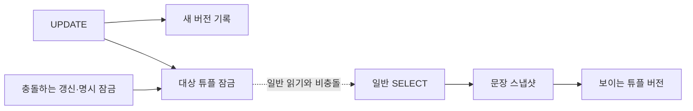
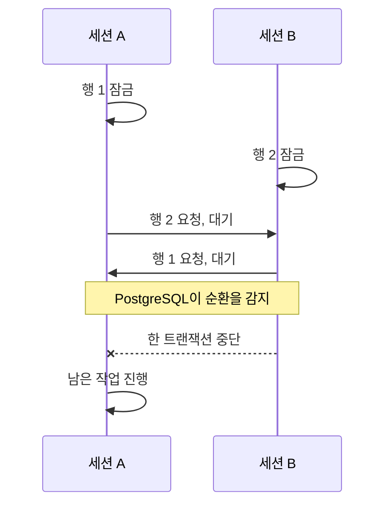
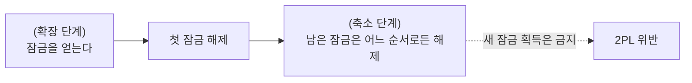

강의의 잠금 표를 외우고도 `UPDATE`가 실제로 어떤 잠금을 잡는지, 여러 행을 한 문장으로 바꾸면 어느 순서로 잠그는지는 남아 있었다. 이 글에서는 강의 내용과 그 뒤 문서·실행 계획으로 확인한 심화를 나눈다.

**공부 내용**은 MVCC와 잠금의 역할, **심화**는 동시 갱신·데드락·잠금 순서, **보충 개념**은 2단계 잠금의 뜻이다. 실습은 [섹션8 실습 1](/study/database/section-8-postgresql-concurrency-lab/)에서 재현한다.

## 공부 내용 — 읽기는 버전을 고르고 쓰기는 행을 잠근다

일반 `SELECT`는 행 잠금을 요청하지 않는다. PostgreSQL의 <abbr title="Multi-Version Concurrency Control. 여러 행 버전을 두고 읽는 쪽의 스냅샷에 맞는 버전을 선택하는 방식.">MVCC</abbr>에서 <abbr title="문장이 어느 시점까지 커밋된 변경을 읽는지 정하는 기준.">문장 스냅샷</abbr>에서 보이는 <abbr title="테이블의 한 행을 저장한 데이터 버전.">튜플 버전</abbr>을 읽으므로, 다른 트랜잭션이 그 행을 갱신 중이어도 보통 기다리지 않고 스냅샷에 맞는 버전을 읽는다. 조회 중 해당 행의 쓰기를 막는 행 수준 공유 잠금이 필요할 때는 `SELECT ... FOR SHARE`를 명시해야 한다.

이것과 별개로 PostgreSQL은 일반 `SELECT`에도 테이블 수준의 `ACCESS SHARE` 잠금을 자동으로 건다. <abbr title="테이블 객체의 정의와 존재를 보호하는 잠금 모드다. 테이블의 모든 행을 잠그는 뜻은 아니며, ACCESS SHARE는 ACCESS EXCLUSIVE와만 충돌한다.">테이블 잠금 모드</abbr>인 `ACCESS SHARE`는 행을 공유 잠그는 `FOR SHARE`와 다르다. 일반적인 데이터 변경이 테이블에 거는 `ROW EXCLUSIVE`와 호환되므로, 이 테이블 잠금 때문에 읽기와 쓰기가 서로 막히지는 않는다. 다만 `ACCESS EXCLUSIVE`처럼 `ACCESS SHARE`와 충돌하는 테이블 잠금은 일반 `SELECT`를 기다리게 할 수 있다.

### 무엇을 문서로 확인했고, 무엇을 직접 관찰했나

PostgreSQL이 일반 `SELECT`에 테이블 `ACCESS SHARE`를 자동으로 건다는 사실은 [PostgreSQL 17 잠금 문서](https://www.postgresql.org/docs/17/explicit-locking.html#LOCKING-TABLES)에서 확인했다. 앞서 실행한 실습에서는 다른 세션이 행에 `FOR SHARE`를 보유한 동안 일반 SELECT가 대기하지 않고 기존 튜플 버전을 읽는 것을 관찰했다. 그 실습은 `pg_locks`를 조회해 `ACCESS SHARE` 항목 자체를 따로 기록한 실험은 아니다.

테이블 잠금을 직접 확인하려면 같은 세션에서 트랜잭션을 열어 잠금을 유지한 채 다음을 실행할 수 있다.

```sql
BEGIN;
SELECT id FROM section8.accounts WHERE id = 1;

SELECT locktype, mode, granted
FROM pg_locks
WHERE pid = pg_backend_pid()
  AND relation = 'section8.accounts'::regclass
ORDER BY locktype, mode;

COMMIT;
```

이 조회에서 테이블 관계에 대한 `AccessShareLock`이 보인다. 이것은 테이블 잠금 확인이고, 행 잠금 여부는 `SELECT ... FOR SHARE`를 추가해 별도로 비교해야 한다.

테이블 잠금은 테이블 정의·존재에 영향을 주는 작업이나 테이블 단위 충돌을 조정하고, 행 잠금은 특정 튜플을 갱신·삭제하거나 `FOR SHARE`·`FOR UPDATE`처럼 명시적으로 잠그는 세션끼리 충돌을 조정한다. 이름에 `ROW`가 있는 테이블 잠금 모드(`ROW SHARE`, `ROW EXCLUSIVE`)도 행 자체를 잠근다는 뜻이 아니다.



먼저 아래 표는 **명시적으로 요청한 행 잠금 모드끼리**의 관계다. 예를 들어 한 트랜잭션이 `FOR NO KEY UPDATE`, 다른 트랜잭션이 `FOR SHARE`를 같은 행에 요청하면 충돌해 한쪽이 기다린다. `FOR NO KEY UPDATE`와 `FOR KEY SHARE`는 동시에 잡을 수 있다. 일반 `SELECT`는 행 잠금을 요청하지 않으므로 이 표의 행 잠금들과 충돌하지 않는다.

일반 `UPDATE`는 `SELECT ... FOR ...`처럼 잠금 절을 직접 쓰지 않지만, 갱신하는 행에 내부적으로 행 잠금을 건다. 키 컬럼을 바꾸지 않는 보통의 업데이트는 `FOR NO KEY UPDATE`와 같은 강도다. 그러므로 이 업데이트와 다른 트랜잭션의 `FOR KEY SHARE`는 함께 진행할 수 있지만, `FOR SHARE` 또는 같은 행의 다른 `UPDATE`는 기다려야 한다. 키 값을 실제로 바꾸는 업데이트는 더 강한 `FOR UPDATE` 강도를 사용한다. 네 모드의 전체 호환 관계는 바로 아래 표를 기준으로 보면 된다.

| 요청 | 의미와 대표 동작 |
| --- | --- |
| `FOR UPDATE` | 가장 강한 행 잠금이다. `DELETE`, 기본 키나 외래 키의 참조 대상이 될 수 있는 고유 키 값을 바꾸는 `UPDATE`, 그리고 명시적 `SELECT ... FOR UPDATE`가 취한다. |
| `FOR NO KEY UPDATE` | `FOR UPDATE`보다 약한 쓰기 행 잠금이다. 키 값을 바꾸지 않는 일반적인 `UPDATE`와 명시적 `SELECT ... FOR NO KEY UPDATE`가 취하며, `FOR KEY SHARE`만 동시에 허용한다. |
| `FOR SHARE` | 해당 행의 `UPDATE`·`DELETE`·`FOR UPDATE`·`FOR NO KEY UPDATE`를 막지만, 같은 `FOR SHARE`·`FOR KEY SHARE`와는 공존한다. |
| `FOR KEY SHARE` | 해당 행의 삭제·키 변경은 막지만, 일반 조회·일반 비키 컬럼 변경·다른 `FOR KEY SHARE`는 막지 않는다. |

행 잠금 호환성은 [PostgreSQL 행 잠금 표](https://www.postgresql.org/docs/17/explicit-locking.html#LOCKING-ROWS)에 정리돼 있다. `UPDATE ... WHERE`는 조건에 맞는 각 대상 행을 갱신하면서 행 잠금을 잡는다. 키 컬럼을 바꾸는지에 따라 적용되는 쓰기 행 잠금의 강도가 달라진다.

### `NO KEY`에서 키는 무엇을 가리키나

여기서 키는 외래 키 컬럼 자체를 뜻하지 않는다. PostgreSQL은 바꾸는 컬럼이 기본 키에 속하는지, 또는 **외래 키의 참조 대상으로 쓸 수 있는 고유 인덱스**에 속하는지를 본다. 실제 외래 키가 그 고유 키를 참조 중일 필요는 없다. 그래서 단순한 고유 키라도 그 고유 인덱스가 외래 키 대상이 될 수 있으면 키 변경으로 취급한다. 복합 키라면 구성 컬럼 중 하나를 바꾸는 경우가 해당한다. 다른 테이블 쪽의 FK 컬럼은 이 기준을 정하는 컬럼이 아니다. PostgreSQL 문서는 현재 부분 인덱스와 표현식 인덱스는 이 판단에 포함하지 않는다고 설명한다.

예를 들어 다음 스키마에서 `orders.account_id`는 부모 계정의 `id`를 참조한다. 자식의 `account_id`는 여러 주문이 같은 계정을 가리킬 수 있으므로 `UNIQUE`가 아니다.

```sql
CREATE TABLE accounts (
    id bigint PRIMARY KEY,
    balance numeric NOT NULL
);

CREATE TABLE orders (
    id bigint PRIMARY KEY,
    account_id bigint NOT NULL REFERENCES accounts(id)
);
```

`UPDATE accounts SET balance = balance - 10 WHERE id = 1`은 키를 그대로 두므로 보통 `FOR NO KEY UPDATE` 강도의 행 잠금을 취한다. `UPDATE accounts SET id = 2 WHERE id = 1`처럼 PK 값을 바꾸면 `FOR UPDATE` 강도의 잠금을 취한다. `orders`에 `account_id = 1`인 행을 넣는 트랜잭션은 FK를 검사할 때 부모의 `id = 1` 행을 보호한다. 그 보호는 부모의 잔액 변경과는 공존하지만 PK 변경·삭제와는 충돌한다. 참조하는 FK가 전혀 없는 `UNIQUE` 키를 바꿔도, 그 인덱스가 외래 키의 참조 대상으로 쓸 수 있다면 `FOR UPDATE` 강도로 잠근다. [실습에서 `pgrowlocks`로 확인한 결과](/study/database/section-8-postgresql-concurrency-lab/#실제-외래-키가-없는-고유-키도-키-변경으로-취급한다)도 이 기준과 일치한다.

따라서 “일반 `UPDATE`에 배타락이 걸린다”는 말은 넓은 의미의 쓰기 잠금을 가리키는 구어로는 통할 수 있지만, PostgreSQL의 정확한 행 잠금 모드는 대개 `FOR NO KEY UPDATE`다. `SELECT ... FOR UPDATE`가 요청하는 명시적 잠금과 항상 같은 모드라는 뜻은 아니다. [PostgreSQL 문서의 행 잠금 설명](https://www.postgresql.org/docs/17/explicit-locking.html#LOCKING-ROWS)은 `UPDATE`가 키 컬럼을 바꾸지 않을 때 `FOR NO KEY UPDATE`를 사용한다고 구분한다.

## 심화 — 대기 뒤에는 격리 수준이 결과를 바꾼다

두 세션이 같은 행을 갱신하면 먼저 잠금을 얻은 쪽이 트랜잭션을 끝낼 때까지 다른 쪽은 기다린다. `READ COMMITTED`에서 대기한 `UPDATE`는 먼저 커밋된 최신 행 버전을 대상으로 `WHERE` 조건을 다시 평가한다. 조건이 더는 참이 아니면 그 행은 갱신하지 않는다. 이는 문장 시작 스냅샷과 갱신 대상 행에 대한 재평가가 함께 작동하는 규칙이다.

`REPEATABLE READ`와 `SERIALIZABLE`은 트랜잭션 스냅샷을 유지한다. 그 스냅샷보다 뒤에 다른 트랜잭션이 같은 행을 바꿨다면, 대기한 쪽은 보통 직전 버전을 조용히 덮어쓰지 않고 <abbr title="동시 실행 결과를 직렬 실행과 양립시킬 수 없어 트랜잭션을 중단하는 오류.">serialization failure</abbr>(`40001`)로 중단된다. 애플리케이션은 전체 트랜잭션을 다시 실행해야 한다. `SERIALIZABLE`은 행 갱신 충돌만 보는 것이 아니라 읽기·쓰기 의존성도 추적해 직렬 실행과 모순되는 실행을 중단할 수 있다.

일반 `INSERT`도 데이터를 쓰므로 대상 테이블에는 테이블 수준의 `ROW EXCLUSIVE` 잠금을 건다. 새로 삽입한 행은 다른 트랜잭션의 문장 스냅샷에서 보이지 않고, 다른 트랜잭션이 그 미커밋 행을 행 잠금 대상으로 잡는 방식으로 보호되는 것도 아니다. 고유 인덱스에 같은 키를 동시에 넣으면 고유성 판단을 위해 서로 기다리거나 중복 키 오류가 날 수 있다. 이는 기존 행에 `FOR UPDATE`를 거는 것과는 다른 조정이다. FK가 있는 자식 행 삽입은 참조하는 부모 행을 확인하며 `FOR KEY SHARE`와 호환성 규칙을 따른다. `INSERT ... ON CONFLICT`는 고유 인덱스를 기준으로 경쟁을 조정한다. `DO UPDATE`는 커밋 또는 삽입 중 하나의 결과를 보장하고, `DO NOTHING`은 다른 세션의 미커밋 삽입을 기다린 뒤 삽입을 생략할 수 있다. [PostgreSQL 잠금 문서](https://www.postgresql.org/docs/17/explicit-locking.html#LOCKING-TABLES), [행 잠금 문서](https://www.postgresql.org/docs/17/explicit-locking.html#LOCKING-ROWS), [격리 수준별 갱신 규칙](https://www.postgresql.org/docs/17/transaction-iso.html), [`INSERT` 문서](https://www.postgresql.org/docs/17/sql-insert.html)를 구분해 읽어야 한다.

## 심화 — 데드락은 잠금 대기 그래프의 순환이다

트랜잭션 A가 1번 행을 잡고 2번 행을 기다리며, B가 2번 행을 잡고 1번 행을 기다리면 서로 진행할 수 없다. 명시적 `SELECT FOR UPDATE`뿐 아니라 일반 `UPDATE` 여러 개로도 일어난다. PostgreSQL은 데드락을 감지해 관련 트랜잭션 중 하나를 중단한다. 어느 쪽이 희생될지는 애플리케이션이 의존할 수 없으며, `40P01`을 받은 트랜잭션은 안전한 경계에서 재시도해야 한다.



또 다른 데드락은 두 트랜잭션이 같은 행을 `FOR SHARE`로 잠근 뒤 둘 다 `UPDATE`를 요청할 때 생긴다. 두 `FOR SHARE`는 공존하지만, 각 `UPDATE`가 요청하는 쓰기 행 잠금은 상대 트랜잭션의 `FOR SHARE`와 충돌한다. 둘 다 상대가 끝나길 기다리므로 데드락이다. 처음부터 필요한 잠금을 요청하거나, 모든 트랜잭션이 같은 순서로 자원을 잠그면 이 위험을 낮출 수 있다.

## 심화 — 다중 행의 잠금 순서는 SQL 문장 모양만으로 단정할 수 없다

`UPDATE accounts SET ... WHERE id IN (1, 2)`는 대상 집합을 뜻할 뿐, `IN` 목록의 나열 순서를 잠금 순서로 보장하지 않는다. 두 행뿐인 PostgreSQL 17.11 실험 테이블에서 `UPDATE`의 실제 계획은 `Bitmap Heap Scan`과 `Bitmap Index Scan`이었다. 이 계획 역시 이 데이터와 통계에서 관찰한 결과이지, 다른 환경에서 고정되는 순서는 아니다.

실제 계획을 보면 차이가 분명하다. 아래는 앞의 실습 글에서 격리된 PostgreSQL 17.11 테이블에 실행한 결과다. 첫 계획은 두 행뿐인 `section8.accounts`, 마지막 계획은 1만 행이 든 별도 `section8.plan_accounts`에서 얻었다. 첫 쿼리는 데이터를 바꾸므로 실습용 데이터에서만 실행한다.

```sql
EXPLAIN (ANALYZE, BUFFERS, COSTS OFF)
UPDATE section8.accounts SET balance = balance + 1 WHERE id IN (1, 2);
```

```text
Update on accounts
  ->  Bitmap Heap Scan on accounts
        Recheck Cond: (id = ANY ('{1,2}'::integer[]))
        ->  Bitmap Index Scan on accounts_pkey
              Index Cond: (id = ANY ('{1,2}'::integer[]))
```

여기에는 `Sort`가 없다. `IN (1, 2)`를 썼다고 해서 1번 행부터 잠근다는 뜻이 아니다. 이 `Bitmap Heap Scan`은 조건에 맞는 행을 찾을 뿐, `IN`에 적은 순서를 보장하지 않는다.

같은 데이터에서 정렬한 뒤 잠그는 쿼리는 다음 계획이었다.

```sql
EXPLAIN (ANALYZE, BUFFERS, COSTS OFF)
SELECT id FROM section8.accounts WHERE id IN (1, 2) ORDER BY id FOR UPDATE;
```

```text
LockRows
  ->  Sort
        Sort Key: id
        Sort Method: quicksort  Memory: 25kB
        ->  Bitmap Heap Scan on accounts
              Recheck Cond: (id = ANY ('{1,2}'::integer[]))
              ->  Bitmap Index Scan on accounts_pkey
                    Index Cond: (id = ANY ('{1,2}'::integer[]))
```

이 계획에서는 아래쪽 `Bitmap Index Scan`과 `Bitmap Heap Scan`이 후보 행을 찾고, `Sort`가 id 순으로 결과를 만든 다음, 그 위의 `LockRows`가 결과를 받아 잠금을 요청한다. 따라서 **이 실행에서는** 정렬된 순서로 잠금 요청이 이뤄진다. 계획을 확인할 때 `LockRows`와 그 입력 쪽의 정렬 노드를 함께 보는 이유다. 계획은 글 아래 실습처럼 두 행인 테이블에서 관찰했다.

행 수가 1만 개인 별도 표본에서는 기본 키 B-tree가 정렬을 만족해 `Sort`가 필요 없었다.

```sql
EXPLAIN (ANALYZE, BUFFERS, COSTS OFF)
SELECT id FROM section8.plan_accounts WHERE id IN (100, 200) ORDER BY id FOR UPDATE;
```

```text
LockRows
  ->  Index Scan using plan_accounts_pkey on plan_accounts
        Index Cond: (id = ANY ('{100,200}'::integer[]))
```

`ORDER BY id`의 결과 순서는 두 계획 모두 지킨다. 한 계획은 `Sort`로, 다른 계획은 id 순으로 읽는 B-tree 인덱스 스캔으로 그 순서를 만든다. `LockRows`가 입력 행을 처리하는 순서도 각각 그 정렬 결과 또는 인덱스 스캔 결과를 따른다. 반면 `UPDATE ... WHERE id IN (...)`에는 결과 정렬 요구가 없으므로 그 쿼리 계획만으로 `IN`에 적은 순서를 보장할 수 없다.

이 결과는 이 쿼리와 데이터에서 관찰한 계획이지 모든 실행의 보장은 아니다. 다른 통계·인덱스·조인·파티션 조건에서는 계획이 달라질 수 있고, `UPDATE ... WHERE id IN (...)`의 잠금 순서와도 별개다. 정렬된 사전 잠금은 같은 행 집합을 다루는 트랜잭션이 같은 계획과 순서 규칙을 사용하게 설계할 때 데드락 위험을 낮춘다. 모든 경로가 그 규칙을 따르지 않거나 추가 행을 다른 순서로 잠그면 데드락은 여전히 가능하다. PostgreSQL `UPDATE` 문서는 갱신할 행을 정렬된 서브쿼리로 선택하는 방법이 동시 갱신의 데드락을 줄이는 데 도움이 될 수 있다고 설명한다.

또한 `READ COMMITTED`에서 `ORDER BY ... FOR UPDATE`는 먼저 정렬하고 잠금을 기다리는 동안 정렬 키가 바뀌면 반환 결과가 현재 값 기준으로 정렬되지 않을 수 있다. 엄격한 결과 순서가 필요하면 문서의 서브쿼리 방식이 있지만, 더 많은 행을 잠글 수 있다. 계획을 확인할 때는 `EXPLAIN`을 보고, 동시성 보장은 실제 데이터베이스·격리 수준·쿼리 범위를 함께 따져야 한다. [`SELECT`의 locking clause 주의사항](https://www.postgresql.org/docs/17/sql-select.html#SQL-FOR-UPDATE-SHARE)과 [`UPDATE` 문서](https://www.postgresql.org/docs/17/sql-update.html)를 참고한다.

## 보충 개념 — 2단계 잠금은 획득·해제의 순서 규칙이다

2단계 잠금(two-phase locking, 2PL)은 **잠금을 얻는 동안에는 해제하지 않고, 하나라도 해제한 뒤에는 새 잠금을 얻지 않는 규칙**이다. 처음 잠금을 해제한 시점부터 축소 단계다. 잠금을 얻은 순서와 반대로 풀어야 한다는 뜻은 아니다.



규칙만 보면 `잠금 A 획득 → 잠금 B 획득 → A 해제 → B 해제`는 가능하다. 반면 `A 획득 → A 해제 → B 획득`은 A를 해제한 뒤 새 잠금 B를 얻었으므로 2PL을 어긴다. A와 B를 얻었으면 B부터 풀어야 한다는 규칙은 없다.

PostgreSQL에서 행 잠금은 SQL 문장이 끝나도 트랜잭션이 끝날 때까지 유지된다. 다음 예에서는 `SELECT` 다음에 애플리케이션 코드가 실행되는 동안에도 행 잠금이 남아 있고, `COMMIT`할 때 해제된다. 실행 환경은 PostgreSQL 17이며, 임시 테이블만 사용한다.

```sql
CREATE TEMP TABLE lock_demo (id integer PRIMARY KEY);
INSERT INTO lock_demo VALUES (1);

BEGIN;
SELECT id FROM lock_demo WHERE id = 1 FOR UPDATE; -- 행 잠금 획득
-- 여기서 SELECT 문장만 끝났고, 트랜잭션은 계속 열려 있다.
COMMIT; -- 행 잠금 해제
```

이 예시는 PostgreSQL에서 행 잠금이 언제 풀리는지를 보여준다. `FOR UPDATE`를 두 번 쓰는 것이 2PL의 정의는 아니다. PostgreSQL은 저장점 뒤에서 얻은 잠금을 `ROLLBACK TO SAVEPOINT` 때 풀 수도 있다. 이는 그 저장점 뒤의 작업을 롤백하는 동작이다. [PostgreSQL 잠금 문서](https://www.postgresql.org/docs/17/explicit-locking.html#LOCKING-ROWS)

실행 계획은 2PL 여부나 단계를 보여주지 않는다. `EXPLAIN`에서 `LockRows`가 보이면 그 문장에 행 잠금 절이 있다는 점만 확인할 수 있다. `EXPLAIN ANALYZE`는 문장을 실제 실행하지만, 트랜잭션 전체의 잠금 획득·해제 이력은 보여주지 않는다.

## 배경 지식 — 행 잠금은 semaphore 하나로 구현되지 않는다

여기서 말하는 `FOR SHARE`와 `FOR UPDATE`는 SQL에서 보이는 **행 잠금 모드**다. PostgreSQL은 행마다 공유 메모리에 semaphore를 하나씩 만들어 두지 않는다. 튜플 헤더의 `xmax`와 <abbr title="튜플 상태와 잠금 모드를 구분하려고 헤더에 저장하는 비트.">infomask 비트</abbr>에 “어느 트랜잭션이 이 튜플을 잠갔거나 갱신했는가”와 잠금 강도를 기록한다. 따라서 `xmax`가 유효하다고 해서 그 튜플이 반드시 삭제됐다는 뜻은 아니다. 삭제나 갱신의 표식일 수도 있고, **잠금만 기록**할 수도 있다. `HEAP_XMAX_LOCK_ONLY` 같은 infomask 비트로 두 경우를 구별한다.

여러 트랜잭션이 같은 행을 동시에 잠그면 튜플 헤더 한 칸에 <abbr title="트랜잭션을 식별하는 번호.">XID</abbr> 하나만 담을 수 없으므로 <abbr title="동시에 행을 잠근 여러 트랜잭션과 각 잠금 모드를 나타내는 식별자.">MultiXact ID</abbr>를 쓸 수 있다. 이때 튜플의 `xmax`에는 MultiXact ID가 들어가고, 구성원 XID와 잠금 모드 정보는 `pg_multixact`에 저장된다. 이 역시 `xmax`가 삭제 표시라고만 볼 수 없는 이유다. 따라서 공유 잠금은 “세마포어의 공유 카운터”가 아니라 튜플 헤더와 트랜잭션 상태를 이용해 기록·판정된다.

경쟁하는 세션이 충돌하는 잠금을 요청하면 PostgreSQL은 상대 트랜잭션의 종료를 기다린다. 실제 대기는 heavyweight lock manager의 트랜잭션 잠금(`transactionid`) 등으로 조정된다. 이 과정에는 내부 자료구조 보호를 위한 LWLock 같은 동기화 장치도 쓰이지만, 이것을 SQL 행 잠금 자체와 동일시하면 안 된다. 즉 “PostgreSQL 내부에 semaphore나 동기화 primitive가 전혀 없다”가 아니라, **행마다 semaphore를 두어 SQL 공유/배타 잠금을 구현하는 것은 아니다**가 정확한 표현이다.

잠긴 행의 기록이 튜플에 남기 때문에 많은 행을 잠가도 각 행마다 lock manager 객체를 따로 저장할 필요가 없다. 반면 여러 공유 잠금이 한 행에 겹치면 MultiXact 메타데이터가 생기므로 PostgreSQL은 vacuum으로 오래된 XID·MultiXact 상태를 정리하고 wraparound를 관리한다.

자세한 설명은 PostgreSQL 17의 [Transactions and Locking](https://www.postgresql.org/docs/17/xact-locking.html), [MultiXacts와 vacuum](https://www.postgresql.org/docs/17/routine-vacuuming.html#VACUUM-FOR-MULTIXACT-WRAPAROUND), 그리고 PostgreSQL 소스의 [`README.tuplock`](https://github.com/postgres/postgres/blob/REL_17_STABLE/src/backend/access/heap/README.tuplock)을 참고한다.

## 정리

| 상황 | 기억할 기준 |
| --- | --- |
| 일반 조회와 갱신 | 일반 SELECT는 스냅샷 버전을 읽고, 명시 행 잠금과 쓰기끼리 충돌한다. |
| 같은 행 동시 갱신 | READ COMMITTED는 대기 후 조건을 다시 보고, 더 강한 격리 수준은 serialization failure가 날 수 있다. |
| 여러 행 갱신 | 공통된 순서를 정해 사전 잠금하면 위험을 줄이지만 계획과 범위를 확인한다. |
| 데드락 | 감지 후 한 트랜잭션이 중단되며, 애플리케이션은 재시도를 고려한다. |

다음에 잠금 대기를 보면 SQL 키워드만 보지 말고, 먼저 어떤 행·어떤 모드인지 확인한다. 그다음 격리 수준과 대기 중인 상대 트랜잭션을 보고, 다중 행이면 각 참여 쿼리의 실행 계획과 획득 순서를 비교한다.

## 참고

- [Fundamentals of Database Engineering](https://www.udemy.com/course/database-engineering-korean/) — Hussein Nasser
- [PostgreSQL 17 MVCC](https://www.postgresql.org/docs/17/mvcc-intro.html), [잠금](https://www.postgresql.org/docs/17/explicit-locking.html), [트랜잭션 격리](https://www.postgresql.org/docs/17/transaction-iso.html)
- [Django 5.2 QuerySet API](https://docs.djangoproject.com/en/5.2/ref/models/querysets/#select-for-update)
