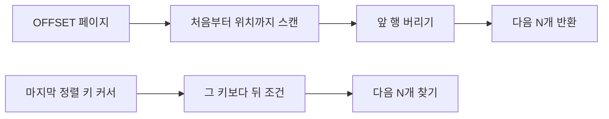

페이지네이션은 화면에서 몇 개씩 나눠 보이는 문제처럼 보이지만, 데이터가 커지거나 페이지 사이에 행이 바뀌면 쿼리의 비용과 의미가 달라진다. 핵심은 페이지 번호를 행 위치로 해석할지, 마지막으로 본 정렬 키로 해석할지다.

아래 SQL은 PostgreSQL 17에서 `posts(id bigint PRIMARY KEY, created_at timestamptz NOT NULL, title text)` 테이블을 조회하는 예다. 실제 서비스에서는 예시 커서 값을 드라이버의 바인드 변수로 전달한다.

**공부 내용**에서 OFFSET과 커서 방식의 차이를 잡고, **심화**에서 복합 정렬 키로 페이지 경계를 표현한다. 실습은 [섹션8 실습 2](/study/database/section-8-postgresql-pagination-lab/)에서 PostgreSQL 17.11로 확인한다.

## 공부 내용 — OFFSET은 앞의 행을 지나간다

```sql
SELECT id, created_at, title
FROM posts
ORDER BY created_at DESC, id DESC
LIMIT 20 OFFSET 100000;
```

`OFFSET`은 건너뛸 행을 찾아 버린 뒤 다음 행을 반환한다. 페이지가 깊을수록 앞의 행을 더 많이 처리해야 해 비용이 커질 수 있다. 정렬이 유일하지 않으면 페이지 경계가 실행마다 달라질 수 있으므로 고유한 타이브레이커를 정렬에 추가해야 한다.

동시에 앞쪽에 새 행이 들어오면 다음 요청에서 기존 행이 한 칸 밀려 중복될 수 있고, 앞 행이 삭제되면 한 칸 당겨져 건너뛸 수 있다. `ORDER BY`는 한 쿼리 결과의 순서를 정하지만 여러 페이지 요청을 하나의 고정 스냅샷으로 묶어 주지는 않는다.



## 심화 — 커서는 위치가 아니라 정렬 경계다

정렬 키가 고유한 단일 `id`라면 오름차순에서 다음 페이지는 `WHERE id > 42 ORDER BY id LIMIT 20`처럼 쓸 수 있다. 여기서 `42`는 직전 페이지 마지막 행의 id 예시다. 내림차순이면 부등호 방향을 바꾼다. 커서는 “페이지 번호”가 아니라 이미 전달한 마지막 행의 키를 뜻한다.

실제 목록은 `created_at`이 같을 수 있으므로 `(created_at, id)`처럼 유일한 복합 정렬 키를 쓴다. 두 컬럼을 내림차순으로 읽는 예시는 다음과 같다.

```sql
SELECT id, created_at, title
FROM posts
WHERE (created_at, id) < (timestamptz '2026-01-01 00:00:08+00', 26)
ORDER BY created_at DESC, id DESC
LIMIT 20;
```

행 비교는 사전식 순서다. 먼저 `created_at`이 더 과거인 행이 오고, 시간이 같으면 `id`가 더 작은 행이 온다. 첫 페이지에는 커서 조건을 넣지 않는다. 다음 커서는 반환된 페이지에서 가장 마지막 행의 `(created_at, id)`를 그대로 저장한다. 중간 행이나 다음 페이지 첫 행을 쓰면 경계가 겹치거나 빠진다.

커서 조건은 마지막 키보다 뒤에 있는 행만 찾도록 만든다. 그래서 `(created_at, id)` 순서에 맞는 복합 B-tree 인덱스를 두면 그 경계부터 탐색하는 계획을 선택할 수 있다. 인덱스의 구조와 열 순서는 [섹션4 인덱스 정리](/study/database/section-4-indexing/)에서 다뤘으므로 여기서는 반복하지 않는다. 실습 글에서는 이 쿼리의 실행 계획을 확인한다.

정렬은 오름차순·내림차순이나 문자열 순서 등 화면 요구에 맞게 정한다. 중요한 점은 각 행의 정렬 값이 페이지를 넘기는 사이 바뀌면 그 행이 커서 경계를 이동한다는 것이다. 예를 들어 내림차순에서 아직 읽지 않은 행의 `created_at`이 더 최근 시각으로 바뀌면 다음 페이지 조건에서 빠져 누락될 수 있다. 이미 읽은 행의 시각이 더 오래된 쪽으로 바뀌면 다음 페이지에 다시 나타날 수 있다. 삽입·삭제도 여러 요청 사이 결과를 바꾸므로 커서 방식은 전체 페이지를 하나의 고정 스냅샷으로 만들지 않는다.

## 정리

| 방식 | 페이지 경계 | 깊은 페이지 비용 | 동시 변경 |
| --- | --- | --- | --- |
| OFFSET | 행 위치 | 앞의 행을 지나가므로 누적 | 삽입·삭제에 따라 중복·누락 가능 |
| 단일 키 커서 | 마지막 고유 키 | 경계 이후 탐색 | 키가 안정적이면 앞쪽 변경 영향이 작다 |
| 복합 keyset | 마지막 복합 정렬 키 | 복합 B-tree 범위 탐색 | 고유 타이브레이커와 안정적 정렬이 중요 |

먼저 화면에 필요한 정렬을 고정하고 마지막 행의 키를 커서로 만든다. 복합 정렬이라면 정렬 키 전체를 커서와 다음 페이지 조건에 넣는다. 실습에서는 같은 조건을 실행 계획으로 확인한다.

## 참고

- [Fundamentals of Database Engineering](https://www.udemy.com/course/database-engineering-korean/) — Hussein Nasser
- [섹션4: PostgreSQL 인덱스 정리](/study/database/section-4-indexing/)
