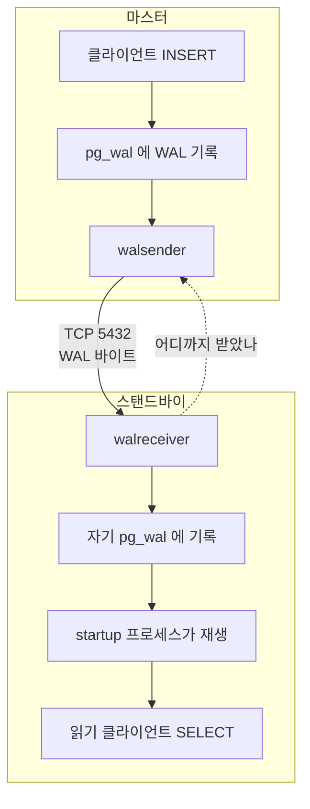
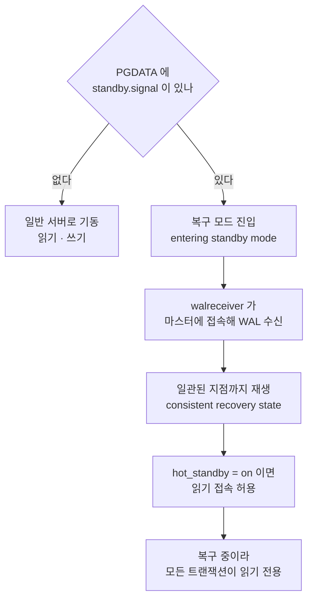
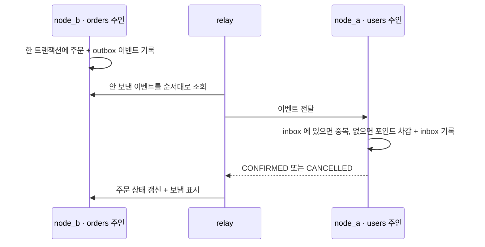

강의는 마스터 한 대가 쓰고 스탠드바이가 따라 쓰는 구조, 그리고 여러 노드가 같이 쓰는
멀티 마스터를 보여 줬다. 설정 파일 몇 줄을 고치고 컨테이너를 띄우니 복제가 됐다.
그런데 세 가지가 안 풀렸다. 마스터의 변경은 **무슨 절차로** 스탠드바이까지 가는가.
스탠드바이는 **무엇을 보고** 자기가 읽기 전용이라는 걸 아는가.
멀티 마스터에서 두 노드가 같은 행을 고치면 **락은 어떻게 되는가.**

파고들어 얻은 결론은 이렇다. **복제는 WAL 을 TCP 연결 하나로 흘려보내 스탠드바이가 그대로
재생하는 것이다.** 스탠드바이는 무언가를 감지해서 읽기 전용이 되는 게 아니라, `standby.signal`
파일 때문에 **처음부터 복구 모드로 떠서** 쓰기가 막힌다. 멀티 마스터에서 행 락은 **자기 노드
안에서만** 유효하다. 그래서 충돌을 사후에 해결하기보다 데이터마다 쓰기 주인을 하나로 정하는
편이 낫고, 주인이 다른 데이터를 함께 바꿀 때는 outbox 와 relay 로 잇는다.

**공부 내용**은 강의가 알려준 것, **심화**는 거기서 파고든 것,
**보충 개념**은 그걸 이해하려다 걸린 DB 일반 용어다.

강의는 DB 종류를 따로 정하지 않았지만 `standby.signal`, `pg_hba.conf` 같은 용어로 보아
PostgreSQL 기준으로 정리했다. 아래 출력은 전부 PostgreSQL 18 컨테이너에서 직접 받은 것이다.
재현 과정은 실습 글 두 개로 따로 뺐다.

## 공부 내용 — 같은 데이터를 여러 노드에 둔다

레플리케이션은 같은 데이터를 여러 노드에 두는 것이다. 이유는 셋이다.
조회를 여러 대로 나누는 **읽기 확장**, 마스터가 죽어도 같은 데이터가 남는 **고가용성**,
백업·통계 같은 무거운 읽기를 운영 DB 에서 떼어내는 **부하 분리**.

| 구조 | 쓰기 | 장점 | 대가 |
| --- | --- | --- | --- |
| 마스터 · 스탠드바이 | 마스터 한 곳 | 쓰기 지점이 하나라 정합성이 쉽다 | 쓰기는 늘릴 수 없다 |
| 멀티 마스터 | 여러 노드 | 쓰기를 늘릴 수 있다 | 같은 데이터를 두 곳에서 쓰면 충돌한다 |

| 방식 | 커밋 응답 시점 | 대가 |
| --- | --- | --- |
| 동기 | 스탠드바이가 받았다고 답한 뒤 | 스탠드바이가 멈추면 마스터 커밋도 멈춘다 |
| 비동기 | 마스터 디스크에 쓰자마자 | 마스터가 죽으면 아직 못 보낸 변경이 사라진다 |

강의에서 본 것과 거기서 생긴 질문을 정리하면 이렇다. 답은 전부 심화에 있다.

| 강의에서 본 것 | 거기서 생긴 질문 |
| --- | --- |
| 스탠드바이 설정에 마스터 주소를 적는다 | 누가 누구에게 연결하나. 마스터가 밀어 주나, 스탠드바이가 당겨 가나 |
| 스탠드바이에 `standby.signal` 파일을 만든다 | 이 빈 파일 하나로 어떻게 읽기 전용이 되나 |
| 동기 복제는 스탠드바이 응답을 기다린다 | "받았다"는 게 메모리인가, 디스크인가, 테이블인가 |
| 멀티 마스터는 충돌이 생길 수 있다 | 락은 어디에 걸리고, 충돌하면 실제로 무슨 일이 일어나나 |

## 심화 — 복제는 어떻게 흐르나

여기부터는 강의 밖이다.

### WAL 을 TCP 연결 하나로 흘려보낸다

물리 복제는 SQL 문장을 다시 실행하는 게 아니다. 마스터가 디스크 페이지를 어떻게 바꿨는지
적은 <abbr title="Write-Ahead Log. 데이터 파일을 고치기 전에 변경 내용을 먼저 순서대로 적어 두는 로그">WAL</abbr> 을 그대로 복사한다.
스탠드바이는 그걸 장애 복구 때와 **똑같은 코드로** 재생한다. 그래서 스탠드바이는 바이트 단위로
마스터와 같은 클러스터가 된다.



실습 컨테이너에서 프로세스를 찍으면 이 세 개가 보인다.

```text
postgres: walsender replicator 172.18.0.3(33756) streaming 0/304E140   # 마스터
postgres: walreceiver streaming 0/304E140                              # 스탠드바이
postgres: startup recovering 000000010000000000000003                  # 스탠드바이
```

뒤에 붙은 `0/304E140` 이 [LSN](/study/database/section-2-acid/#lsn--재생을-두-번-해도-안전한-이유 "Log Sequence Number. WAL 스트림 안에서의 바이트 위치다") 이다.
양쪽 숫자가 같으면 스탠드바이가 마스터를 다 따라잡았다는 뜻이다.

### 연결은 스탠드바이가 건다

방향부터 짚는다. 마스터가 스탠드바이를 찾아가는 게 아니다. **스탠드바이가 손님처럼 마스터에
접속해서 "복제하러 왔다"고 말한다.** 단계마다 목적이 있다.

| 단계 | 하는 일 | 왜 |
| --- | --- | --- |
| TCP 연결 | `primary_conninfo` 의 `host:5432` 로 접속 | 말을 하려면 먼저 연결돼야 한다 |
| 용건 밝히기 | `replication=true` 로 접속 → 마스터가 walsender 를 새로 띄운다 | 복제 손님에게는 전담 프로세스가 붙는다 |
| 출입 명단 확인 | `pg_hba.conf` 에 `replication` 줄이 있는지 본다 | 아무나 DB 전체를 복사해 가면 안 된다 |
| 신분 확인 | `REPLICATION` 권한이 있는 계정으로 로그인 | 명단의 그 사람이 맞는지 확인한다 |
| 시작 위치 지정 | `START_REPLICATION` + 시작 LSN | 끊긴 곳부터 이어 받으려고 |
| 계속 주고받기 | 마스터는 WAL 을, 스탠드바이는 수령 확인을 보낸다 | 다음 절 |

가운데 세 단계는 일반 `psql` 접속과 같은 절차다. 다른 점은 "복제 손님" 표시와
`pg_hba.conf` 의 `replication` 키워드뿐이다. `DATABASE` 칸에 `all` 을 써도 복제 접속은
허용되지 않는다.

### 오가는 메시지는 두 종류다

연결이 끝나면 메시지는 두 가지만 오간다.

| 메시지 | 방향 | 담긴 것 |
| --- | --- | --- |
| XLogData | 마스터 → 스탠드바이 | WAL 바이트 묶음과 그 묶음의 시작 LSN, 마스터가 지금까지 쓴 끝 LSN, 보낸 시각 |
| Standby Status Update | 스탠드바이 → 마스터 (주기적으로) | write · flush · apply 세 위치 |

택배 상자와 수령 확인 문자라고 생각하면 된다. 수령 확인에 위치가 **세 개** 들어가는 게 핵심이다.

- **write** — 받아서 WAL 파일에 썼다. 아직 OS 메모리에 있을 수 있다.
- **flush** — WAL 파일을 디스크에 확정했다. 정전이 나도 남는다. 하지만 테이블에는 아직 없다.
- **apply** — WAL 을 재생해 테이블에 반영했다. 이제 `SELECT` 에 보인다.

flush 와 apply 는 다르다. flush 는 "기록장에 적어 뒀다"이고 apply 는 "기록장대로 실제로 고쳤다"이다.
둘 사이에 시간 차이가 있어서, 디스크에는 있는데 조회하면 안 보이는 순간이 생긴다.

마스터는 이 확인을 세 군데에 쓴다. 오래된 WAL 을 지워도 되는지 판단하고,
동기 복제라면 기다리던 커밋을 풀어 주고, `pg_stat_replication` 의 지연 시간을 계산한다.

```text
application_name | standby1
client_addr      | 172.18.0.3
client_port      | 33756
state            | streaming
sync_state       | async
sent_lsn         | 0/3002758
write_lsn        | 0/3002758
flush_lsn        | 0/3002758
replay_lsn       | 0/3002758
replay_lag       | 00:00:00.000686
```

`client_addr`, `client_port` 가 스탠드바이 walreceiver 의 TCP 소켓이다.
`write_lsn`, `flush_lsn`, `replay_lsn` 이 수령 확인의 세 위치이고, 전부 `sent_lsn` 과 같으니 지연이 없다.

### 위치는 스탠드바이가 정하고 전달은 마스터가 밀어준다

push 방식이면 연결이 잠깐 끊긴 사이에 보낸 걸 놓치지 않을까 걱정이 됐다.
pull 은 놓쳐도 그 지점부터 다시 읽으면 되니까. 답은 **둘을 섞는다**는 것이다.

- **pull** — 어디서부터 받을지는 스탠드바이가 정한다. 접속할 때 "이 LSN 부터 달라"고 요청하고,
  다시 접속하면 마지막으로 디스크에 저장한 지점부터 또 요청한다.
- **push** — 연결이 맺어진 뒤에는 마스터의 walsender 가 새 WAL 이 생기는 대로 바로 밀어 준다.
  매번 요청·응답을 왕복하지 않으니 지연이 짧다.

연결 하나를 열어 두고 서버가 계속 밀어 준다는 점은 웹소켓과 비슷하다. 다른 점은 받은 쪽이
**자기가 어디까지 받았는지 LSN 으로 기억한다**는 것이다. 그래서 끊겨도 놓치지 않는다.

| 놓치지 않게 하는 장치 | 역할 |
| --- | --- |
| TCP | 빠진 패킷은 재전송하고, 앱에는 순서대로만 넘긴다. 복구가 안 되면 연결이 끊긴다 |
| WAL 레코드 연결 검사 | 레코드마다 바로 앞 레코드 위치와 체크섬이 있다. 구멍이 있으면 재생을 멈추고 그 지점부터 다시 요청한다 |
| [레플리케이션 슬롯](#레플리케이션-슬롯 "스탠드바이가 아직 못 받은 WAL 을 마스터가 지우지 못하게 붙잡아 두는 책갈피") | 스탠드바이가 확인한 위치 이전의 WAL 만 지울 수 있다 |
| 타임아웃 | 조용히 죽은 연결은 `wal_receiver_timeout` · `wal_sender_timeout` (기본 60초) 이 잡아낸다 |

실습에서 스탠드바이를 껐다 켜자 로그에 이 줄이 찍히며 이어 받았다.

```text
LOG:  started streaming WAL from primary at 0/3000000 on timeline 1
```

### 동기 복제는 커밋이 어디까지 기다리느냐다

동기와 비동기의 차이는 **커밋이 응답하기 전에 스탠드바이의 어느 단계까지 기다리느냐**다.
`synchronous_commit` 값이 위의 write · flush · apply 와 그대로 맞물린다.

| `synchronous_commit` | 커밋 응답 시점 | 유실 위험 |
| --- | --- | --- |
| `local` | 마스터 디스크에 WAL 을 쓴 뒤 | 마스터가 죽으면 아직 못 보낸 변경 |
| `remote_write` | 스탠드바이 write 뒤 | 스탠드바이 OS 가 같이 죽으면 |
| `on` | 스탠드바이 flush 뒤 | 없음 |
| `remote_apply` | 스탠드바이 apply 뒤 | 없음. 커밋 직후 스탠드바이에서 조회해도 보인다 |

이 값은 `synchronous_standby_names` 에 스탠드바이 이름이 있을 때만 의미가 있다. 비어 있으면
`on` 이어도 마스터 디스크까지만 기다린다. `on` 은 데이터는 안전하지만 apply 까지는 안 기다리므로,
커밋 직후 스탠드바이에서 조회하면 아직 안 보일 수 있다.

동기 모드에서 스탠드바이를 끄고 `INSERT` 를 하면 커밋이 멈춘다.

```text
 wait_event_type | wait_event | state
-----------------+------------+--------
 IPC             | SyncRep    | active
```

스탠드바이를 다시 켜자 그제야 `INSERT 0 1` 이 돌아왔다. 동기 복제는 정합성을 얻는 대신 가용성을
내준다. 그래서 보통 스탠드바이를 두 대 이상 두고 `ANY 1 (s1, s2)` 처럼 그중 하나만 답하면 되게 건다.

## 심화 — 스탠드바이는 왜 읽기 전용인가

### 감지가 아니라 복구 모드로 기동한다

처음엔 스탠드바이가 마스터와 연결된 걸 감지해서 쓰기를 막는다고 생각했다. 아니다.
**스탠드바이는 처음부터 복구 모드로 뜨기 때문에 쓰기가 막힌다.** 서버가 확인하는 것은
데이터 디렉터리에 있는 빈 파일 하나, `standby.signal` 이다.



실습 스탠드바이 로그에도 이 순서가 그대로 찍힌다.

```text
LOG:  entering standby mode
LOG:  redo starts at 0/2000028
LOG:  consistent recovery state reached at 0/2000120
LOG:  database system is ready to accept read-only connections
LOG:  started streaming WAL from primary at 0/3000000 on timeline 1
```

"읽기 접속 허용"은 말 그대로 이 시점부터 클라이언트 접속을 받기 시작한다는 뜻이다.
데이터가 일관된 지점에 닿기 전에는 반쯤 재생된 상태를 보여 줄 수 있어서 접속 자체를 안 받는다.
`hot_standby = off` 면 복구가 끝날 때까지 아예 접속을 받지 않는다.

**왜 쓰기를 막아야 하나.** 스탠드바이가 자기 WAL 을 만들기 시작하면 마스터의 WAL 과 갈라진다.
그러면 더 이상 마스터 WAL 을 이어서 재생할 수 없다. 그래서 "복구 중"이라는 상태 자체가 쓰기
금지이고, 이 상태에서는 트랜잭션 ID 도 발급되지 않는다.

```text
=# SELECT pg_is_in_recovery();
 t
=# INSERT INTO orders(item) VALUES ('from-standby');
ERROR:  cannot execute INSERT in a read-only transaction
```

### 마스터와 스탠드바이에 고치는 설정

마스터는 **보낼 준비**와 **받아 줄 문**을 연다.

```ini
# 마스터 postgresql.conf
listen_addresses = '*'
wal_level = replica              # 논리 복제까지 하려면 logical (재시작 필요)
max_wal_senders = 10             # 동시에 띄울 수 있는 walsender 수
max_replication_slots = 10
wal_keep_size = 256MB            # 슬롯이 없어도 최소한 남겨 둘 WAL
max_slot_wal_keep_size = 1GB     # 슬롯이 WAL 을 무한정 붙잡지 않게
synchronous_standby_names = ''   # 동기로 바꾸려면 'FIRST 1 (standby1)'
```

```text
# 마스터 pg_hba.conf
# TYPE  DATABASE     USER        ADDRESS    METHOD
host    all          all         0.0.0.0/0  scram-sha-256
host    replication  replicator  0.0.0.0/0  scram-sha-256
```

```sql
CREATE ROLE replicator WITH REPLICATION LOGIN PASSWORD 'replpass';
SELECT pg_create_physical_replication_slot('standby1_slot');
```

스탠드바이는 **어디서 받을지**와 **복구 중에도 읽기를 받을지**를 적고, 신호 파일을 만든다.

```ini
# 스탠드바이 postgresql.conf
hot_standby = on
primary_conninfo = 'host=primary port=5432 user=replicator password=replpass application_name=standby1'
primary_slot_name = 'standby1_slot'
hot_standby_feedback = on        # 스탠드바이에서 읽는 중인 행을 마스터 VACUUM 이 지우지 않게
```

```bash
# 마스터 데이터를 통째로 복사한 뒤, 신호 파일을 만들고 기동한다
pg_basebackup -h primary -U replicator -D "$PGDATA" -X stream --checkpoint=fast
touch "$PGDATA/standby.signal"
```

`pg_basebackup -R` 을 쓰면 신호 파일과 `primary_conninfo` 를 알아서 만들어 준다.
여기서는 원리를 보이려고 손으로 나눴다.

## 심화 — 멀티 마스터의 락과 정합성

### 행 락은 자기 노드 밖으로 안 나간다

같은 순간에 노드 A 가 `UPDATE price SET v = 200` 을, 노드 B 가 `UPDATE price SET v = 300` 을 한다.
A 는 A 의 행 락을, B 는 B 의 행 락을 잡고 각자 커밋한다. **서로의 락을 모른다.**
락은 각 노드 메모리 안에만 있고, 복제로 넘어가는 건 커밋된 결과뿐이기 때문이다.
그래서 두 변경은 나중에 엇갈려 도착한다.

이 문제를 다루는 방법은 크게 두 갈래다. 커밋 **전에** 노드끼리 합의하거나,
일단 각자 커밋하고 **나중에** 충돌을 정리하거나.

### 충돌을 다루는 세 가지 방식

| 방식 | 동작 | 대표 구현 | 대가 |
| --- | --- | --- | --- |
| 비관적 전역 락 | 쓰기 전에 클러스터 전체에서 락을 잡는다. 분산 락 매니저나 2PC | Oracle RAC 의 분산 락, XA 의 2PC | 쓰기마다 노드 간 왕복. 한 노드가 멈추면 대기 |
| 커밋 시 검증 (certification) | 로컬에서 실행하고, 커밋할 때 바꾼 행 목록을 전체에 보내 검증한다. 겹치면 나중 것을 롤백 | Galera, MySQL Group Replication | 같은 행을 자주 고치면 롤백이 폭증. 커밋마다 그룹 왕복 |
| 비동기 + 충돌 해결 | 각자 바로 커밋. 복제가 도착했을 때 충돌을 감지하고 규칙으로 정리 | pglogical, PGD, PG 논리 복제 | 최종 정합성. 진 쪽 변경이 조용히 사라질 수 있다 |

가운데 방식은 이름이 낯설었다. certification 은 **커밋 직전에 "이 변경을 확정해도 되나"를
그룹이 검증하는 단계**다. 실행 중에는 락을 노드 밖으로 내보내지 않는다. 대신 커밋할 때 한 번,
과반 노드가 이 트랜잭션의 순서에 동의할 때까지 기다린다. 같은 행을 먼저 고친 트랜잭션이 있으면
나중 것은 커밋 단계에서 에러를 받고 롤백된다.

위의 두 방식은 **커밋이 성공했다고 답하기 전에** 충돌을 잡는다. 그래서 노드끼리 값이 갈라지지
않고, 충돌한 쪽은 클라이언트가 에러를 받는다. 앱은 그 에러를 보고 재시도하면 된다.
실습 2 의 충돌은 세 번째 방식에서만 생긴다.

세 번째 방식에서 자주 쓰는 규칙은
<abbr title="Last Writer Wins. 커밋 시각이 늦은 쪽의 값을 남기는 충돌 해결 규칙">LWW</abbr> 다.
시각이 늦은 쪽이 이긴다. 대가는 서버 시계 오차, 그리고 진 쪽 쓰기가 아무 알림 없이 사라진다는 것이다.

### 네이티브 양방향 복제는 충돌을 감지만 한다

PostgreSQL 18 의 기본 [논리 복제](#물리-복제와-논리-복제 "WAL 을 행 단위 변경으로 풀어서 보내는 복제. 받는 쪽도 읽기·쓰기가 가능하다") 로 두 노드가 서로를 구독하게 만들었다.
양방향으로 걸려면 구독 옵션 `origin = none` 이 필요하다.
"다른 노드에서 복제로 받은 변경은 다시 보내지 않고, 이 노드에서 직접 일어난 변경만 보낸다"는 뜻이다.
이게 없으면 A 의 변경이 B 로 갔다가 다시 A 로 돌아오는 무한 반복이 생긴다.
**양방향 복제가 돌아가게 하는 최소 조건일 뿐, 충돌을 막아 주지는 않는다.**

구독을 잠시 꺼서 네트워크 단절을 흉내 낸 뒤 양쪽에서 같은 행을 고쳤다.

**같은 행을 동시에 UPDATE** — 값이 엇갈린다.

```text
 node_a | price | 300 | node_b
 node_b | price | 200 | node_a

LOG:  conflict detected on relation "public.shared_kv": conflict=update_origin_differs
```

각 노드가 상대의 변경을 받아 그대로 덮어썼다. 충돌은 로그와 통계에 남지만 정리되지 않는다.

**같은 PK 를 동시에 INSERT** — 그 구독의 반영이 멈춘다.

```text
ERROR:  conflict detected on relation "public.shared_kv": conflict=insert_exists
 confl_insert_exists | apply_error_count
---------------------+-------------------
                   2 |                 2
```

"멈춘다"의 범위를 정확히 해야 한다. 노드 자체는 멀쩡하다. **각 노드의 로컬 쓰기는 계속 된다.**
멈추는 건 상대 노드에서 오는 변경을 적용하는 일이다. 복제 적용 프로세스가 충돌한 트랜잭션에서
에러를 내고, 재시작해서 같은 트랜잭션을 다시 시도하고, 또 에러를 낸다. 그 뒤에 온 변경은 전부
그 뒤에 줄 서 있다. 사람이 `ALTER SUBSCRIPTION ... SKIP` 으로 그 트랜잭션을 건너뛰어야 풀린다.

이 실습의 충돌은 노드 사이의 복제에서만 보이고 클라이언트는 모른다. 양쪽 `INSERT` 는 모두
성공했다고 응답을 받았다. 그래서 웹서버는 실패를 알 수 없고, 보상할 수도 없다.
네이티브 기능만으로는 **같은 행을 두 노드가 쓰지 않게 설계하는 것이 먼저**다.

### 충돌을 풀기보다 쓰기 주인을 정한다

충돌을 잘 해결하는 것보다 충돌이 안 생기게 하는 편이 쉽다. 방법은 하나로 모인다.
**어떤 데이터든 쓰기 주인은 한 곳이다.** 그 안에서는 일반 락이 다시 제대로 작동한다.

| 방법 | 주인을 정하는 단위 | 대가 |
| --- | --- | --- |
| 테이블 소유권 | 테이블마다 쓰는 노드 하나 | 테이블을 넘는 트랜잭션이 안 된다 |
| 샤딩 · 파티셔닝 | 키 범위나 해시마다 노드 하나 | 샤드를 넘는 조인·트랜잭션이 비싸다 |
| 서비스별 DB | 서비스마다 자기 DB | 남의 데이터는 API 나 이벤트로만 |
| 충돌 없는 데이터 | UUID 키, 더하기만 하는 카운터 | 쓸 수 있는 연산이 제한된다 |

### 테이블별 주인 + outbox

공부하면서 떠올린 구조는 이거였다. 테이블마다 마스터를 정하고, 다른 노드의 테이블을 바꿔야
하면 이벤트로 넘긴다. 확인해 보니 MSA 에서 쓰는 Transactional Outbox 패턴과 같은 구조다.

**원자성을 포기하는 게 아니라 좁히는 것이다.** 주문 행과 "주문이 생겼다"는 이벤트 행을 같은 노드,
같은 로컬 트랜잭션으로 쓴다. 둘 다 커밋되거나 둘 다 안 된다. 이벤트를 상대 노드로 옮기는 일은
그 뒤에 따로 한다.



**relay** 는 DB 바깥에서 도는 작은 프로그램이다. outbox 에서 아직 안 보낸 이벤트를 꺼내 상대
노드로 전달하고, 성공하면 보냄 표시를 한다. 웹서버처럼 별도 프로세스지만 요청을 받아 처리하는
게 아니라 스스로 돌면서 이벤트를 옮긴다. 두 트랜잭션을 하나로 묶지는 않는다. 한쪽에 커밋된
일이 **결국** 상대에게 전달되도록 이어 줄 뿐이다.

이 구조에서 따라오는 문제와 보완책은 이렇다.

| 문제 | 왜 생기나 | 보완책 |
| --- | --- | --- |
| 중복 수신 | relay 가 전달 직후, 보냄 표시 전에 죽으면 같은 이벤트를 또 보낸다 | 받는 쪽 inbox 에 이벤트 ID 를 같은 트랜잭션으로 기록해 두 번째는 무시 |
| 순서 뒤바뀜 | 이벤트가 여러 개면 도착 순서가 바뀔 수 있다 | 증가하는 순번으로 조회하고 그 순서대로 보낸다 |
| 조회 부하 · 지연 | relay 가 outbox 를 주기적으로 조회한다 | 조회 대신 WAL 을 읽어 바로 전달하는 relay 를 쓴다 |
| 불변식이 잠시 깨짐 | 주문은 생겼는데 포인트는 아직 안 빠진 순간이 있다 | 주문을 `PENDING` 으로 만들고, 결과를 받은 뒤 확정한다 |
| 방금 쓴 값이 안 보임 | 다른 노드의 복제본은 늦을 수 있다 | 쓰기 직후 읽기는 주인 노드로 보낸다 |

보냄 표시는 전달이 성공한 뒤에만 한다. 그래서 이벤트는 **최소 한 번** 전달되고, 받는 쪽의
멱등성은 선택이 아니라 필수다.

### 스키마 변경은 여전히 묶여 있다

소유권을 나누면 **같은 행을 두 노드가 동시에 고치는 충돌**은 사라진다. 쓰기 주인이 하나로
고정되니 값이 엇갈리거나 LWW 로 누가 이길지 정할 일이 없다. 하지만 테이블을 고치는 일은
서비스마다 DB 를 따로 두는 MSA 보다 여전히 까다롭다. 읽기와 조인을 위해 **테이블 자체를**
다른 노드에 복제하고 있기 때문이다.

MSA 에서 서비스끼리 약속하는 건 API 와 이벤트 형식이다. 자기 DB 에 컬럼을 추가해도 상대는 알
필요가 없다. 이 구조에서는 약속에 **테이블 모양**까지 들어간다. 그런데 PostgreSQL 논리 복제는
`ALTER TABLE` 같은 <abbr title="Data Definition Language. 테이블 구조를 만들고 바꾸는 SQL. CREATE, ALTER, DROP">DDL</abbr> 을 복제하지 않는다.
주인 노드에서 컬럼을 추가해도 구독하는 노드에는 생기지 않는다. 구독 노드에 없는 컬럼의 값이
도착하면 그 구독의 반영이 멈춘다. 실습 2 의 INSERT 충돌과 같은 모양이다. 에러를 내고 재시도를
반복하고, 뒤의 변경은 전부 줄을 선다. 노드 자체와 로컬 쓰기는 멀쩡하다.

그래서 스키마를 바꿀 때는 노드 사이 순서를 지켜야 한다. `users` (주인 node_a, 구독 node_b)
에 컬럼을 추가한다면 이렇다.

1. **구독 노드에 먼저 추가한다.** NULL 을 허용하거나 기본값을 준다. 구독 쪽에 컬럼이 더 있는
   건 문제가 안 된다.
2. **주인 노드에 추가한다.** 이때부터 새 컬럼 값이 복제된다.
3. 컬럼 목록을 지정해서 발행했다면 `ALTER PUBLICATION` 으로 새 컬럼을 넣는다.
   `FOR TABLE users` 처럼 테이블 전체를 발행했다면 자동으로 포함된다.
4. 양쪽이 준비된 뒤에 새 컬럼을 쓰는 앱 코드를 배포한다.

삭제는 반대다. 앱이 컬럼을 안 쓰게 바꾸고, 주인 노드에서 먼저 지운 뒤, 구독 노드에서 지운다.
이름 바꾸기는 한 번에 못 한다. 새 컬럼을 추가하고 옮겨 쓴 뒤 옛 컬럼을 지우는 식으로 여러
단계에 걸쳐 나눈다.

제약도 신경 써야 한다. 구독 노드는 인덱스가 달라도 되지만, 주인보다 **엄격한** NOT NULL,
CHECK, UNIQUE 가 있으면 주인에서 통과한 행이 구독 쪽에서 거부된다. 그러면 역시 반영이 멈춘다.
구독 쪽 제약은 주인과 같거나 더 느슨해야 한다.

| 구분 | MSA (서비스별 DB) | 소유권 분리 + 테이블 복제 | 양쪽 쓰기 멀티 마스터 |
| --- | --- | --- | --- |
| 같은 행 동시 수정 | 없다. 주인 서비스만 쓴다 | 없다. 주인 노드만 쓴다 | 생긴다. 값이 엇갈리거나 반영이 멈춘다 |
| 스키마 변경 | 자기 DB 만 바꾼다 | 노드 사이 순서를 맞춰 바꾼다 | 순서에 더해 동시 쓰기까지 고려한다 |
| 남의 데이터 조회 | API 호출이나 이벤트로 받은 사본 | 로컬 복제본에 바로 SQL 조인 | 바로 SQL 조인 |
| 약속하는 것 | API · 이벤트 형식 | 테이블 모양 + 이벤트 형식 | 테이블 모양 |

정리하면 소유권 분리는 **런타임 충돌**을 없애는 대신 **배포 시점의 스키마 결합**을 남긴다.
양쪽 쓰기 멀티 마스터보다는 훨씬 예측 가능한 타협점이다. 결합을 더 줄이고 싶다면 테이블은
복제하지 않고 outbox 이벤트만 주고받으면 된다. 그러면 약속이 이벤트 형식 하나로 줄어들고,
사실상 MSA 와 같은 구조가 된다. 로컬 조인을 못 하는 대가는 따라온다.

### 보상은 실패를 아는 곳에서 한다

포인트가 모자라 차감이 실패하면 주문을 되돌려야 한다. 이 되돌리는 트랜잭션을
<abbr title="여러 로컬 트랜잭션을 이어 붙여 하나의 업무를 처리하고, 중간에 실패하면 앞 단계를 취소하는 트랜잭션을 실행하는 패턴">Saga</abbr> 의 보상 트랜잭션이라고 한다.
처음엔 이걸 DB 복제의 충돌 해결로 할 수 있지 않을까 생각했다. 그렇지 않다.

보상은 **실패를 알게 된 곳**에서만 할 수 있다. 실습에서는 node_a 의 이벤트 처리 함수가
"포인트 부족"을 판단해 `CANCELLED` 를 돌려주고, relay 가 그 결과로 node_b 의 주문 상태를 바꾼다.
복제 충돌은 이런 업무 판단을 하지 않는다. LWW 는 어느 값이 이겼는지만 정할 뿐, 진 쪽에 무엇을
되돌려야 하는지는 모른다.

## 실습 — 직접 확인해보기

위에서 말한 것을 두 실습으로 나눠 확인했다.

- [섹션9 실습 1: 스트리밍 복제와 읽기 전용 스탠드바이](/study/database/section-9-replication-lab/) —
  TCP 연결과 세 프로세스, write · flush · apply, 동기 복제에서 커밋이 멈추는 것, 스탠드바이 쓰기 거부
- [섹션9 실습 2: 멀티 마스터 충돌과 outbox](/study/database/section-9-replication-lab-multi-master/) —
  양방향 논리 복제의 UPDATE · INSERT 충돌, 테이블 소유권, outbox 와 relay, 중복 전달

## 보충 개념 — 주제와는 별개로 몰라서 막혔던 것들

### 레플리케이션 슬롯

마스터에 만들어 두는 책갈피다. "이 스탠드바이는 여기까지 받았다"는 위치를 기억하고, 그 이후
WAL 은 지우지 못하게 붙잡는다. 스탠드바이가 한참 꺼져 있다 돌아와도 이어 받을 수 있는 이유다.
반대로 스탠드바이가 영영 안 돌아오면 WAL 이 계속 쌓여 마스터 디스크가 찬다. 그래서
`max_slot_wal_keep_size` 로 상한을 둔다.

```text
   slot_name   | slot_type | active | restart_lsn | wal_status
---------------+-----------+--------+-------------+------------
 standby1_slot | physical  | t      | 0/3002758   | reserved
```

### 체크포인트와 WAL 삭제

WAL 은 덧붙이기만 하는 로그라서 지워지지 않는다고 생각했다. 기록을 고치지 않는 건 맞지만,
**오래된 WAL 파일은 지워진다.** 지우는 건 VACUUM 이 아니라 체크포인트다.
VACUUM 은 테이블의 죽은 행을 정리할 뿐 WAL 은 건드리지 않는다.

- WAL 은 `pg_wal/` 아래 16MB 파일로 쌓인다.
- 체크포인트는 메모리에서 바뀐 페이지를 테이블 파일에 모두 쓴다. 그러면 그 이전 WAL 은 장애
  복구에 더 필요 없다.
- 그래서 그 이전 파일은 지워지거나 이름만 바꿔 재사용된다. 체크포인트는 `checkpoint_timeout`
  (기본 5분) 이 지나거나 WAL 이 `max_wal_size` (기본 1GB) 만큼 쌓이면 돈다.
- 단, `wal_keep_size` 만큼, 슬롯이 붙잡은 부분, 아직 아카이브하지 못한 파일은 남긴다.

여기서 체크포인트는 디스크에 변경을 확정하는 서버 작업이다. 트랜잭션 안에서 돌아갈 지점을 찍는
`SAVEPOINT` · `ROLLBACK TO` 와는 다른 개념이다.

### 물리 복제와 논리 복제

| 구분 | 물리 복제 | 논리 복제 |
| --- | --- | --- |
| 보내는 것 | WAL 바이트 그대로 | WAL 을 행 단위 변경으로 풀어낸 것 |
| 범위 | 클러스터 전체 | PUBLICATION 에 넣은 테이블만 |
| 받는 쪽 | 복구 모드라 읽기 전용 | 일반 서버라 읽기 · 쓰기 가능 |
| `wal_level` | `replica` | `logical` |
| 쓰임 | 고가용성, 읽기 복제본 | 일부 테이블 복제, 버전 업그레이드, 멀티 마스터 |

PUBLICATION 은 `CREATE TABLE` 처럼 `CREATE PUBLICATION` 으로 만드는 객체다.
"이 테이블들의 변경을 내보낸다"는 목록일 뿐, 변경 내용을 따로 저장하는 테이블이 아니다.
내용은 여전히 WAL 에 있고, 구독자가 접속하면 WAL 을 읽어 그 목록에 든 테이블의 변경만 골라 보낸다.

```sql
CREATE PUBLICATION pub_a FOR TABLE users, shared_kv;              -- 보내는 쪽
CREATE SUBSCRIPTION sub_b_from_a CONNECTION '...' PUBLICATION pub_a
  WITH (origin = none);                                           -- 받는 쪽
```

MySQL 이라면 WAL 대신 binlog, walsender 대신 binlog dump 스레드가 같은 역할을 한다.
MySQL 레플리카의 읽기 전용은 복구 모드가 아니라 `read_only` · `super_read_only` 설정값이다.

## 정리

| 질문 | 답 |
| --- | --- |
| 무엇이 넘어가나 | WAL. SQL 이 아니라 페이지 변경 기록 |
| 누가 연결하나 | 스탠드바이가 마스터 5432 로. 마스터는 접속마다 walsender 를 띄운다 |
| push 인가 pull 인가 | 시작 위치는 스탠드바이가 정하고(pull), 그 뒤 전달은 마스터가 밀어 준다(push) |
| 끊기면 놓치나 | 안 놓친다. LSN 으로 이어 받고, 슬롯이 그 사이 WAL 을 붙잡는다 |
| 동기는 무엇을 기다리나 | 스탠드바이의 write · flush · apply 중 `synchronous_commit` 이 정한 단계 |
| 스탠드바이는 왜 읽기 전용인가 | `standby.signal` 때문에 복구 모드로 떠서. 감지가 아니다 |
| 멀티 마스터의 락은 | 노드 안에서만 유효하다. 커밋 전 합의 아니면 커밋 후 충돌 처리 |
| 네이티브 양방향 복제는 | 충돌을 감지만 한다. UPDATE 는 엇갈리고, INSERT 는 그 구독의 반영이 멈춘다 |
| 그래서 어떻게 하나 | 데이터마다 쓰기 주인을 하나로. 주인끼리는 outbox + relay + inbox |
| 소유권만 나누면 끝인가 | 런타임 충돌은 없지만, 테이블을 복제하는 한 스키마 변경은 노드 순서를 맞춰야 한다 |

다음에 이 근처에서 막히면 이 순서로 본다. 먼저 **"이 데이터의 쓰기 주인은 몇 곳인가"**를 묻는다.
한 곳이면 복제는 WAL 을 따라 재생하는 것뿐이고, 남은 질문은 "커밋이 어디까지 기다리나"다.
두 곳 이상이면 락이 노드를 넘지 못하므로, 충돌을 커밋 전에 막을지 후에 정리할지부터 정한다.

## 참고

- [Fundamentals of Database Engineering](https://www.udemy.com/course/database-engineering-korean/) — Hussein Nasser
- [PostgreSQL 18: Log-Shipping Standby Servers](https://www.postgresql.org/docs/18/warm-standby.html)
- [PostgreSQL 18: Streaming Replication Protocol](https://www.postgresql.org/docs/18/protocol-replication.html) — XLogData, Standby Status Update
- [PostgreSQL 18: synchronous_commit](https://www.postgresql.org/docs/18/runtime-config-wal.html#GUC-SYNCHRONOUS-COMMIT)
- [PostgreSQL 18: Hot Standby](https://www.postgresql.org/docs/18/hot-standby.html)
- [PostgreSQL 18: WAL Configuration](https://www.postgresql.org/docs/18/wal-configuration.html) — 체크포인트와 WAL 파일 재사용
- [PostgreSQL 18: Logical Replication Conflicts](https://www.postgresql.org/docs/18/logical-replication-conflicts.html)
- [PostgreSQL 18: CREATE SUBSCRIPTION](https://www.postgresql.org/docs/18/sql-createsubscription.html) — `origin`
- [Galera Cluster: Certification-Based Replication](https://galeracluster.com/library/documentation/certification-based-replication.html)
- [microservices.io: Transactional outbox](https://microservices.io/patterns/data/transactional-outbox.html)
