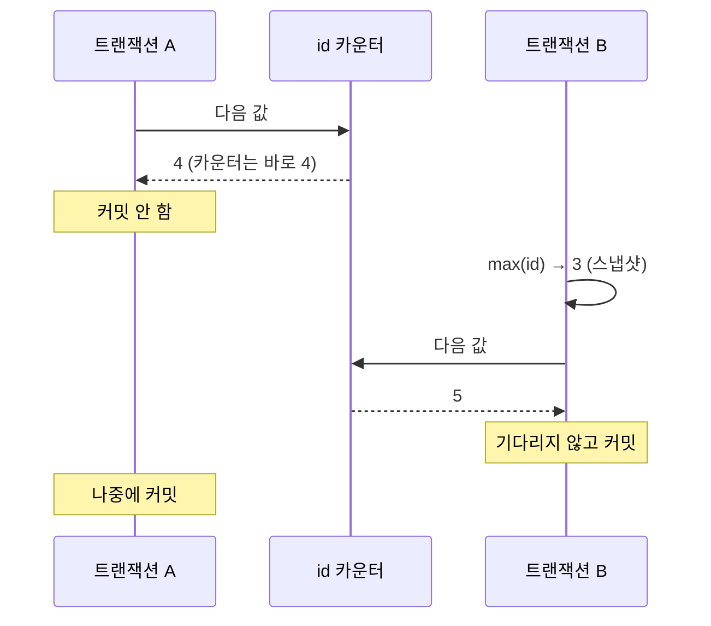

두 트랜잭션이 같은 테이블에 INSERT 를 한다. A 가 먼저 INSERT 했지만 아직 커밋하지 않았고,
B 는 나중에 INSERT 했는데 **기다리지 않고 먼저 끝난다.** PK 는 auto increment 다.

여기서 걸렸다. B 의 [스냅샷](/study/database/section-2-acid/#스냅샷과-가시성-검사--select-가-버전을-고르는-법 "트랜잭션이 읽을 때 기준으로 삼는 시점. 그 시점에 커밋되지 않은 변경은 보이지 않는다.")에는 A 의 행이 안 보인다.
그러면 B 가 아는 최대 id 는 A 가 알던 것과 같고, 둘이 같은 id 를 받아 충돌하거나
B 가 기다려야 하지 않나.

**아니다. id 는 "보이는 최대값 + 1" 이 아니라, 트랜잭션과 상관없는 카운터에서 꺼낸다.**
그 카운터는 <abbr title="Multi-Version Concurrency Control. 행을 덮어쓰는 대신 여러 버전을 두고, 읽는 쪽에 맞는 버전을 골라 주는 방식.">MVCC</abbr> 밖에 있어서
스냅샷이 무엇을 보든 상관없이 다음 값을 준다.

## 실험

PostgreSQL 17 과 MySQL 8.4 를 컨테이너로 띄워 같은 상황을 만들었다.
id 1~3 이 들어 있는 테이블에 두 세션이 INSERT 한다.

```sql
-- PostgreSQL
CREATE TABLE orders (
  id    bigint GENERATED ALWAYS AS IDENTITY PRIMARY KEY,
  item  text
);
INSERT INTO orders (item) VALUES ('a'), ('b'), ('c');
```

```sql
-- 세션 A
BEGIN ISOLATION LEVEL REPEATABLE READ;
INSERT INTO orders (item) VALUES ('A') RETURNING id;
SELECT pg_sleep(4);   -- 커밋을 미룬다
COMMIT;
```

```sql
-- 세션 B (A 가 INSERT 한 1초 뒤)
BEGIN ISOLATION LEVEL REPEATABLE READ;
SELECT max(id) FROM orders;
SELECT last_value FROM orders_id_seq;
INSERT INTO orders (item) VALUES ('B') RETURNING id;
SELECT string_agg(id::text, ',' ORDER BY id) FROM orders;
COMMIT;
```

MySQL 은 같은 테이블을 `BIGINT AUTO_INCREMENT` 로 만들고 기본 격리 수준(`REPEATABLE-READ`)에서 돌렸다.
두 DB 모두 `READ COMMITTED` 로 바꿔 다시 돌려도 결과는 같았다.

| | PostgreSQL 17 | MySQL 8.4 |
| --- | --- | --- |
| A 가 받은 id | 4 | 4 |
| B 의 `max(id)` | **3** | **3** |
| B 가 받은 id | **5** | **5** |
| B 의 INSERT 대기 | 없음 | 없음 (1.6ms) |
| B 가 보는 행 | 1, 2, 3, 5 | 1, 2, 3, 5 |
| A 커밋 후 최종 | 1, 2, 3, 4, 5 | 1, 2, 3, 4, 5 |

B 의 스냅샷에서 최대값은 3 이다. 그런데 B 가 받은 id 는 4 가 아니라 5 다.
B 가 보는 행에도 4 는 끝까지 없다. **id 를 정하는 일이 스냅샷을 거치지 않는다**는 뜻이다.

PostgreSQL 쪽에서는 더 직접적으로 보인다. B 가 시퀀스의 `last_value` 를 읽으면 **4** 가 나온다.
테이블에서는 4 번 행이 안 보이는데, 시퀀스는 4 까지 나갔다는 걸 이미 알고 있다.

## 시퀀스와 MVCC



행은 버전이 여러 개 있고, 읽는 트랜잭션이 자기 스냅샷에 맞는 버전을 고른다.
카운터는 그렇지 않다. **버전이 하나뿐이고, 올라가는 순간 모두에게 보인다.**

- **PostgreSQL** — `IDENTITY` 컬럼 뒤에는 별도의 시퀀스 객체(`orders_id_seq`)가 붙는다.
  INSERT 는 `nextval()` 로 값을 꺼낸다. 문서에 따르면 `nextval()` 은 롤백되지 않고,
  여러 세션이 동시에 불러도 서로 다른 값을 받는다.
- **MySQL InnoDB** — 테이블마다 메모리에 카운터를 두고 값을 꺼낼 때만 잠깐
  <abbr title="AUTO_INCREMENT 값을 꺼낼 때 잡는 테이블 수준의 특수 락. 트랜잭션 끝까지 잡지 않는다.">AUTO-INC 락</abbr>을 잡는다.
  8.0 부터 기본값인 `innodb_autoinc_lock_mode=2` 에서는 값을 꺼내는 순간만 잡는다.
  가장 보수적인 `0` 으로 바꿔 돌려도 B 는 기다리지 않았다(0.4ms).
  `0` 에서도 이 락은 **문장이 끝날 때** 풀리지 트랜잭션 끝까지 가지 않는다.

카운터에서 서로 다른 값을 받았으니, 그다음 행 락도 부딪히지 않는다.
A 는 4 번 키를, B 는 5 번 키를 잡는다. 키가 다르면 서로 막을 이유가 없다.

## 롤백 구멍

카운터가 트랜잭션 밖에 있다는 건 **롤백해도 값이 돌아오지 않는다**는 뜻이기도 하다.

```sql
BEGIN;
INSERT INTO orders (item) VALUES ('R') RETURNING id;   -- 6
ROLLBACK;
INSERT INTO orders (item) VALUES ('next') RETURNING id; -- 7
```

두 DB 모두 6 을 받은 트랜잭션을 롤백했더니 다음 INSERT 는 7 을 받았다.
6 은 영영 비어 있다.

돌려줄 수도 없다. 롤백하는 시점에는 다른 트랜잭션이 이미 7, 8 을 받아 갔을 수 있다.
6 을 되돌리려면 "6 이후로는 아무도 값을 받지 않았다"를 확인해야 하고,
그러려면 INSERT 하는 트랜잭션끼리 커밋할 때까지 줄을 서야 한다. 동시성을 위해 연속성을 포기한 것이다.

그래서 시퀀스 id 가 보장하는 건 **겹치지 않는다** 하나뿐이다.

| 시퀀스 id 가 | 보장하나 | 이유 |
| --- | --- | --- |
| 겹치지 않는다 | 한다 | 카운터가 하나라서 |
| 빈 번호가 없다 | 안 한다 | 롤백한 값을 돌려주지 않아서 |
| 커밋 순서와 같다 | 안 한다 | 값을 받은 순서일 뿐, 커밋은 그 뒤에 각자 한다 |

마지막 줄이 실험에서 본 그대로다. 4 를 받은 A 가 5 를 받은 B 보다 늦게 커밋됐다.

## MAX + 1 과 비교

처음에 머릿속에 그렸던 방식, 즉 **스냅샷에서 최대값을 읽어 +1** 하는 방식을 직접 짜면
처음에 걱정했던 대기와 충돌이 실제로 일어난다.

```sql
CREATE TABLE orders2 (id bigint PRIMARY KEY, item text);
INSERT INTO orders2 VALUES (1, 'a'), (2, 'b'), (3, 'c');

-- 세션 A
BEGIN;
INSERT INTO orders2 SELECT max(id) + 1, 'A' FROM orders2;   -- 4
SELECT pg_sleep(4);
COMMIT;

-- 세션 B (1초 뒤)
BEGIN;
INSERT INTO orders2 SELECT max(id) + 1, 'B' FROM orders2;   -- 스냅샷의 max 는 3 → 4
```

```text
ERROR:  duplicate key value violates unique constraint "orders2_pkey"
DETAIL:  Key (id)=(4) already exists.
```

B 는 바로 실패하지 않는다. PK 인덱스에서 A 가 넣은 4 를 발견하는데, A 가 아직 커밋 전이라
A 가 어떻게 끝날지 **기다린다.** 약 3초 뒤 A 가 커밋하자 그제야 중복 키 에러가 났다.
같은 실험에서 A 가 롤백하게 바꾸면 B 는 4 로 성공한다.

시퀀스는 바로 이 대기와 충돌을 없애려고 스냅샷 밖에 있다.

한 가지 차이가 더 보였다. PostgreSQL 은 이 에러가 나면 **트랜잭션 전체가 aborted 상태**가 되어
ROLLBACK 전까지 어떤 명령도 받지 않는다. MySQL 은 실패한 문장만 취소하고 트랜잭션은 이어 간다.
MySQL 에서 한 트랜잭션 안에 2, 중복 키, 3 을 차례로 넣고 커밋하면 2 와 3 은 남는다.

## 정리

INSERT 끼리 기다리지 않는 건 시퀀스가 스냅샷 밖의 카운터라서다.
그 대가로 id 에는 구멍이 생기고, **id 순서는 커밋 순서가 아니다.**
id 가 큰 행이 먼저 보일 수 있고, 나중에 작은 id 가 끼어든다.

"id 가 크면 나중 일" 이라고 가정하고 순서를 맞추는 코드가 있다면 의심해 본다.
id 를 직접 `MAX + 1` 로 만들고 있다면 시퀀스로 바꾼다.

이 성질이 실제로 문제가 된 사례, 즉 체결이 뒤섞여 들어오는 주문 원장에서 잔고를 맞추는 이야기는
[다음 글](/study/database/ordering-across-tables/)에서 다룬다.

## 참고

- [PostgreSQL — Sequence Manipulation Functions](https://www.postgresql.org/docs/current/functions-sequence.html)
- [MySQL 8.4 — AUTO_INCREMENT Handling in InnoDB](https://dev.mysql.com/doc/refman/8.4/en/innodb-auto-increment-handling.html)
